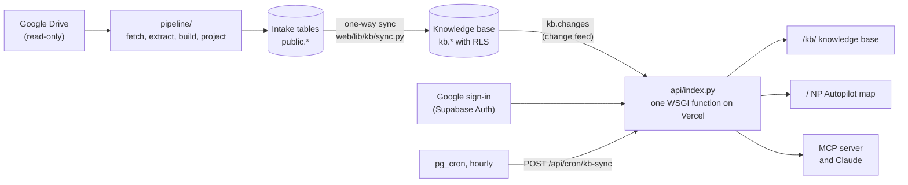

# np-autopilot: the IK New Programs knowledge platform

Interview Kickstart's New Programs (NP) team designs and runs programmes: their
courses, domains, modules, weekly sessions, the instructors who teach them and
the people who own them. That knowledge used to live in a Google Drive folder of
spreadsheets and documents. This repository turns it into one audited, editable
knowledge base that every tool reads.

It ships as one Vercel deployment with:

- **The knowledge base at `/kb/`** (`public/kb/`): an editable, audited
  workspace of programs, courses, domains, modules, weeks, live sessions,
  topics, people and links, with custom record and relationship types.
- **The NP Autopilot map at `/`** (`public/index.html`): the programme,
  domain, module and instructor graph the NP team uses day to day.
- **The intake pipeline** (`pipeline/`): reads the NP Drive folder (read-only)
  and builds the graph that feeds the knowledge base.
- **An MCP server and a Claude Code plugin**, so Claude can search and edit the
  knowledge base as you, under your role.

## Key features

- **One source of truth.** The `kb` schema is authoritative. Every page,
  including the map at `/`, reads it, and the pipeline's own tables are only its
  intake, copied in by a scheduled one-way sync that never overwrites a KB edit.
- **Live everywhere.** Every change appears on every open page within about
  3 seconds, through one change feed.
- **A graph you can navigate.** A hierarchy layout (Program → Course → Domain →
  Module → Week → Session), focus mode, a legend that filters, search-jump, a
  minimap, and labels that never overlap.
- **Roles enforced by the database.** Viewer, contributor, editor and admin,
  with row-level security on every table; contributors' edits go to Approvals.
  Sign-in is IK Google accounts only, checked on every request.
- **Audited and reversible.** An append-only audit log, Activity in plain
  sentences, archive and restore, and a tested export and restore for
  permanent deletions.
- **Claude, as you.** The MCP server uses your personal token and your role,
  and its risky calls become proposals.

## Architecture



Every request enters `api/index.py`. The caller's identity and IK domain are
checked there before any database connection, and queries run as the Postgres
role `authenticated` with the caller's claims, so row-level security applies.
More: [docs/architecture/overview.md](docs/architecture/overview.md) and
[docs/architecture/single-source-of-truth.md](docs/architecture/single-source-of-truth.md).

## Quick start

You need **Python 3.12**, **Docker** (running), **Node** (for `npx supabase`)
and **Git Bash** on Windows. `uv` is optional. The first start of the local
database stack pulls about 2 GB of images.

### Windows (Git Bash)

```bash
git clone <this repository> np-autopilot && cd np-autopilot
py -3.12 -m venv .venv && .venv/Scripts/pip install -r requirements.txt
source .venv/Scripts/activate
bash db/local/setup.sh                              # local Supabase stack, migrations, seed
python eval/kb_demo_seed.py                         # demo users and fictional data
python eval/kb_demo_server.py 8765                  # prints READY 8765
```

### Linux / macOS

```bash
git clone <this repository> np-autopilot && cd np-autopilot
python3.12 -m venv .venv && .venv/bin/pip install -r requirements.txt
source .venv/bin/activate
bash db/local/setup.sh                              # needs Docker (macOS: Docker Desktop or colima)
python eval/kb_demo_seed.py
python eval/kb_demo_server.py 8765
```

Then open **http://localhost:8765/local-login** and sign in as
`demo-admin@interviewkickstart.com` with the password `ik-demo-local`. These
demo accounts and the password sign-in exist only in the local stack and
`eval/`, and are never deployed. `bash db/local/setup.sh --stop` stops the stack
and keeps its data.

- The local stack uses fixed loopback addresses and development keys. The tests
  and the local servers refuse any non-local database.
- A second local server, `eval/kb_realdata_server.py 8766`, serves a local copy
  of real data from the gitignored `backups/`: see
  [docs/operations/local-demo.md](docs/operations/local-demo.md).
- `requirements.txt` is the full environment (pipeline, MCP, tests);
  `pyproject.toml` holds only the Vercel function's dependencies (the bundle is
  at its size limit, so don't add packages there).

### Tests

```bash
bash scripts/verify_all.sh                      # everything against the local stack
python -m pytest tests/test_kb_sync.py -q       # one suite
python scripts/check_md_links.py                # every Markdown link resolves
```

On a 16 GB laptop run the browser test files one at a time. Running the KB tests
wipes the local `kb` data, so re-seed the demo afterwards. Details:
[docs/operations/testing.md](docs/operations/testing.md).

## Project structure

| Path | What it is |
|---|---|
| `api/` | HTTP: `index.py` (the front door and only Vercel function), `kb_routes.py` (the KB API), the map's routes |
| `web/lib/kb/` | The KB service layer: `service.py` (the rulebook), `validate.py`, `typedefs.py`, `graph.py`, `npmap.py`, `sync.py`, `activity.py`, `connectors/`, … |
| `web/lib/` | Shared server code: authentication (`auth.py`), database access, the map's old read path |
| `public/` | The map (`index.html`) and the KB app (`kb/`: vanilla JS and Cytoscape; `kb/guide.md` is the in-app Guide) |
| `db/migrations/` | Numbered `.up.sql` / `.down.sql` pairs; the `kb` schema is 0022 onwards |
| `db/local/` | The local Supabase stack (`setup.sh`) |
| `pipeline/` | Drive fetch, extraction, graph build, projection, and the KB import, admin and legacy CLIs ([pipeline/README.md](pipeline/README.md)) |
| `config/` | `taxonomy.yaml` (the only source of type names) and the mapping files |
| `knowledge/` | The pipeline's committed graph snapshot (`graph.json`, `content_graph.json`, `graph.html`) |
| `mcp_server/`, `plugins/ik-knowledge-assistant/` | The MCP server and the Claude Code plugin |
| `commands/`, `.claude-plugin/` | The older `np-autopilot` plugin's commands (they read `knowledge/graph.json`) |
| `eval/` | Local servers, seeds and checks; never deployed (`.vercelignore`) |
| `scripts/` | `verify_all.sh`, `dev_db.py` (the dev database), deploy and profiling scripts, the link checker |
| `tests/` | pytest suites; `tests/kb_support.py` holds the KB fixtures |
| `docs/` | All documentation ([docs/README.md](docs/README.md)) |

## Documentation

Start at **[docs/README.md](docs/README.md)**, the index of every document. The
most used:

- Architecture: [overview](docs/architecture/overview.md) ·
  [data model](docs/architecture/data-model.md) ·
  [knowledge graph](docs/architecture/knowledge-graph.md) ·
  [single source of truth](docs/architecture/single-source-of-truth.md) ·
  [API contracts](docs/architecture/contracts.md)
- How things work: [docs/workflows/](docs/README.md#workflows) (CRUD and change
  propagation, sync, sign-in and roles, approvals, owner linking, legacy
  deletion, MCP)
- Operating it: [deployment](docs/operations/deployment.md) ·
  [GO_LIVE](docs/operations/GO_LIVE.md) ·
  [environment variables](docs/operations/environment-variables.md) ·
  [runbook](docs/operations/runbook.md)
- Security: [docs/security.md](docs/security.md) and [SECURITY.md](SECURITY.md)
- Extending it: [connectors](docs/integrations/connectors.md) ·
  [MCP](docs/integrations/mcp.md) · [VISION_AND_ROADMAP](docs/VISION_AND_ROADMAP.md)
- Contributing: [CONTRIBUTING.md](CONTRIBUTING.md) · [CHANGELOG.md](CHANGELOG.md)

## Current status

- **Production** runs `main`: the NP Autopilot map at `/`, database migration 0021.
- **This branch** (`auto/knowledge-platform-20261102`) holds the knowledge
  platform (migrations 0022–0037). It is verified on the local stack and on the
  DEV database, and is not yet on `main` or in production. The Vercel preview is
  waiting on an owner step (preview variables).
- **The latest hand-over**, with the status of every item and the owner's next
  steps to production: [docs/project-history/HANDOFF.md](docs/project-history/HANDOFF.md).
- **The rollout:** [docs/operations/GO_LIVE.md](docs/operations/GO_LIVE.md).

## Rules that are not optional

The full text is in [CLAUDE.md](CLAUDE.md); read it before touching the
pipeline. In short:

- **The corpus is read-only.** Never write, move or rename a Drive or corpus
  file. The Drive scope stays `drive.readonly`. Filename typos are citation keys.
- **Contact data stays out.** Extraction reads declared name columns only
  (`pipeline/lib/sources.py` is the allow-list). Never declare a contact column.
  The payroll file is excluded, and the sensitive half of the graph is never
  projected publicly or committed.
- **Counts are floors, not totals.** Entity scans have not read every file.
- **Thresholds rank or warn; they never silently exclude** (CLAUDE.md §4).
- **`config/taxonomy.yaml` is the only source of type names.**
- **One rulebook:** KB rules live in `web/lib/kb/`, and the database enforces
  them again.
- **The audit log is append-only.** No real names or e-mail addresses in code,
  tests, docs or commits: use synthetic `kbtest-*@interviewkickstart.com` data.
- **Never connect to production** from a laptop session, and never print
  secrets, URLs or hosts.

## The pipeline's graph (the intake), generated

These are the counts of the pipeline's own graph (`knowledge/graph.json`), the
intake of the knowledge base, not the KB's live numbers. **Generated by
`pipeline/gen_index.py`; do not hand-edit the block**
(`tests/test_readme_counts.py`). Person, instructor and module counts are floors.

<!-- generated:counts -->
`3,146 nodes · 34,575 edges` at plugin **v0.1.9**, built `2026-09-17`.

**Plus 1,902 nodes and 2,102 edges withheld from this repo** — `sensitive: true`, hiring rejections and in-pipeline candidates about named external people. They live in `graph-sensitive.json`, which is gitignored, and are projected behind the `recruiting` access policy. Full graph is 5,048 nodes / 36,677 edges. See `docs/DECISIONS.md` §F.2.

| node type | count |
|---|---:|
| instructor | 1,915 |
| module | 922 |
| workflow | 92 |
| file | 74 |
| person | 43 |
| domain | 42 |
| program | 42 |
| theme | 16 |

| edge type | count |
|---|---:|
| sourced_from | 30,554 |
| teaches | 2,239 |
| expert_in | 1,155 |
| contains | 351 |
| belongs_to | 92 |
| supported_by | 58 |
| owned_by | 55 |
| delivered_by | 43 |
| covers | 28 |

Declared but at zero, deliberately: `depends_on`, `workflow_owned_by`. No evidence in the corpus.
<!-- /generated:counts -->
