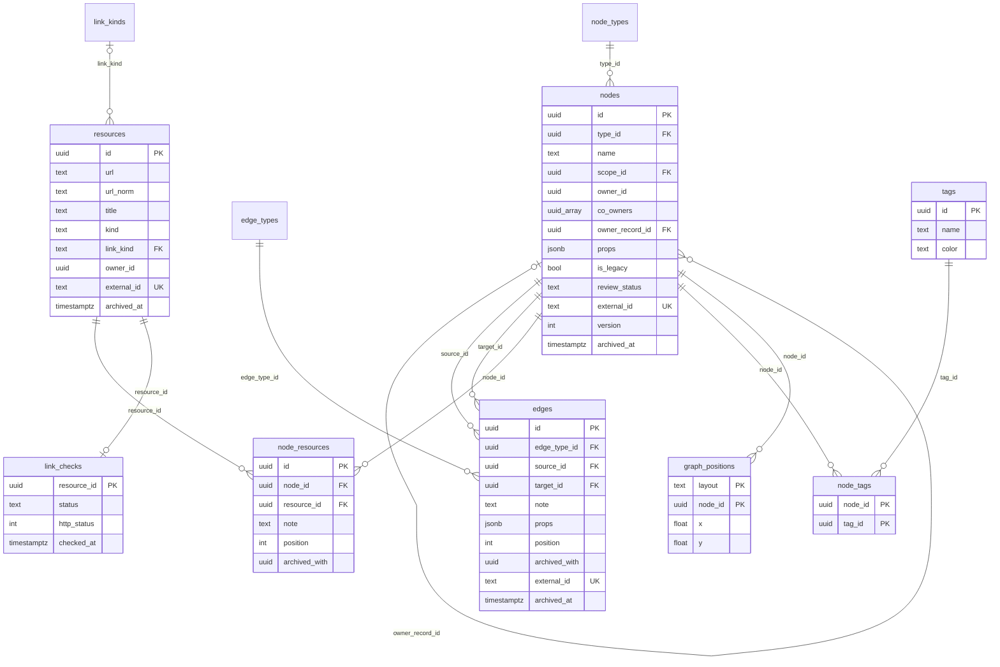
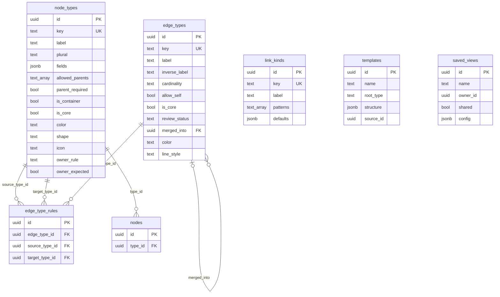
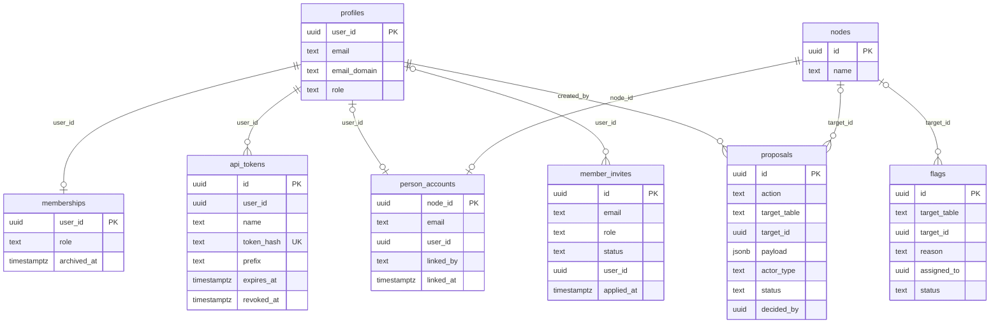
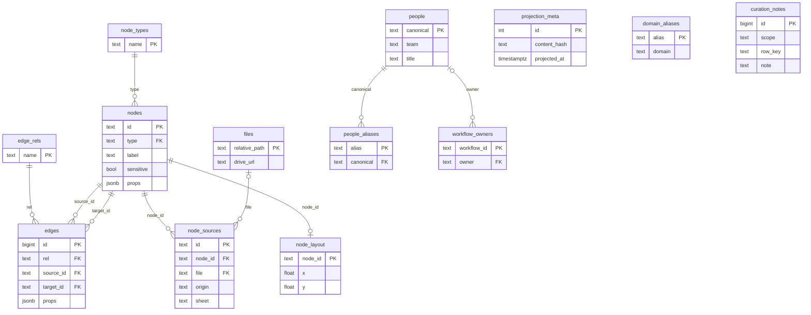
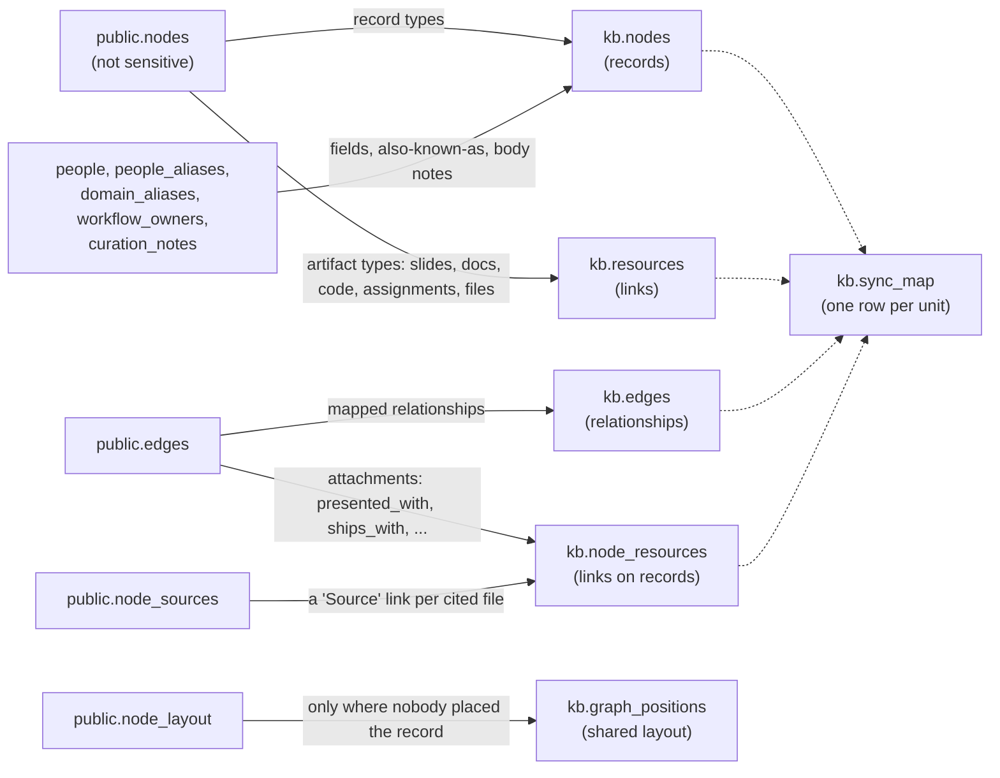

# Data model

The tables behind the platform, drawn from the migrations
`db/migrations/0022_kb_schema.up.sql` to `0037_kb_sync_exclusions.up.sql` (the
`kb` schema) and the earlier ones that created the `public` intake. The
diagrams show **key columns only**; every column, constraint and index is in
the SQL and summarised in [schema.md](schema.md).

Two schemas:

- **`kb`**: the knowledge base. The source of truth for everything a person
  sees or edits ([single-source-of-truth.md](single-source-of-truth.md)).
- **`public`**: the NP Autopilot pipeline's intake (written by
  `pipeline/project_graph.py`), curation, and sign-in profiles. The sync reads
  the intake; no page reads it directly.

## Conventions on every mutable kb table

| Column | Meaning |
|---|---|
| `id uuid` | Primary key (`gen_random_uuid()`), except where noted. |
| `created_by`, `updated_by`, `created_at`, `updated_at` | Stamped by the `kb.stamp()` trigger from the caller's identity (`kb.actor_id()`). |
| `version integer` | Bumped on every update. Writes must send it (optimistic locking). |
| `status text`, `archived_at timestamptz` | `archived_at` set means archived; the two always agree (`archived_consistent`). Archiving hides, never deletes. |
| `external_id text` (records, links, relationships) | Where the row came from. The sync uses `np:<projection id>`; the Sheets import uses `<sheet id>:<tab>:<row key>`. |

Uniqueness is "one live row": the unique indexes are partial (`where
archived_at is null`), so archiving frees a name or URL. Every audited write
goes through `kb.audit()`, which writes one row to `kb.audit_log` and one to
`kb.changes`.

## 1. Records, relationships and links

The core of the knowledge base. A **record** is a row in `kb.nodes` (a
program, course, domain, module, week, session, topic, instructor, team
member, process, theme, or any custom type). A **relationship** is a row in
`kb.edges`. A **link** is a row in `kb.resources`, attached to records through
`kb.node_resources`.

What the columns mean:

- **`nodes.scope_id`** is the record's primary placement (the course, module or
  week it sits in). Names are unique per type and scope
  (`nodes_name_unique`), so "Week 1" can exist in many modules. Further
  placements are `contains` relationships.
- **`nodes.owner_id` / `co_owners`** are sign-in accounts (user ids).
  **`owner_record_id` / `co_owner_record_ids`** are person *records*
  (instructors, team members): owners by role, which become `owner_id` /
  `co_owners` once that person record is linked to an account (0030).
- **`nodes.props`** holds the custom field values; `kb.check_node_props()`
  validates them against the type's `fields` (0027).
- **`nodes.is_legacy`** marks records NP Autopilot counts as "older sheets"
  (0030). **`review_status`** is `none`, `needs_review` or `approved`.
- **`edges.archived_with`** / **`node_resources.archived_with`** name the record
  whose archiving archived this row, so a restore brings back exactly those
  (`kb.cascade_archive()`).
- **`resources.url_norm`** (lower-case, no trailing slash) is unique among live
  links, so one URL is one link, reused across records.
- **`resources.kind`** is what the link is (slides, recording, assignment brief,
  ...); **`link_kind`** is where it lives (Drive, Docs, GitHub, UpLevel, Zoom,
  ...), detected from `kb.link_kinds.patterns`.
- **`kb.link_checks`** keeps the last result of checking a link, in its own
  table so a check never bumps the link's `version` and causes a false
  conflict (0026).
- **`kb.graph_positions`** stores layout only (`default` = the shared layout,
  or a saved view's uuid); it never changes a record (0029).

## 2. Types and configuration

Record types, relationship types and their rules are rows, so admins extend
the vocabulary in the app (Settings) without a migration.

- **`node_types.fields`** is a JSON array of field definitions (key, label,
  kind, options, required, archived, help). A field key never changes;
  removing a field archives it and keeps the data. Kinds: `short_text`,
  `long_text`, `number`, `date`, `datetime`, `duration`, `url`,
  `single_select`, `multi_select`, `person`, `reference`, `checkbox`.
- **`allowed_parents`** lists the type keys a record may be placed under
  (placement); `is_container` marks types that can be a scope.
- **`edge_type_rules`**: an edge type with no rules accepts no relationships.
  `kb.check_edge()` enforces the rules, cardinality and `allow_self`.
- **`edge_types.review_status`**: `reviewed`, or `unreviewed` for a type an
  editor created, until an admin confirms, renames or merges it
  (`merged_into`). See [knowledge-graph.md](knowledge-graph.md).
- **`shape`, `color`, `line_style`** are the graph styles ([contracts.md](contracts.md) §3).
- **`templates`** store a course or program structure to copy;
  **`saved_views`** store a person's filters or graph layout (`shared` lets
  everyone use it).

## 3. People, access and approvals

Who may do what, and how person records meet sign-in accounts.

- **`public.profiles`** is the sign-in profile (one per IK account; the
  database refuses any other domain, `domain_is_ik`). Its `role` is the NP
  role (`member`, `recruiting`, `admin`) used by the map and curation; it is
  not the knowledge base role.
- **`kb.memberships`** grants a knowledge base role: `viewer`, `contributor`,
  `editor` or `admin`. With no row, a signed-in IK profile is a viewer
  (`kb.role()`, 0023 and 0035). The last admin cannot be demoted or removed
  (`kb.keep_an_admin()`, 0034).
- **`kb.member_invites`** lets an admin add a person by their
  `@interviewkickstart.com` address before or after their first sign-in. The
  role is applied at once if the account exists, otherwise on first sign-in
  (0035). The address is never copied into the audit log.
- **`kb.person_accounts`** links a person record (instructor or team member)
  to an e-mail and, once resolved, to an account. `linked_by` says how:
  `admin`, `csv`, `sign_in_email`, `sign_in_name` or `claim` (0030, 0033).
  Only admins (and the person) can read the addresses.
- **`kb.api_tokens`** are the MCP tokens: only the SHA-256 hash is stored;
  every token expires (1 to 365 days, default 90).
- **`kb.proposals`** are the approvals. `action` is `archive`, `delete`,
  `create`, `type_change`, `update` or `claim`; `status` is `pending`,
  `approved` or `rejected`. A **claim** ("this person record is me") is a
  proposal an admin approves (`kb.claim_person`, `kb.apply_claim`, 0033).
- **`kb.flags`** are "this is incorrect" reports, assigned to the owner and
  shown in Approvals → Reviews.

## 4. Sync, audit and the change feed

The bookkeeping that makes the sync safe to re-run and every change traceable.

```mermaid
erDiagram
    sync_runs ||--o{ changes : "sync.run event"
    sync_map }o--o| nodes : "kb_id"
    audit_log |o--|| changes : "same id"
    nodes ||--o| legacy_archive : "node_id"

    sync_map {
        text unit PK
        text key PK
        text kb_table
        uuid kb_id
        text checksum
        text kb_checksum
        timestamptz removed_at
        timestamptz conflict_at
    }
    sync_runs {
        bigint id PK
        timestamptz started_at
        timestamptz finished_at
        text status
        text trigger
        jsonb counts
        int conflicts
        jsonb resume
    }
    sync_exclusions {
        text unit PK
        text key PK
        text reason
    }
    legacy_archive {
        uuid node_id PK
        timestamptz archived_at
        text reason
    }
    import_runs {
        uuid id PK
        text source
        jsonb counts
        jsonb report
    }
    audit_log {
        bigint id PK
        uuid actor_id
        text actor_type
        text table_name
        uuid row_id
        text action
        jsonb before
        jsonb after
    }
    changes {
        bigint id PK
        uuid actor_id
        text actor_type
        text table_name
        uuid row_id
        text kind
        uuid_array node_ids
    }
    nodes {
        uuid id PK
    }
```

- **`kb.sync_map`** has one row per source unit (`unit` = `record`, `link`,
  `relationship` or `attachment`; `key` = the source identity). `checksum` is
  the source content; `kb_checksum` is what the sync last wrote. If the KB
  copy no longer matches `kb_checksum`, someone edited it in the app, and a
  source change is flagged as a conflict (`conflict_at`) instead of being
  written. `removed_at` marks a unit that left the source. The `kb_id` column
  points at a row in `nodes`, `resources`, `edges` or `node_resources`
  (`kb_table` says which); there is no foreign key.
- **`kb.sync_runs`** is the run log: `trigger` is `cron`, `manual` or `cli`;
  `status` is `running`, `ok`, `error` or `skipped`; `resume` holds where a
  time-boxed run stopped (0033).
- **`kb.sync_exclusions`** (0037): `unit = 'rule'` switches on a rule (today
  `np_legacy_domains_modules`), `unit = 'record'` lists one source id the sync
  must never create again. Written only by the owner (the CLI); admins can
  read it.
- **`kb.legacy_archive`** records what the legacy step archived, so one
  command restores it (0030).
- **`kb.import_runs`** logs each Sheets import (0024).
- **`kb.audit_log`** is append-only for everyone (0029): no update or delete,
  and it is never written directly. Admins read every row; editors read their
  own and those about records in their scope; everyone else reads a record's
  history through `kb.record_history()`. Token hashes and invitation addresses
  are stripped before writing.
- **`kb.changes`** is the content-free change feed (0029, `kind` and
  `node_ids` since 0032). Its `id` is the audit log id, so the feed is one
  monotonic cursor. `graph_positions`, `person_accounts` and finished
  `sync_runs` emit change rows with no audit row (`kb.change_only()`).
  Viewers read it; Realtime publishes it.

## 5. The intake tables in public

Written by the pipeline, read only by the sync (and by the rollback path
`NP_MAP_SOURCE=old`, see [overview.md](overview.md)). Created by migrations
0002, 0003, 0005, 0011 and 0021.

(These `nodes`, `edges` and `node_types` are `public.*`, not the `kb` tables
of the same name.)

## How the intake maps into kb

The mapping is configuration, not code: `config/kb-projection-mapping.yaml`,
checked against `config/taxonomy.yaml` at the start of every run
(`sync.load_mapping`), so a taxonomy change fails loudly instead of silently
mapping nothing. The engine is `web/lib/kb/sync.py`; the full table-by-table
and type-by-type mapping, with the special rules, is in
[import-mapping.md](import-mapping.md) ("Projection → KB mapping").

| Projection type (public) | KB type (kb) |
|---|---|
| `program` | `program` |
| `domain` | `domain` |
| `module` | `module` |
| `class_session` | `session` |
| `program_week` | `week` |
| `content_topic` | `topic` |
| `instructor` | `instructor` |
| `workflow` | `process` |
| `person` | `team_member` (a type the sync creates) |
| `theme` | `theme` (a type the sync creates) |
| `slide_deck`, `curriculum_doc`, `code_repo`, `assignment`, `assignment_review`, `file` | links (`kb.resources`), not records |

The projection has no course type: `course` records exist only when someone
creates them in the KB.

Ids: a synced record keeps its projection id as `external_id = 'np:<id>'`.
Sensitive rows (`public.nodes.sensitive`) are never synced.
