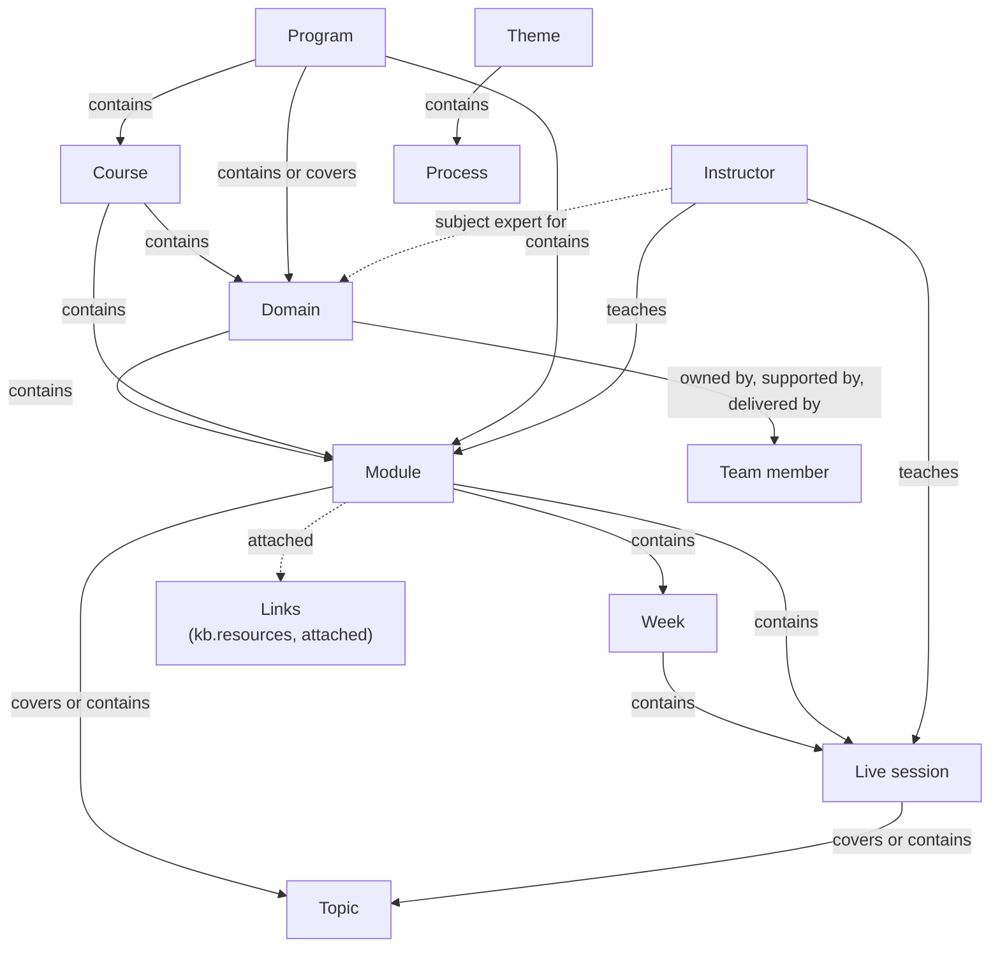
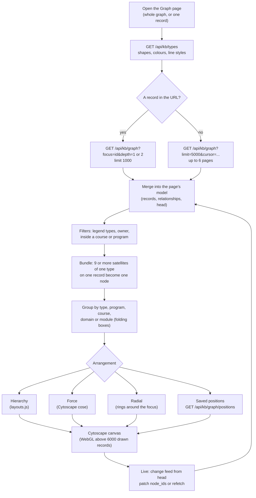

# The knowledge graph

What the knowledge base models (record types and relationships), how it is
drawn (shapes, colours, line styles), what "current" and "legacy" mean, and
how a graph gets from the database to the screen.

Sources of truth for this page: the seed rows in
`db/migrations/0022_kb_schema.up.sql`, `0026`, `0027`, `0028` and `0032`;
`config/kb-projection-mapping.yaml` (the types and relationships the sync
adds); `web/lib/kb/typedefs.py`; `web/lib/kb/graph.py`;
`public/kb/js/views/graph.js` and `public/kb/js/graph/*.js`. Admins can add
and restyle types in the app, so the live database may hold more than is
listed here: `GET /api/kb/types` is the authority at run time.

## Record types

| Key | Label | Role in the graph | Allowed parents (placement) | Where it comes from |
|---|---|---|---|---|
| `program` | Program | top of the hierarchy (container) | none | built in (0022); synced from the projection's `program` |
| `course` | Course | container | program | built in (0022); **created in the KB only**: the projection has no course type |
| `domain` | Domain | a subject area | course, program | built in (0026); synced. Carries the `slug` field (0033) |
| `module` | Module | a unit of a course | course, domain, program | built in (0022); synced |
| `week` | Week | a week of the schedule | module, course | built in (0026); synced from `program_week` |
| `session` | Live session | a live class | week, module | built in (0026); synced from `class_session` |
| `topic` | Topic | satellite: a concept taught | module, session, course | built in (0022); synced from `content_topic` |
| `instructor` | Instructor | satellite: a person who teaches (name only) | none | built in (0022); synced |
| `process` | Process | an internal workflow | theme (added by the sync) | built in (0022); synced from `workflow` |
| `team_member` | Team member | satellite: an IK person (owner, supporter, deliverer) | none | created by the sync (`new_record_types`) from `person` |
| `theme` | Theme | a group of processes | none | created by the sync from `theme` |

Allowed parents come from 0027 (`allowed_parents`) plus the sync's
`placement` section. The types marked built in are `is_core` (they cannot be
archived). Links (slides, recordings, repositories, documents) are **not**
records: they are `kb.resources` attached to records, listed on the Links page
and on each record's Links tab ([data-model.md](data-model.md) §1).

### The hierarchy

The full ladder is **Program → Course → Domain → Module → Week → Session**.
This is also the row order of the Graph page's Hierarchy arrangement
(`RANK` in `public/kb/js/graph/style.js`). Every level may be skipped, so a
module can sit directly in a course or a program, and a session directly in a
module.

In the data the sync brings in, the levels used are Program, Domain, Module,
Week and Session. A domain *offers* a module (`contains`), a program contains
modules and covers domains, a module contains its sessions, and each week
sits inside its module (`scheduled_in` becomes module `contains` week).

## Relationship types

| Key | Reads as (inverse) | Allowed source → target (seeded) | Colour | Line |
|---|---|---|---|---|
| `contains` | contains (part of) | program → course, domain, module; course → domain, module, week; domain → module; module → topic, week, session; week → session; session → topic; theme → process (sync) | `#475569` | solid |
| `covers` | covers (covered by) | course, module, session → topic; course, program → domain | `#0e7490` | solid |
| `teaches` | teaches (taught by) | instructor → course, module, session | `#be123c` | solid |
| `sme` | subject expert for (has subject expert) | instructor → course, module, session, domain, topic | `#a16207` | dashed |
| `prerequisite` | requires (required by) | course → course, module → module, topic → topic | `#b91c1c` | dashed |
| `related` | related to (related to) | topic, course, module, process, domain → the same type; process → course, program | `#4d7c0f` | dotted |
| `owned_by` | owned by (owns) | domain → team member | `#1d4ed8` | solid |
| `supported_by` | supported by (supports) | domain → team member | `#0369a1` | dashed |
| `delivered_by` | delivered by (delivers) | domain → team member | `#c2410c` | solid |

`contains` through `sme` are built in (0022, 0026, 0027); `owned_by`,
`supported_by` and `delivered_by` are created by the sync
(`new_relationship_types` in the mapping). A `teaches` relationship from the
sync carries the teaching role in `props.role` (current mastersheet: primary,
backup 1 to 3) or `props.older_role` (older sheets), and the class dates in
its note.

Rules the database enforces (`kb.check_edge()`): a relationship needs an
allowed (source type, target type) pair for its type, an edge type with no
rules accepts nothing, the same pair cannot be connected twice the same way
while live, self-links need `allow_self`, and `cardinality` (`many_to_many`,
`one_to_many`, `many_to_one`, `one_to_one`) is respected.

### Adding a custom relationship type

There are two places to start:

1. **Settings → Relationship types → New relationship type** (editors; a
   contributor sees **Propose relationship type**).
2. **In the relationship picker** on a record or on the Graph page: type a
   name and choose **Create relationship "…"**.

Either way you give a label, the inverse label, and at least one allowed
source → target pair. What happens next depends on who you are
(`typedefs.create_edge_type`; the same split is enforced by the 0029 policies
on `kb.edge_types` and `kb.edge_type_rules`):

| Caller | Result |
|---|---|
| Admin (a person) | Created and **reviewed**; usable by everyone at once. |
| Editor | Created as **unreviewed** and usable at once ("Awaiting review" badge), plus a `type_change` proposal in Approvals so an admin confirms it, renames it or merges it into an existing type. |
| Contributor, or the AI assistant at any role | A `type_change` proposal only (HTTP 202). Nobody can use it until an admin approves. |

Near-duplicate names are refused before anything is written: the label and
inverse are compared after normalising case, spacing, punctuation, plurals
and verb endings (`kb.rel_stem`), so "Teaches", "teach" and "taught by" all
match **teaches / taught by**. The API answers 409 with the existing type
(`GET /api/kb/types/edge-similar` lets the UI warn while you type).

**The review.** An admin decides the proposal in Approvals: approve (with an
optional rename), reject, or merge. **Merge** (`POST /api/kb/types/edge/{key}/merge`,
admin only, also under Settings → Relationship types → Merge…) moves every
relationship of one type onto another (optionally flipping direction), shows
the count first, and archives the merged type with `merged_into` set. Adding
or removing allowed pairs on an existing type is an admin action
(`POST /api/kb/types/rule`); narrowing never deletes relationships, it lists
the ones that no longer fit on Data quality.

Custom **record types** work the same way in **Settings → Record types**:
admins apply changes directly; an editor's change becomes a `type_change`
proposal an admin approves. Safe-change rules (a field key never changes,
removing a field archives it, a new required field never blocks existing
records) are in `web/lib/kb/typedefs.py`'s docstring and the Guide.

## Styles

Every record type has a **shape**, a **colour** and an **icon**; every
relationship type has a **colour** and a **line style**. They are columns on
`kb.node_types` and `kb.edge_types` (0028, 0032), served by
`GET /api/kb/types`, and turned into Cytoscape styles by
`public/kb/js/graph/style.js`. The map at `/` reads the same metadata through
`public/kb/js/graph/map.js`, so both graphs look alike.

| Type | Shape | Default colour |
|---|---|---|
| program | hexagon | `#b45309` |
| course | round-rectangle | `#1d4ed8` |
| domain | diamond | `#0e7490` |
| module | round-rectangle | `#0f766e` |
| week | rectangle | `#15803d` |
| session | barrel | `#c2410c` |
| topic | tag | `#4d7c0f` |
| instructor | ellipse | `#be123c` |
| team_member | ellipse | `#475569` |
| process | triangle | `#475569` |
| theme | tag | `#0e7490` |

An admin may change a colour; the migration only replaced colours still at
their seed value. A **new custom type** gets the next entry of
`typedefs.PALETTE` (12 accessible colours, no purple) and the next of
`typedefs.SHAPES` (8 shapes). A **new relationship type** gets
`typedefs.edge_style(n)`: every colour in `solid`, then every colour in
`dashed`, then `dotted`, so the first 36 custom relationship types all look
different.

## Current and legacy

Three different things hide a record; do not confuse them.

| State | Column | Meaning | Who sets it | Reversible |
|---|---|---|---|---|
| **Legacy** | `kb.nodes.is_legacy` | NP Autopilot counts it as "older sheets". Still live and editable. Hidden from default lists, counts and graphs. | The sync only, by NP Autopilot's own rules (`sync.np_categories`) | Follows the source |
| **Archived** | `archived_at` | Hidden everywhere until restored, with the relationships and links archived with it. | An editor (a contributor or the AI proposes), or the legacy step | Yes: Restore, or `pipeline/kb_legacy.py restore` |
| **Permanently deleted** | the row is gone | Removed from the database, and the sync is told never to create it again. | An admin (one archived row), or the owner-approved legacy deletion | From the export only |

**Who is legacy** (`sync.np_categories`, mirroring the map's own logic in
`public/index.html`):

- a module with no `domain_slug` (no mastersheet identity);
- a domain that offers no current module;
- an instructor with no current mastersheet role;
- every program (programmes come from the older sheets).

**The legacy step** (`web/lib/kb/legacy.py`, CLI `pipeline/kb_legacy.py plan |
archive | restore`) archives, reversibly, legacy domains and the legacy
modules and instructors that belong only to them, but never anything
connected to a current item. What it archived is recorded in
`kb.legacy_archive`; once that table has rows, every sync run re-applies the
step (the NP Autopilot connector's `after_run`). `restore` empties it and
the sync stops re-applying.

**The permanent deletion (run 6, R3)** (`web/lib/kb/legacy_delete.py`, CLI
`pipeline/kb_legacy_delete.py plan | delete | restore <export.json>`) removes
every domain except the four current ones (Full Stack, Backend, Frontend,
Test Engineering) and every legacy module, with their relationships,
attachments, tags and positions (by the database's cascades). Records that
sat inside a deleted record are detached and flagged for Data quality, not
deleted. `delete` first writes every affected row to a gitignored file in
`backups/` and refuses to proceed if the file does not read back complete;
`restore` puts every row back with the same ids. It also writes
`kb.sync_exclusions`: the rule `np_legacy_domains_modules` (the sync leaves
out every non-current domain and every legacy module) and one `record` row
per deleted source id, so the sync never re-creates them. The old `public`
tables are not touched. It refuses a production database unless
`NP_ALLOW_LEGACY_DELETE_ON_PRODUCTION=yes` is set; the production run is a
step of [../operations/GO_LIVE.md](../operations/GO_LIVE.md). Legacy
instructors, topics, sessions and programs stay. Details:
[../workflows/legacy-deletion-and-restore.md](../workflows/legacy-deletion-and-restore.md).

**Filtering.** Every read takes `legacy=current` (the default), `all` or
`only`:

- `GET /api/kb/nodes?legacy=...` (All records: **Filter → Current and legacy**
  or **Legacy only (older sheets)**);
- `GET /api/kb/graph?legacy=...` (the Graph page's **Show legacy**);
- `GET /api/kb/views/teaching?legacy=...` (Who teaches what: **Include legacy
  (older sheets)**).

Archived rows are added with `archived=1`.

## How a graph is loaded

### The API: `GET /api/kb/graph`

One read API for the knowledge base's Graph page (`web/lib/kb/graph.py`,
contract in [contracts.md](contracts.md) §1). It runs as the caller, so RLS
decides what is visible.

| Parameter | Values | Default | Meaning |
|---|---|---|---|
| `types` | comma list of record type keys | all | which records |
| `rels` | comma list of relationship type keys | all | which relationships |
| `legacy` | `current`, `all`, `only` | `current` | legacy records |
| `archived` | `0`, `1` | `0` | include archived records and relationships |
| `focus` | a record id | none | neighbourhood mode: this record and `depth` hops |
| `depth` | `1`, `2` | `1` | hops, with `focus` only |
| `scope` | a record id | none | only this record and what sits under it (`scope_id` chain, any depth) |
| `limit` | 1 to 5000 | 2000 | records per page |
| `cursor` | `next_cursor` from the last page | none | the next page |

- **Paging** is by record id. A relationship comes with the page of its
  source record, and only when its target passes the same filters, so each
  relationship arrives exactly once across pages.
- **Focus mode** walks relationships (filtered by `rels`) out to `depth` hops,
  returns the nearest records first, ignores `cursor` and reports `truncated`.
- Every response has `total_nodes`, `truncated`, `next_cursor` and `head` (the
  newest `kb.changes` id at read time; the client follows the change feed from
  there).
- Errors: 422 for a bad parameter (with `field`), 404 for an unknown `focus`
  or `scope`.

### The Graph page (`#/graph`, `public/kb/js/views/graph.js`)

- **Two entry points, one view.** `#/graph` loads the whole current graph in
  pages; `#/graph/<id>` loads one record's neighbourhood (depth 1 or 2) and
  expands on demand (the **+** next to a record).
- **Bundles** (`BUNDLE_FROM = 9`): nine or more satellites of one type on one
  record are drawn as one node ("137 topics") that opens on click.
  `?bundle=0` turns bundling off.
- **Groups**: **Group by** type, or by program, course, domain or module,
  draws a box per group that folds into one node.
- **Arrangements**: **Hierarchy** (the default: Program to Session in rows,
  satellites in a grid under the record they hang off; `layouts.hierarchy`),
  **Force** (Cytoscape's `cose`), **Radial** (rings of hop distance around the
  focused record) and **Saved positions** (the shared layout `default`, or a
  saved graph view). Positions are stored in `kb.graph_positions`
  (contributors and above can save them; **Auto-layout** and **Reset**); they
  never change a record.
- **Focus mode** dims everything except 1 or 2 hops around the selection;
  breadcrumbs show where the focused record sits.
- **Rendering**: Cytoscape.js (vendored, `public/vendor/cytoscape.min.js`) with
  its canvas renderer. Above `GL_FROM = 6000` drawn records it switches to
  Cytoscape's WebGL renderer (`?renderer=webgl` or `?renderer=canvas` forces
  one); large graphs also hide edges and use textures while panning. Labels
  never overlap (`public/kb/js/graph/labels.js`) and a minimap moves the view
  (`public/kb/js/graph/minimap.js`).
- **Live**: change-feed rows (from `live.js`, or the page's own poll of
  `/api/kb/changes` from `head`) patch the records in `node_ids`; type and
  relationship-type changes refetch the metadata.
- **Editing** on the graph (create, connect, rename, archive, move) goes
  through the same API and rules as the forms. See the Guide, "Editing on the
  graph".

### The map at `/` (`public/index.html`)

The NP Autopilot map does **not** call `GET /api/kb/graph`. It reads
`/api/structure` (one response with every record, relationship and position),
`/api/node` and `/api/neighbourhood`, which `web/lib/kb/npmap.py` answers from
an in-memory model of `kb` in the map's own frozen shapes ([contracts.md](contracts.md) §5;
[overview.md](overview.md), "How the map at / reads kb"). Its look comes from
`GET /api/kb/types` through `public/kb/js/graph/map.js`, and its home
positions from the same `hierarchy` layout as the Graph page.

What it renders with: a 2D network drawn on an HTML canvas with the 2D context
(not WebGL). The map is 2D only since 2026-11-07 (owner): the 3D view, its
toggle and its vendored bundle were removed, and an old `?dim=` link opens the
2D map. KB admins see a "Workspace graph" button at the top that opens
`/kb/#/graph`; the workspace's top row has a matching "Map" button.

It follows the change feed by polling `/api/kb/changes` (every 2.5 s, slower
when the tab is hidden, with back-off) and refetches the structure when a
relevant change arrives.
