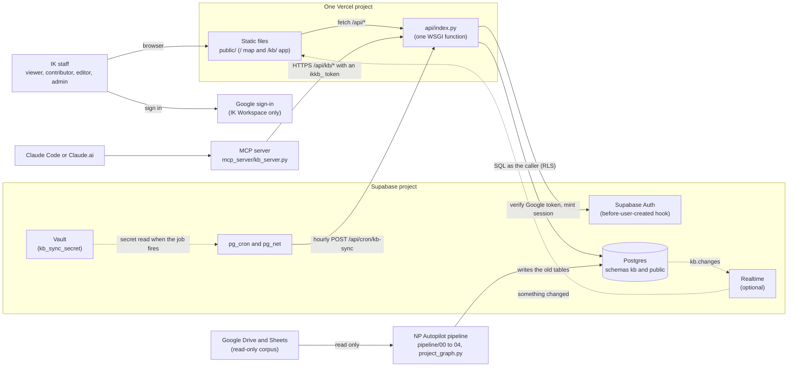
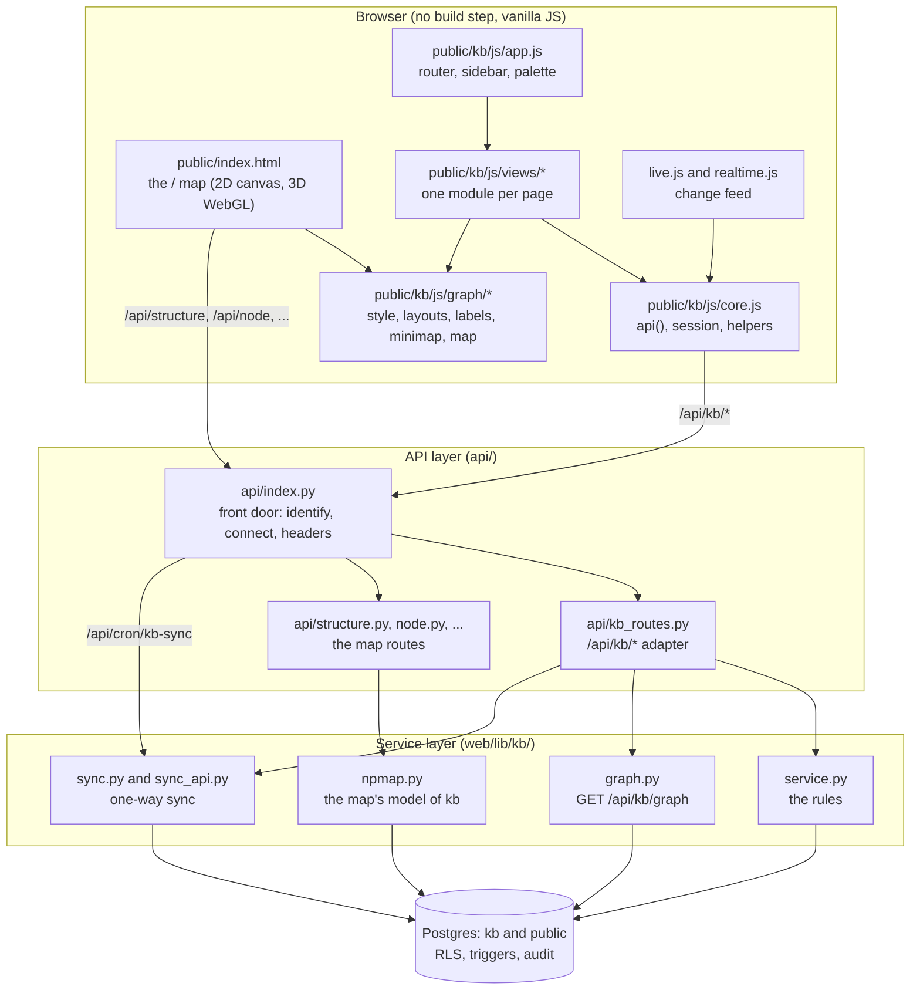
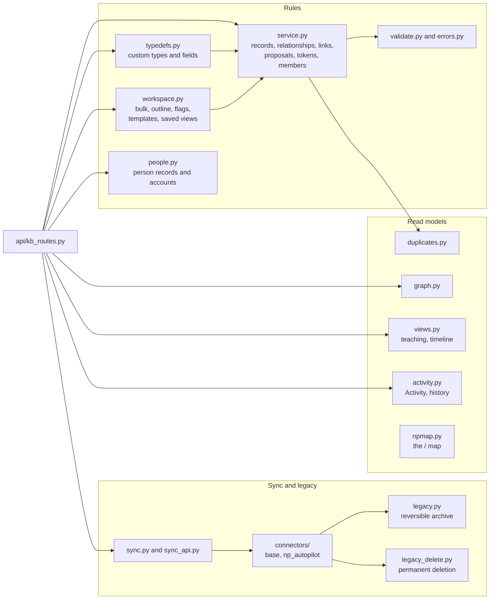
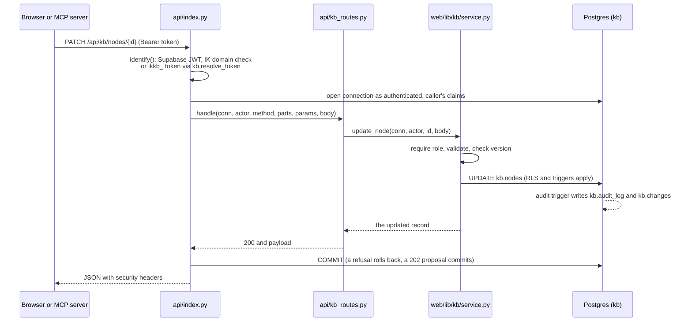

# Architecture overview

This page explains how the New Programs knowledge platform fits together: who
uses it, what runs where, and which code owns which job. Read it before you
change anything that crosses a boundary (browser and API, API and service,
service and database, pipeline and sync).

Related pages:

- [data-model.md](data-model.md): the tables, as entity-relationship diagrams.
- [knowledge-graph.md](knowledge-graph.md): record types, relationships, styles, legacy, how a graph is loaded.
- [single-source-of-truth.md](single-source-of-truth.md): where data comes from and which copy wins.
- [../security.md](../security.md): the access model and the role-by-action matrix.
- [contracts.md](contracts.md): the frozen API shapes (graph read, change feed, type metadata, map routes).
- [schema.md](schema.md): every migration from 0022 to 0037, table by table.
- [../integrations/connectors.md](../integrations/connectors.md): the sync's connector interface.

## The decision everything else follows

**The `kb` schema is the single source of truth for everything a person sees or
edits** (run 6, decision A2). Every page reads `kb`: the knowledge base pages
under `/kb/` (Graph, Outline, Who teaches what, Program timeline and the rest)
and the NP Autopilot map at `/`. The old tables in the `public` schema
(`nodes`, `edges`, `node_sources`, `node_layout`, `files`, `projection_meta`,
the curation tables) are kept only as the **intake** of the NP Autopilot
pipeline. They reach `kb` through a scheduled one-way sync, and no page reads
them directly. The one exception is curation (`/api/aliases`, `/api/curate`):
admins on `/` still edit the intake's curation tables, because those are the
pipeline's input. The whole data flow is in
[single-source-of-truth.md](single-source-of-truth.md).

## System context

| Actor or system | What it does here |
|---|---|
| IK staff | Sign in with their `@interviewkickstart.com` Google account. Everyone with an IK profile is at least a knowledge base **viewer**; contributor, editor and admin are granted by an admin (see [../security.md](../security.md)). |
| Google sign-in | Issues the ID token. The OAuth consent screen is Internal, and the server checks the `hd` claim ([auth.md](auth.md)). |
| Vercel | One project. `public/` is served as static files; every `/api/*` request goes to one Python WSGI function, `api/index.py` (the entry point is set in `pyproject.toml`, `[tool.vercel] entrypoint = "api.index:app"`). |
| Supabase Postgres | Two schemas: `kb` (the knowledge base, the source of truth) and `public` (the pipeline's intake tables, sign-in profiles and curation). |
| Supabase Auth | Turns a verified Google identity into a Supabase session. A "before user created" hook (migration 0007) refuses any account outside the IK domain. |
| Supabase Vault, pg_cron, pg_net | The sync's schedule lives in the database: pg_cron fires, pg_net POSTs to `/api/cron/kb-sync` with the secret stored in Vault as `kb_sync_secret` (migration 0031). |
| Supabase Realtime | Optional. When configured, the browser is told over a socket that `kb.changes` has a new row; otherwise it polls. |
| NP Autopilot pipeline | Reads the Drive corpus (read-only) and writes the old `public` tables. It never writes `kb`. |
| MCP server and Claude | A thin HTTP client of `/api/kb/*` that Claude uses as tools. It acts as the person who owns the token, with that person's role ([../integrations/mcp.md](../integrations/mcp.md)). |

## Containers and components

The frontend, the API layer, the service layer and the database, and which
calls which. Arrows point from caller to callee.

### Frontend (`public/`)

| Path | Role |
|---|---|
| `public/index.html` | The NP Autopilot map at `/`. A classic script. It loads its look (colours, shapes, hierarchy levels) from `public/kb/js/graph/map.js`, reads the map routes (`/api/structure`, `/api/node`, `/api/neighbourhood`, ...) and polls `/api/kb/changes`. The map is 2D only, drawn on a canvas (the 3D view was removed on 2026-11-07); KB admins get a button at the top to the workspace Graph. |
| `public/kb/index.html`, `public/kb/kb.css`, `public/kb/graph.css` | The knowledge base app shell and styles ([design-system.md](design-system.md)). |
| `public/kb/js/app.js` | Boot, the sidebar, the hash router (`ROUTES`, `PAGES`, `NAV`), the Ctrl K palette and keyboard shortcuts. |
| `public/kb/js/core.js` | Shared state, the `api()` helper that calls `/api/kb/*` with the session token, DOM helpers, `can(role)`. |
| `public/kb/js/live.js`, `public/kb/js/realtime.js` | Live updates: `realtime.js` opens a Supabase Realtime socket only when `GET /api/kb/realtime` returns a configuration; `live.js` reads the rows from `GET /api/kb/changes?since=<id>` and tells pages what changed. |
| `public/kb/js/views/*.js` | One module per page: dashboard, records (All records, Programs, Courses), resources (Links), outline, graph, teaching (Who teaches what, Program timeline), quality, approvals, activity, archived, settings, people, guide. |
| `public/kb/js/detail.js`, `form.js`, `relpicker.js`, `page.js`, `aliases.js` | The record panel, the New record form, the relationship picker, page headers, and old-link redirects. |
| `public/kb/js/graph/{style,layouts,labels,minimap,map}.js` | The graph's visual language and layouts, shared by the Graph page and the map at `/` (`map.js` is the adapter for `/`). |
| `public/kb/guide.md` | The in-app Guide (rendered by `public/kb/js/views/guide.js`). |
| `public/vendor/` | Vendored libraries: Cytoscape.js (the Graph page), the Inter font, the Lucide icon sprite. No CDN. |

### API layer (`api/`)

| Path | Role |
|---|---|
| `api/index.py` | **The one front door.** Every `/api/*` request enters `app()`. It identifies the caller before any endpoint module is imported or any connection opens, opens a connection scoped to that caller (role `authenticated`, the caller's claims, so RLS applies), commits only on success, and adds the security headers to every response. There is no CORS header. |
| `api/kb_routes.py` | `/api/kb/*`: parse, call the service, shape the response. No SQL and no permission logic. Route list: [../integrations/http-api.md](../integrations/http-api.md). |
| `api/structure.py`, `node.py`, `neighbourhood.py`, `search.py`, `overview.py`, `staffing.py`, `coverage.py`, `me.py` | The map's routes. Each reads `kb` through `web/lib/kb/npmap.py` (or the old tables when `NP_MAP_SOURCE=old`, see Rollback). |
| `api/aliases.py`, `api/curate.py` | Curation of the pipeline intake (admins on `/`), through `web/lib/curation_service.py`. |
| `api/session.py`, `api/config.py` | Sign-in (trades a verified Google ID token for a Supabase session) and the public browser configuration. |

Special paths handled in `api/index.py` itself: `/api/config` (public: the
Supabase URL, the anon key and the Google client id), `/api/stats` (public
landing numbers, counts only), `/api/session` (sign-in), `/api/cron/kb-sync`
(the scheduled sync, secret only) and `/api/kb/*`.

### Service layer (`web/lib/kb/`)

| Path | Role |
|---|---|
| `web/lib/kb/service.py` | **The only place knowledge base rules live**: validation calls, role checks (`require`), optimistic locking (`version`), proposals (`NeedsApproval`, HTTP 202), tokens, members and invitations, claims. The HTTP routes, the MCP server (through HTTP) and the Sheets importer (directly) all call it. |
| `web/lib/kb/validate.py`, `errors.py` | Hand-written input validation (no pydantic: the Vercel bundle is at its size limit) and the error types that become HTTP statuses. |
| `web/lib/kb/typedefs.py` | Custom record types and fields, relationship types (with review and merge), link kinds; the palette, shapes and line styles new types receive. |
| `web/lib/kb/workspace.py` | Bulk actions, the Outline, completeness, flags, templates, saved views, graph positions, tags, removing a member. |
| `web/lib/kb/people.py` | Person records (instructors, team members) linked to sign-in accounts, CSV linking, "owned by me", claims support. |
| `web/lib/kb/graph.py` | The one graph read API, `GET /api/kb/graph` ([contracts.md](contracts.md) §1). |
| `web/lib/kb/views.py` | Read-only views: Who teaches what, Program timeline. |
| `web/lib/kb/activity.py` | The Activity page, record history, the change feed's readers. |
| `web/lib/kb/duplicates.py` | Near-duplicate records (trigram similarity). |
| `web/lib/kb/npmap.py` | The map's routes at `/`, read from `kb`, in the response shapes the map has always used ([contracts.md](contracts.md) §5). |
| `web/lib/kb/sync.py`, `sync_api.py` | The one-way sync from the old tables into `kb`; its cron route, "Sync now" and run log. |
| `web/lib/kb/connectors/` | The connector interface the sync engine runs (`base.py`), the registry (`__init__.py`) and the one connector, NP Autopilot (`np_autopilot.py`). |
| `web/lib/kb/legacy.py` | The reversible legacy archive (CLI `pipeline/kb_legacy.py`). |
| `web/lib/kb/legacy_delete.py` | The owner-approved permanent deletion of legacy domains and modules (CLI `pipeline/kb_legacy_delete.py`). |

### Database

| Schema | Holds | Written by |
|---|---|---|
| `kb` | Records, relationships, links, types, tags, people links, members, tokens, proposals, the audit log, the change feed, the sync's bookkeeping. RLS on every table; triggers stamp authorship, bump versions, check relationship rules, cascade archives and write the audit log. | The API (as the caller), the sync and the importers (as the table owner, attributed to `sync` or `import`). |
| `public` | The pipeline's intake (`nodes`, `edges`, `node_sources`, `node_layout`, `files`, `projection_meta`), curation (`people`, `people_aliases`, `domain_aliases`, `workflow_owners`, `curation_notes`), sign-in (`profiles`, `shared_accounts`). | The pipeline (`project_graph.py`), curation routes, the sign-up trigger. |

Tables and keys: [data-model.md](data-model.md). Every migration is in
`db/migrations/` with a `.down.sql`; schema changes stay additive.

### Jobs

| Job | Where it runs | What it does |
|---|---|---|
| Scheduled sync | pg_cron job `kb-sync` in the Supabase project (installed with `kb.sync_schedule_install`, migration 0031), hourly by default | POSTs to `/api/cron/kb-sync` with `Authorization: Bearer <secret>`. The work runs in the Vercel function under a time budget (`KB_SYNC_BUDGET_SECONDS`, default 10 s); a run that runs out saves where it stopped and the next tick continues. |
| Sync now | Settings → Sync (admins) | `POST /api/kb/sync/run`: one time-boxed run, the same code. |
| The pipeline | An operator's machine (not scheduled) | Passes 0 to 4 and `project_graph.py` refresh the old tables from Drive. |

Vercel Cron is not used: it fires on Production deployments only, so a preview
(the dev deployment) would never sync. Details:
[../workflows/sync.md](../workflows/sync.md).

## How one request flows

## Principles

1. **One front door.** Every HTTP request enters `api/index.py`; identity is
   established before any endpoint module loads or any connection opens. A new
   endpoint is an entry in a table, so it cannot bring its own front door.
2. **One rulebook.** `web/lib/kb/service.py` is the only place knowledge base
   rules live. The HTTP routes, the MCP server (through HTTP) and the Sheets
   importer (directly) all call it.
3. **The database is the last line.** RLS (0023 and later) and triggers enforce
   roles, uniqueness, relationship rules, archive cascades, the contributor
   limits (0033), the AI limits (0034), the last-admin rule (0034) and the
   audit log, even if the service is bypassed. Tested directly in
   `tests/test_kb_rls.py` and `tests/test_kb_schema.py`.
4. **Never the whole graph in one response.** List pages are at most 200
   rows; neighbourhoods are at most 2 hops and 300 records; the graph read API
   pages at most 5,000 records per call; every response reports `total` and
   `truncated`.
5. **Additive schema.** New migrations add; every one has a `.down.sql`. (The
   earlier "additive: the old explorer is untouched" principle was superseded
   by the run-6 decision above: the map at `/` now reads `kb`.)

## Collaboration model

- **Optimistic locking** everywhere: a write carries `version`; a mismatch is
  409 with the current record. The UI shows a field diff and offers reload, or
  overwrite for editors (`?force=1`).
- **The change feed.** Every audited write also appends a content-free row to
  `kb.changes` (0029; `kind` and `node_ids` since 0032), in the
  `supabase_realtime` publication, so Realtime forwards it under the
  subscriber's RLS. `realtime.js` opens the socket only when
  `GET /api/kb/realtime` returns a configuration (`KB_REALTIME_ORIGIN` must
  equal `SUPABASE_URL`, and the deployment's CSP must allow that origin). The
  socket only says *that* something changed; `live.js` then fetches the rows
  from `GET /api/kb/changes?since=<id>`.
- **Polling is the fallback:** every 2.5 s while the tab is visible, slower
  when hidden or when the socket is up, with exponential back-off on failure.
  A page patches the records named in `node_ids`; a type, relationship-type,
  tag or sync change, or more than 200 changes at once, means refetch. An open
  record that changed elsewhere reloads, or warns if you are mid-edit.
- **Optimistic UI** for inline edits and tags, rolled back with a toast on error.

## How the map at `/` reads kb (`web/lib/kb/npmap.py`)

- **One module, the same shapes.** `npmap` answers `/api/structure`,
  `/overview`, `/node`, `/neighbourhood`, `/search`, `/staffing`, `/coverage`
  and `/me` with `web/lib/data.py`'s response shapes ([contracts.md](contracts.md) §5),
  from one in-memory model of the live KB per change-feed head (rebuilt when
  `max(kb.changes.id)` or the live counts move; about 0.8 s on the real data,
  then cached per process). It reads `kb` directly; it does not call
  `GET /api/kb/graph`.
- **Vocabulary, translated back.** `config/kb-projection-mapping.yaml` read
  backwards: KB type to projection type (`session` to the map's session type,
  `team_member` to person, ...; a type the projection never had keeps its KB
  key); KB relationship (type, source type, target type) to projection
  relation, with `flip`; the teaching pair split on the relationship's own
  props (`role` = current mastersheet, `older_role` = older sheets, class dates
  read back from the note). Links attached with a mapping note (Slides, Code,
  Assignment, ...) become the artifact nodes they came from
  (`link:<resource id>`). No taxonomy literal in the code.
- **Ids.** A record the sync brought in keeps its projection id
  (`external_id` `np:<id>`), so shared links still open; a KB-made record uses
  its uuid; `/api/node` and `/api/neighbourhood` accept either. Relationship
  ids are 32-bit numbers derived from the KB ids (the wire format packs Uint32).
- **Positions** come from `kb.graph_positions` (layout `default`, the Graph
  page's shared layout, divided by the sync's scale 4). A record with none is
  placed next to its placed neighbours (deterministic), so the map never
  re-simulates.
- **Current domains' codes** (SD1 to SD4) come from the domain records' `slug`
  field (0033; the sync fills it from the mastersheet), else the name.
- **ETag** = format + newest change id + live counts + the caller's NP and KB
  roles. **Landing numbers** (`/api/stats`, no session, counts only, through
  `kb.landing_stats()`) replace `public/stats.json`, which stays as the fallback.
- **Live.** The map polls `/api/kb/changes` every 2.5 s (it has no
  supabase-js; every NP member is a KB viewer) and refetches the structure on
  a relevant change (304 when nothing it shows changed). A relationship-type
  change also refetches `/api/kb/types`, so a custom type is drawn in the
  legend with its own colour and line style. Positions, the camera and the
  open panel stay.
- **Access** to `/` is unchanged: anyone with an NP role is at least a KB
  viewer (`kb.role()`).

What users of `/` see: the map shows what the KB holds. Edits made in the KB
(names, relationships, owners, archiving) appear on the map, and legacy items
follow the KB's legacy flag. What the sync skips (files as nodes, provenance
edges) is shown through the record's links instead of as nodes.

**What the KB cannot supply** (the key stays, empty):

| Key | Route | Why |
|---|---|---|
| `label_raw` | structure `raw`, /node | the KB keeps one name |
| `sensitive` | /node | the KB holds no sensitive rows (`false`) |
| provenance `sheet`, `row_num`, `col_num`, `col_name`, `page`, `within_cell`, `ordinal`, `prop`, `evidence`, `entered_at`, `sheet_count` | /node `provenance.corpus[]` | the KB keeps a cited file as a "Source" link (file name and Drive link only) |
| `provenance.hand`, `hand_note` | /node | hand-entered provenance is not imported |
| files as nodes (`file`), `delivers` file edges for unattached files | structure, /neighbourhood | files are links on records; only attached ones appear |
| edge props `rank`, `basis`, `inferred`, `avg_rating`, `via_alias`, `subject_raw`, `cell_order`, `attached_*` | structure, /node detail | not imported ([import-mapping.md](import-mapping.md)) |
| node props outside `mapped_props` (`cross_validated`, `merge_ids`, `pipeline_status`, ...) | structure, /node | not imported |
| archived (legacy) records | every route | the map shows what the KB holds: archived records are not on the map |

### Rollback

`NP_MAP_SOURCE=old` (a Vercel environment variable) serves every map route
from the old tables again (`web/lib/data.py`, unchanged), and `/api/stats`
returns 404 (the page falls back to `public/stats.json`). Nothing else
changes; unset it to return to `kb`. The knowledge base pages under `/kb/`
always read `kb`.

The old-table code that serves this rollback is listed for removal after
go-live in [../operations/legacy-removal.md](../operations/legacy-removal.md) §2.

## Who else touches kb

| Path | What it does |
|---|---|
| `pipeline/kb_import_projection.py` | The first import and manual sync runs from the command line (`preview` or `apply`, `--as <admin e-mail>` or `--operator`). The same engine as the scheduled sync. |
| `pipeline/kb_import_sheets.py`, `pipeline/lib/kb_sheets.py`, `config/kb-sheets-mapping.yaml` | The Sheets import. It acts as a named admin through the service (`actor_type='import'`). |
| `pipeline/kb_admins.py` | Bootstraps admins from `ADMIN_EMAILS` (an operator, on the owner connection). |
| `pipeline/kb_legacy.py`, `pipeline/kb_legacy_delete.py` | The legacy archive and the permanent legacy deletion (`plan`, then `archive`/`delete`, and `restore`). |
| `mcp_server/kb_server.py`, `plugins/ik-knowledge-assistant/` | The MCP server and the Claude Code plugin (server config and two skills). |
| `eval/kb_dev_server.py` | A local server for the browser and MCP tests. Never deployed. |
| `scripts/verify_all.sh`, `scripts/kb_perf.py` | Verification. |

## Why these choices

| Choice | Reason |
|---|---|
| Vanilla JS, no framework | The repository has no build step and a strict CSP; the original map is vanilla too. |
| Cytoscape.js (not React Flow) | Framework-free, a canvas renderer comfortable at thousands of records, built-in layouts; vendored under `public/vendor/` (MIT). |
| Python MCP SDK | Shares the service layer through HTTP instead of re-implementing it in TypeScript. |
| MCP over HTTP with a per-user token | No database credential on anyone's machine; RLS acts as the person. |
| Hand-written validation | The Vercel bundle is at its size limit; no pydantic in the function. |
| The schedule in the database | One design for the dev (preview) and production deployments; Vercel Cron only fires on Production. |

## Migrations at a glance

| Migrations | What they add |
|---|---|
| 0022 to 0026 | The `kb` schema, RLS, import runs, token resolution, the course shape (domain, week, session), link health, owner names. |
| 0027 to 0029 | Custom types and link kinds, flags, templates, saved views; the accessible palette and the Realtime publication; named actors, the append-only audit log, `kb.changes`, reviewable relationship types, graph positions. |
| 0030 to 0031 | The legacy flag, owners by role, `person_accounts`, `sync_map` and `sync_runs`, `legacy_archive`; the sync schedule (pg_cron). |
| 0032 to 0037 | Shapes, relationship colours and line styles, change `kind` and `node_ids`; data flow and people (slug, landing stats, resume, update and claim proposals, contributor limits, automatic account linking); performance indexes and the AI and last-admin guards; member invitations; sync exclusions. 0036 is unused. |

Details per migration: [schema.md](schema.md).
