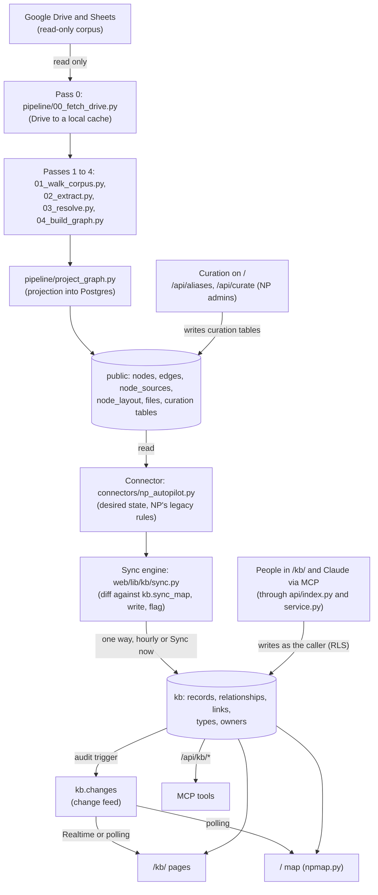
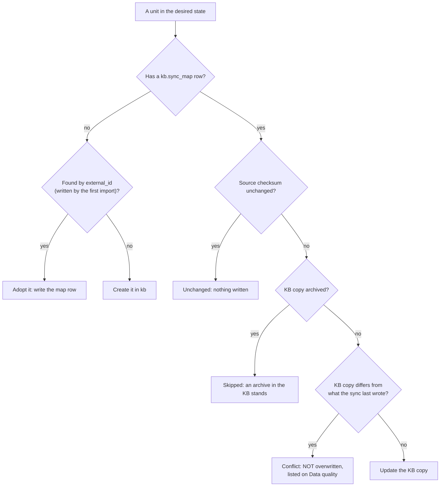

# Single source of truth

**The `kb` schema is the single source of truth for everything a person sees
or edits.** This page shows where the data comes from, which copy is
authoritative at each step, what the sync refuses to overwrite, and how to
roll back. Background: [overview.md](overview.md); tables:
[data-model.md](data-model.md); the sync step by step:
[../workflows/sync.md](../workflows/sync.md).

## The data flow

Nothing flows back: the sync never writes the `public` tables, and nothing in
`kb` is ever written to Drive.

## What is authoritative where

| Data | Authoritative copy | Notes |
|---|---|---|
| Programs, domains, modules, weeks, sessions, topics, instructors, team members, processes, themes (records that came from NP Autopilot) | `kb.nodes`, after the sync wrote them | The old tables are the **input**; once a person edits a record in the KB, the KB copy wins (see Conflicts). |
| Courses, and every record created in the KB | `kb.nodes` only | They have no `kb.sync_map` row, so the sync never touches them. |
| Relationships and links | `kb.edges`, `kb.resources`, `kb.node_resources` | Same rule as records. |
| Record types, relationship types, link kinds, fields | `kb.node_types`, `kb.edge_types`, `kb.edge_type_rules`, `kb.link_kinds` | The sync only **adds** the types and fields its mapping needs (`sync.ensure_config`); it never removes or renames one. |
| Owners (accounts) | `kb.nodes.owner_id`, `co_owners` | Set in the app, or derived from owners by role once a person record is linked to an account (additive only, see below). |
| Who is legacy | `kb.nodes.is_legacy`, set by the sync from NP Autopilot's rules | Not editable in the app. |
| Roles, invitations, tokens, person-account links, approvals | `kb.memberships`, `kb.member_invites`, `kb.api_tokens`, `kb.person_accounts`, `kb.proposals` | KB only; nothing comes from the intake. |
| Graph positions | `kb.graph_positions` | The sync seeds positions from `public.node_layout` only where nobody has placed the record yet. |
| Curation (aliases, people, workflow owners, curation notes) | The `public` curation tables | The pipeline's input, edited by NP admins on `/`; the sync carries them into record fields and notes. |
| The raw corpus | Google Drive | Read-only. Changes there reach the KB only after the pipeline runs and then the sync. |
| History | `kb.audit_log` (append-only) and `kb.changes` | Every write, by every actor (`human`, `ai`, `import`, `sync`, `system`). |

**Every user interface reads `kb`:** the `/kb/` pages through `/api/kb/*`,
the map at `/` through `web/lib/kb/npmap.py`, and Claude through the MCP
server, which calls `/api/kb/*`. The only readers of the old tables are the
sync, the pipeline's own checks (`eval/`, `pipeline/verify_migration.py`), the
curation routes and the rollback path below.

## How the sync decides (and what it never overwrites)

The sync is one engine (`web/lib/kb/sync.py`, `run`) running a connector
(`web/lib/kb/connectors/`, today only NP Autopilot; see
[../integrations/connectors.md](../integrations/connectors.md)). Each run
builds the **desired state** from the old tables, compares it unit by unit
(record, a record's owners, link, relationship, link-on-a-record) with
`kb.sync_map`, and writes only what changed. Writes are attributed to
`actor_type = 'sync'` (Activity shows "Sync").

For every unit, `kb.sync_map` keeps two checksums: `checksum` (what the
source said last time) and `kb_checksum` (what the sync last wrote into the
KB).

What the sync **never** does:

- **Overwrite an edit made in the KB.** If a unit changed at the source *and*
  its KB copy no longer matches `kb_checksum`, it is flagged
  (`kb.sync_map.conflict_at`) and left alone. It appears under **Sync
  conflicts** on Data quality (and the dashboard). If the source later
  returns to what the sync last wrote, the conflict clears itself.
- **Touch a record created in the KB.** No `sync_map` row, no sync.
- **Restore something a person archived.** An archived KB copy is skipped.
- **Delete a record.** A record gone from the source is flagged "removed at
  source" (`removed_at`) and set to `needs_review`; a person decides whether
  to archive it. A relationship or link-on-a-record gone from the source is
  archived (reversible). If the row comes back, it is "restored at source".
- **Replace owners set by hand.** Owners by role are a separate unit
  (`<key>#owners`) with its own conflict check. Turning them into account
  owners (`kb.apply_person_owner`) only fills an empty `owner_id` and only
  appends to `co_owners`.
- **Move a layout someone arranged.** Positions are written only where none
  exists.
- **Re-create what was permanently deleted.** `kb.sync_exclusions` (0037) is
  applied while the desired state is built.
- **Remove types or fields.** It only adds what its mapping lists.

Operational guards: one run at a time (a Postgres advisory lock, `LOCK_KEY`;
a "running" run older than 20 minutes counts as dead), a time budget with
resume (`kb.sync_runs.resume`), and the kill switch `KB_SYNC_ENABLED=false`.
The run log is in Settings → Sync (admins) and `kb.sync_runs`.

## The change feed

Every audited write to `kb`, whoever makes it (a person, the AI assistant, an
import, the sync), goes through the `kb.audit()` trigger, which writes one row
to `kb.audit_log` (with the before and after values) and one content-free row
to `kb.changes` (`kind`, `node_ids`). Layout moves, person-account links and
finished sync runs add a `kb.changes` row with no audit row. The interfaces
pick changes up like this:

- `/kb/` pages: Supabase Realtime when configured, otherwise polling
  `GET /api/kb/changes?since=<id>` every 2.5 s ([overview.md](overview.md),
  "Collaboration model");
- the map at `/`: polling `/api/kb/changes`;
- MCP: reads on demand (`recent_activity` reads the Activity log).

So a change made anywhere appears everywhere within a few seconds, and a sync
run appears as a `sync.run` event that tells pages to refetch.

Contract: [contracts.md](contracts.md) §2.

## Rollback

| What | How | Effect |
|---|---|---|
| The map at `/` back to the old tables | Set `NP_MAP_SOURCE=old` in the Vercel project and redeploy | Every map route reads the old tables again (`web/lib/data.py`), `/api/stats` returns 404 and the page falls back to `public/stats.json`. The `/kb/` pages still read `kb`. Unset it to return. |
| Stop the sync | `KB_SYNC_ENABLED=false` | The cron route and Sync now report "disabled"; nothing is written. |
| Remove the schedule | `select kb.sync_schedule_remove();` as the database owner | No more hourly runs. |
| Undo the legacy archive | `pipeline/kb_legacy.py restore` | Everything the legacy step archived comes back, and the sync stops re-applying it. |
| Undo the permanent legacy deletion | `pipeline/kb_legacy_delete.py restore <export.json>` | Every deleted row back with the same ids; the exclusions switched off. |
| Undo a person's archive | Restore on the Archived page (editors) | The record and exactly what was archived with it. |

There is no automatic "replay the source over the KB". After a rollback of
the map, edits made in the KB since the switch are still only in `kb`.
Backups: [../operations/backups-and-restore.md](../operations/backups-and-restore.md).
