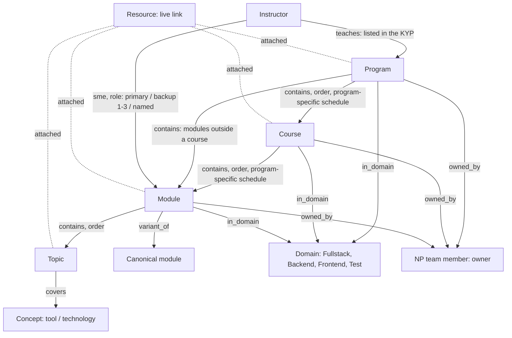

# Curriculum model (run C, 2026-11-07)

Status: **implemented** on the branch and on DEV. Owner decisions of 2026-11-07. This document is redacted: no person names, emails, page ids or URLs.

## Structure

| Rule | Where it is enforced |
|---|---|
| Exactly four domains, shown by name only; old names (SD1–SD4, long names) are hidden search aliases | `kb.nodes.search_aliases` (migration 0039) feeds the search vector only; no API returns it; the map shows names only |
| A domain classifies programs, courses and modules (`in_domain`); it is not a parent | edge rules (0039); `allowed_parents` of module = course, program |
| Week-agnostic: no week records or relationships; a week label lives only on a program's link | week type archived; `contains module→week` and `week→session` rules retired (0039); `edges.props.schedule = {program, rows:[{label, start, end}]}` |
| Owner = NP team member; many-to-many | `owned_by` rules allow only program/course/module → team member; `owner_record_id` / `co_owner_record_ids` refuse anything but a team member (trigger `kb.check_owner_records`) |
| SME = instructor → module, many-to-many, role required | trigger `kb.check_sme_role`: role `primary`, `backup` with rank 1–3, or a named role (≤ 60 characters); several primaries are allowed and flagged by Data quality |
| Module variants link to one canonical module | `variant_of` (module → module); identity = title + topics |
| Copy-paste programs are imported separately; course name matches are not auto-linked | the importer creates one course per program (scoped to it) and shares a module only when its title and topics are identical |
| Every imported record and relationship traces to a source | `props.provenance` (KYP page id, version, heading, table, row); `kb.sources` for every crawled source (0040) |

## Sources

- **Registry sheet** (`KB_SHEETS_ID`): the single list of sources. `pipeline/kb_registry_crawl.py` reads it through the Sheets API (cell hyperlinks, rich-text links, smart chips), follows every link (sheets, Drive folders recursively, Docs, Slides, PDF, Word, Excel, shortcuts), extracts text from documents as a first pass, counts audio and video only, and records every access failure. Re-crawls compare by resource id and version.
- **KYPs** (Confluence): `pipeline/kb_kyp_extract.py` parses the structure of the in-scope families (`config/kb-curriculum-scope.yaml`): the 2026 Interview Preparation KYPs (Week | Module | Agenda), the India KYPs with their included course outlines (nested lists), and the reusable domain self-paced course pages.
- `pipeline/kb_import_curriculum.py` writes the structure; `pipeline/kb_load_sources.py` writes the catalog and attaches the registry's domain folders and `Module-N: <name>` folders to their domain and module.

## One entity profile, one component

`web/lib/kb/profile.py` computes a record's profile from its relationships (domains, owners, SMEs ordered Primary → Backup 1–3 → named roles, where a module is used with each program's week label, children in order, topics, variants, sources). `public/kb/js/entity.js` renders it. The record panel, the record page, the Graph editor's panel and the Map's panel all use it; the Map reads the same record through `GET /api/kb/nodes/by-ref/<map id>`.

## Deferred

Agentic AI and combined programs (EdgeUp, SprintUP wrappers, Applied Agentic AI, GenAI + Interview Lab), PM / TPM / EM, and domains outside the four are listed on the Sources page as deferred and are not imported. A domain course is one reusable course record (for example the domain self-paced courses), so a later EdgeUp program links to it instead of duplicating it.
