# Phase 1 design: UX audit, target navigation, visual directions

Status: **proposal, awaiting the owner's choice of direction** (2026-11-07). Nothing here
is implemented except the performance work. The mockups are static HTML with
fictional content; open them in a browser:

| Direction | File | In one line |
|---|---|---|
| A · Clarity | [direction-a.html](direction-a.html) | Light, calm, dense. Today's workspace refined: sidebar, global search bar, IK blue as the only accent |
| B · Atlas | [direction-b.html](direction-b.html) | Dark-first, map-led. Map and workspace share one look: top bar, deep navy, the graph one click away |
| C · Studio | [direction-c.html](direction-c.html) | Search-first, spacious. Warm neutral canvas, larger type, cards; home opens on one big search box |

Screenshots (1440 px wide, in [screenshots/](screenshots/)):

| Direction | Home | Search results | Record page | Program view |
|---|---|---|---|---|
| A · Clarity | 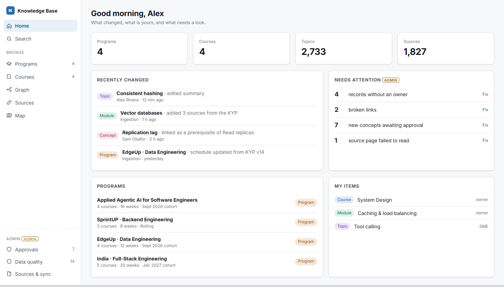 | 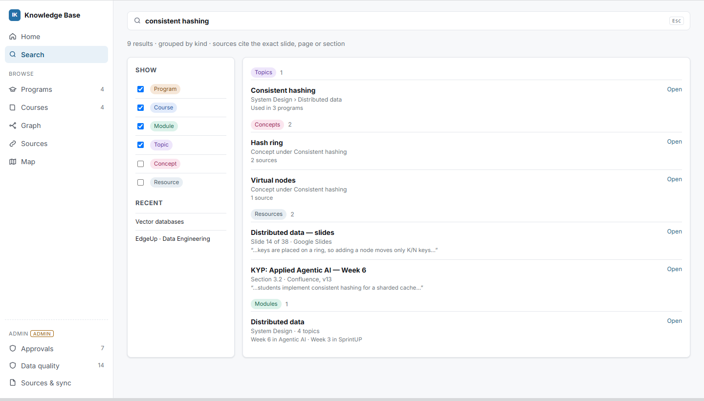 | 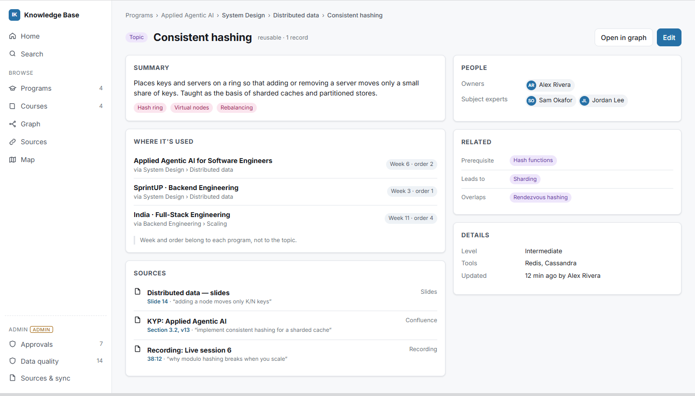 | 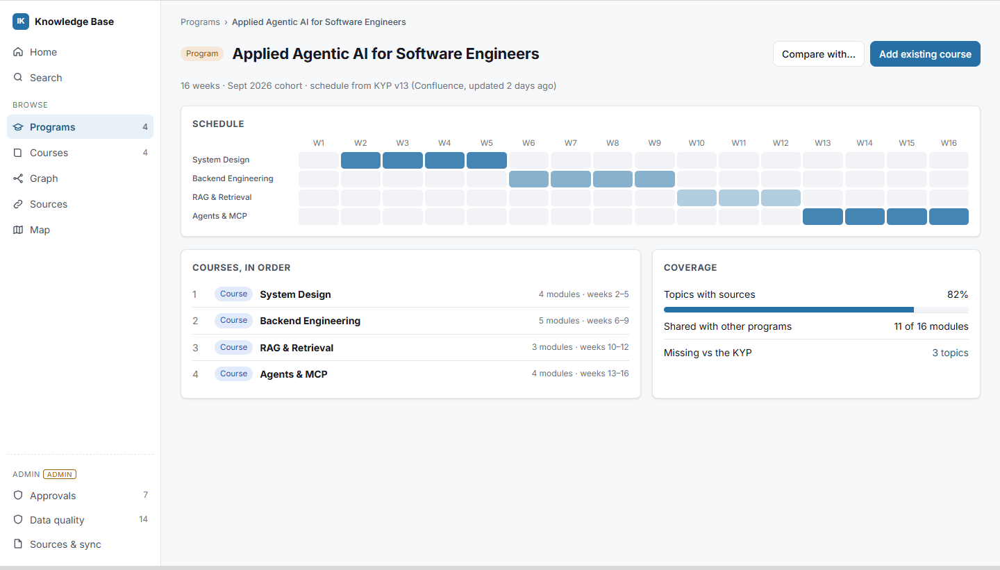 |
| B · Atlas | 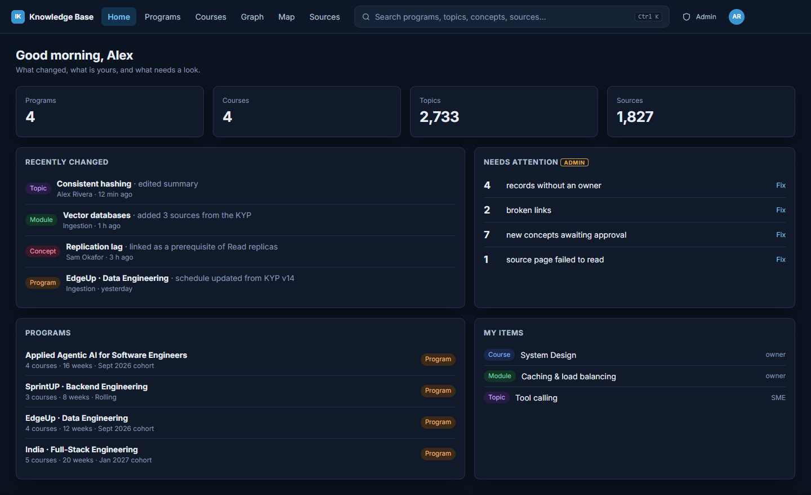 | 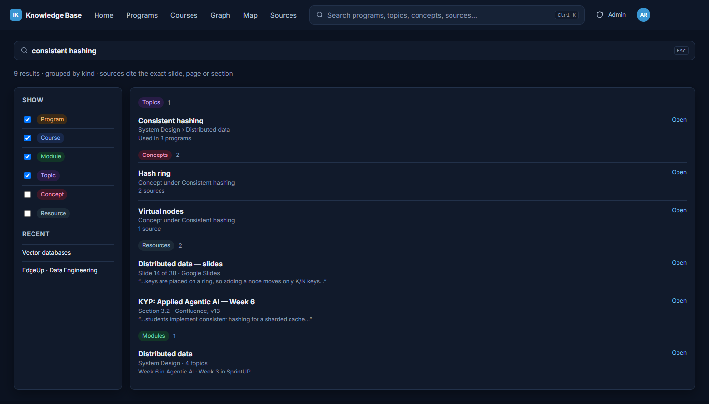 | 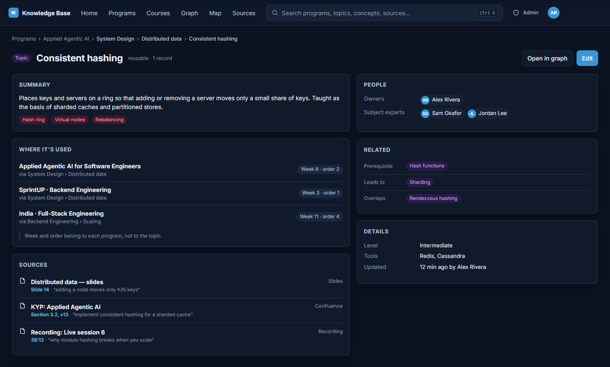 | 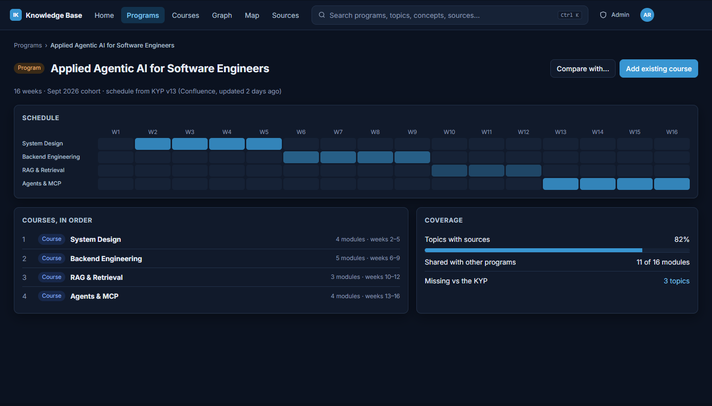 |
| C · Studio | 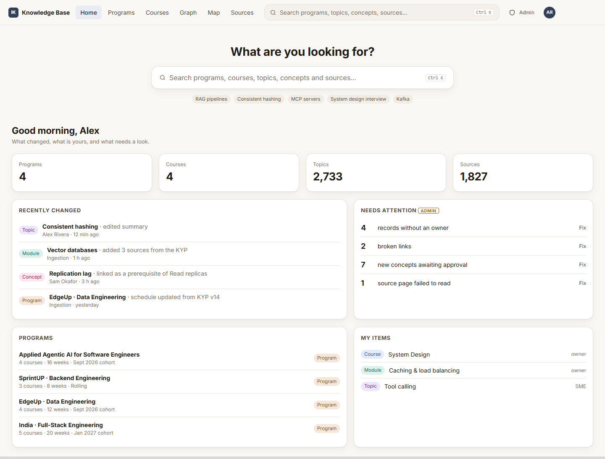 | 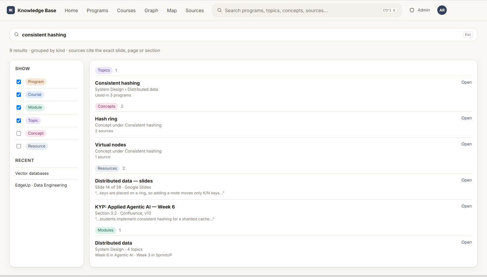 | 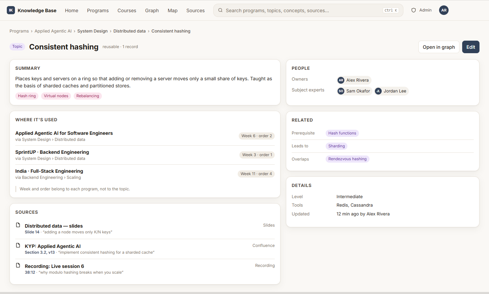 | 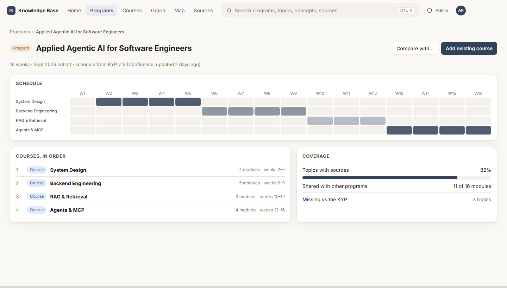 |

Each file has the same four screens (Home, Search results, Record page, Program
view) and the same content, so only the visual system and layout differ.
`python docs/design/phase1/build_mockups.py` regenerates them.

## Target navigation

Built for the final model (Program → Course → Module → Topic → Concept →
Resource). Search is the main entry point; every record has one page; admin
tools are separate from what viewers see.

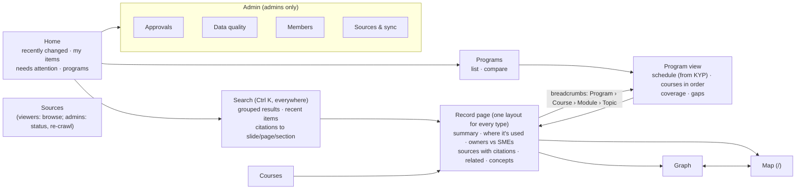

## UX audit, ranked by impact on the top tasks

From a read of the workspace and map code (read-only).

| # | Finding | Hurts tasks | Fix direction |
|---|---|---|---|
| 1 | No way to compare programs; building a program from existing parts takes ~12 clicks through the bulk "Add to…" on tables | Compare programs, build a program | "Add existing…" on programs and Outline rows; a side-by-side compare built on the outline |
| 2 | Links in the record panel jump to All records, wherever you were (`detail.js` 78, 156, 198, 240, 334, 551); "Back to list" always goes to All records | Every task | Open records in place on the current page, like Outline already does |
| 3 | Search dead-ends: at most 12 records, no "See all", a failed search shows commands only | Find material on a topic, browse | "See all N results" row; errors shown inline; grouped results |
| 4 | Program structure is spread over three pages; Outline can scope to one program but nothing links there; the timeline covers only the older sheets' programs | See a program's structure | A Program view (mockup): schedule, courses in order, coverage |
| 5 | Keyboard: link rows and records rows can't be reached by Tab; the panel doesn't take focus; dialogs have no focus trap; tabs lack ARIA | All, for keyboard users | Real links, focus management, one focus-trap helper |
| 6 | The record panel puts the summary last, after up to 14 property rows; links sit behind a tab | Find material, open sources | Summary first, sources next, people, then details (mockup) |
| 7 | Ownership labels contradict each other (Primary/Secondary vs Owner/Co-owners/Owner by role/Backups); "P/B" also means teaching roles | Edit records, find owners | One model, decided in Phase 2: Owners vs SMEs |
| 8 | Clicking a link opens its details, not the link | Open sources | The title opens the source; details behind an icon |
| 9 | Approvals show raw JSON and field names, no before/after | Review approvals | A field-level diff, like the conflict dialog |
| 10 | Data quality lists problems but offers no fixes; dashboard links land at the top of the page | Fix data quality | Anchored sections and "Fix in bulk" links |
| 11 | Narrow screens: nothing below 900 px; the panel's fixed width squeezes the page | All, on laptops/tablets | Panel becomes an overlay below ~900 px; drawer sidebar |
| 12 | Map and workspace disagree: "Programme"/"Program", "Session"/"Live session", "Person"/"Instructor"; separate search boxes; no link from a map item to its record | Every cross-over | Shared vocabulary; same search; "Open record" from the map |
| 13 | Jargon and duplicates: Links vs Resources, "Rule misfits", "mastersheet", "v12", "Your role is editor" | Viewers | A glossary pass, the Guide updated to match |
| 14 | Viewers see the whole Maintain group; Members and Sync hide among 9 Settings tabs | Viewers, admins | An "Admin" group only admins see (mockups) |

Click counts today (from the dashboard):

| Task | Clicks | Main blocker |
|---|---|---|
| Find material on a topic | 3–4 | 12-result cap, no "see all" |
| See a program's structure | 4–5 | no program view; Outline not linked |
| See who teaches what | 1–2 | no program filter |
| Compare programs | not possible | no compare view |
| Build a program from existing pieces | ~12 | no "add existing" on a program |
| Edit records and relationships | 5–7 | panel links leave the page |
| Review approvals | 2 | raw JSON, no diff |
| Fix data quality | 3+ per record | no bulk-fix links |
| Manage members | 2 | buried in Settings |
| Monitor sources/sync | 1–2 | link health is elsewhere |
| Browse and search | 1–3 | Maintain noise for viewers |
| Open a source | 3 | the row opens details |

## Visual system (shared by all three directions)

One token set in one place (`public/kb/kb.css` `:root`), used by the map too:

- **Colour:** neutrals (bg, surface, surface-2, border, text 1–3), one accent
  (IK blue or IK navy), semantic ok/warn/danger with soft backgrounds, one
  colour per record type, shared by the map, Graph, chips and legend.
- **Type:** Inter; 12/13/14/16/20/24/28; weights 400/500/600/700; line-height tokens.
- **Spacing** 4–48, **radius** one size per direction (8/10/14) plus a small one,
  **shadow** two levels, **z-index** scale, **motion** one duration plus
  reduced motion.
- **Components:** button (primary, default, ghost, danger; one class order),
  input, select, table, chip (per type), card, panel, dialog, toast, menu,
  skeleton, spinner/busy button.

Gaps found today: no z-index or small-radius tokens, 10–11 px sizes hard-coded,
the map uses 43 hard-coded hex colours and its own font stack, 23 button class
spellings, no spinner. The map's grey text `#6e7681` fails contrast (4.1:1) and
is fixed in any direction.

## What ships when

| Ships now (Phase 1/2, independent of the model) | Waits for Phase 3 (depends on the new model) |
|---|---|
| All performance work (done in Phase 1) | Programs list and Program view (schedule from KYPs, courses in order) |
| Design tokens and components in the chosen direction | Courses pages |
| Navigation shell: sidebar or top bar, Admin group, one search, breadcrumbs | Record page content: where it's used, owners vs SMEs, concepts, citations |
| Search: grouped results, "See all", recent items, errors inline | Graph restyle around Program → Course → Module → Topic → Concept |
| Record panel order (summary first), open-in-place links, keyboard and focus fixes | Compare programs, "Add existing course/module" |
| Map ↔ workspace: shared vocabulary, header and search | Map restyle in the chosen direction |
| Narrow-screen panel overlay, empty/loading/error states | Home's program quick links (needs current programs) |
