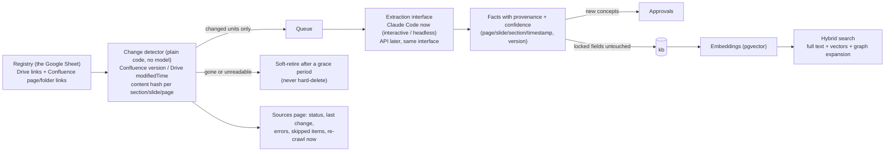

# Phase 4 pilot plan: ingestion, extraction and search (proposal, 2026-11-07)

Status: **plan only**. Nothing is extracted until the owner approves the embedding
choice, this plan and, later, the pilot results. Decisions referenced: PLAN-2026-11-07.md.

## What the sources look like (read-only inventory, 2026-11-07)

| Source (Confluence, space CUR) | Pages | Text | Last edited |
|---|---|---|---|
| 2026 IP Domain KYPs | 20 | ~660k chars | 2026-09-23 – 11-03 |
| SprintUP Courses KYPs | 14 | ~280k | 2026-11-03 |
| Applied Agentic AI KYPs (from Sept 2026) | 7 | ~280k | 2026-09-22 – 11-03 |
| EdgeUp KYPs (from Sept 2026) | 18 | ~1.13M | 2026-09-23 – 11-03 |
| India KYPs and Course Outlines (4 sub-folders) | 123 | ~3.37M | 2025-02-18 – 2026-09-30 |
| **Total** | **182** | **~5.7M chars** | |

- Every page is readable with the scoped token; the space has no anonymous access.
- **Attachments are not readable** with this token (401): skipped and listed on the
  Sources page as "skipped: attachment (not yet supported)" (decision 12).
- **Include macros** pull in other pages (SprintUP 78, India 97): resolved once, linked
  to the source page.
- One page is marked "[Do not Use]": listed as "skipped: marked do-not-use", never dropped silently.
- Drive: the registry sheet `links` is readable; the corpus is reduced to it on purpose.

## Design

- **Units:** a KYP section (by heading), a doc section, a slide, a PDF page, a transcript
  segment. Each unit has a content hash; only changed units are re-extracted.
- **Per unit, extract:** summary; concepts covered; technical depth/level; technologies,
  frameworks and tools; assumed prerequisites; exercises and assignments; interview
  questions and real-world scenarios; overlap with other modules. For KYPs, also the
  program structure: courses, order, duration, weekly plan, stored as program-specific
  schedule data (decisions 7, 8).
- **Provenance and confidence on every fact.** Human-edited or approved fields are
  locked; extraction never overwrites them. New concepts become Approvals proposals.
- **Concept resolution** against the existing records first (name match, then
  embedding similarity with a threshold that RANKS candidates for review, never merges silently).

## Embeddings: recommendation (owner to choose)

| Option | Quality (MTEB retrieval) | Cost | Notes |
|---|---|---|---|
| **A. bge-small-en-v1.5 in the scheduled Python worker** (recommended) | 51.7 | free (CPU) | 384 dims, 512 tokens; fast on CPU; same dims as option B |
| B. Supabase built-in gte-small (Edge Functions) | 49.5 | Edge Function CPU time only | 384 dims; embeds queries server-side without hosting a model |
| C. nomic-embed-text-v1.5 (local) | similar avg (62.3), longer context (8k) | free (CPU) | 768 dims; needs task prefixes; slower |
| D. bge-m3 (local) | strong, multilingual, dense+sparse | free but heavy | 1024 dims; slowest on CPU; only if content is multilingual |

Recommendation: **A**, stored as `pgvector(384)`, with Supabase's documented hybrid
search (Postgres full text + HNSW vectors, reciprocal rank fusion). Chunks of
≤ 400 tokens; full text catches exact curriculum terms; graph expansion adds the
module/course context. Queries are embedded with the same model in the API process.
Sources: huggingface model cards (BAAI/bge-small-en-v1.5, Supabase/gte-small,
nomic-ai/nomic-embed-text-v1.5, BAAI/bge-m3); supabase.com/docs/guides/ai/hybrid-search.

## Where scheduled runs happen (not a laptop)

- **Recommended:** Claude Code **cloud scheduled tasks** (runs on Anthropic's cloud, cron
  no more often than hourly, can use claude.ai connectors including our MCP server;
  research preview; each task belongs to one person's account).
- **Fallback:** GitHub Actions cron with the official `anthropics/claude-code-action`,
  authenticated by a `CLAUDE_CODE_OAUTH_TOKEN` (one-year token from `claude setup-token`);
  switch to an API key if usage limits or terms become a concern.
- **Terms (flagged for the owner):** Pro/Max subscriptions are for "ordinary, individual"
  use; Team/Enterprise fall under commercial terms. A small internal job on the owner's
  seat is plausible; heavy production automation points to an API key. Confirm with
  Anthropic if in doubt. The change detector itself is plain code and can run anywhere
  (a Vercel cron or the same Action).

## Pilot: Applied Agentic AI (approved)

- **Scope:** the 7 pages of "Applied Agentic AI KYPs - From Sept 2026" (one page is
  "[Do not Use]" and is skipped and listed), ~280k characters, ~6 programs' structure.
- **Steps:** (1) registry rows for the folder; (2) detector run (versions, hashes, skipped
  list); (3) interactive extraction in Claude Code, unit by unit, writing to DEV only;
  (4) concepts proposed through Approvals; (5) embeddings + hybrid search on DEV;
  (6) score against the quality set below; (7) report.
- **Estimate (to be replaced by measured numbers):** ~70k tokens of source text; with
  prompts, outputs and resolution roughly 0.3–0.5M tokens; about 1–2 hours of
  interactive work. Report: units/minute, Claude usage per unit, 10 extraction samples
  for review, quality scores.
- **Change test:** edit one KYP page (owner) and confirm only that program's units are
  re-extracted and only its records change.

## Quality evaluation set (draft; expected results confirmed against the pilot inventory)

Scored on: precision@5, citation accuracy (the cited slide/page/section actually
supports the answer), and misses. Re-run after every extraction or search change.

| # | Query | Expected (kind of result) |
|---|---|---|
| 1 | RAG evaluation presentation | slides on RAG evaluation metrics, with slide numbers |
| 2 | how to evaluate a retrieval pipeline | the same deck + any KYP section on evaluation |
| 3 | practical MCP demo | session/recording or slides showing an MCP server demo |
| 4 | build an MCP server in Python | assignment or lab material on MCP servers |
| 5 | Backend assignment on distributed systems | Backend course assignments (distributed systems) |
| 6 | consistent hashing exercise | assignment/topic with consistent hashing |
| 7 | System Design interview questions | System Design interview material |
| 8 | design a URL shortener | system design case-study session/slides |
| 9 | multi-agent orchestration slides | slides on multi-agent orchestration |
| 10 | agent tool calling | topic/slides on tool calling |
| 11 | vector databases comparison | module/slides on vector databases |
| 12 | embeddings and chunking strategies | RAG module sections |
| 13 | prompt engineering basics | Agentic AI early-week material |
| 14 | LLM evaluation and guardrails | evaluation/guardrails sections |
| 15 | caching and load balancing | System Design module |
| 16 | database sharding | System Design / Backend topics |
| 17 | message queues Kafka | Backend topic/resources |
| 18 | CAP theorem | System Design concept |
| 19 | rate limiter design | System Design case study |
| 20 | microservices vs monolith | Backend/System Design material |
| 21 | Agentic AI program weekly schedule | the program's schedule from its KYP |
| 22 | how many weeks is the EdgeUp Data Engineering program | program schedule (count of weeks) |
| 23 | when is RAG covered in Applied Agentic AI | program-specific week for the RAG module |
| 24 | prerequisites for the agents module | prerequisite relationships |
| 25 | SQL window functions exercise | Data Engineering assignment |
| 26 | data pipeline orchestration Airflow | Data Engineering material |
| 27 | Spark performance tuning | Data Engineering material |
| 28 | ML model deployment | ML/MLOps material |
| 29 | feature stores | ML/Data material |
| 30 | mock interview behavioural questions | interview prep material |
| 31 | PM product sense interview | PM/TPM material |
| 32 | engineering manager leadership scenarios | EM material |
| 33 | frontend performance optimisation | Frontend material |
| 34 | React state management | Frontend topic |
| 35 | test automation framework | Test Engineering material |
| 36 | security engineering threat modelling | Security material |
| 37 | Android architecture patterns | Android material |
| 38 | iOS concurrency | iOS material |
| 39 | SRE incident response | SRE material |
| 40 | which programs reuse the System Design course | programs linked to the course |

Real expected record ids per query are filled in from the pilot inventory and kept
locally with the scores (real data stays out of the public repo).
