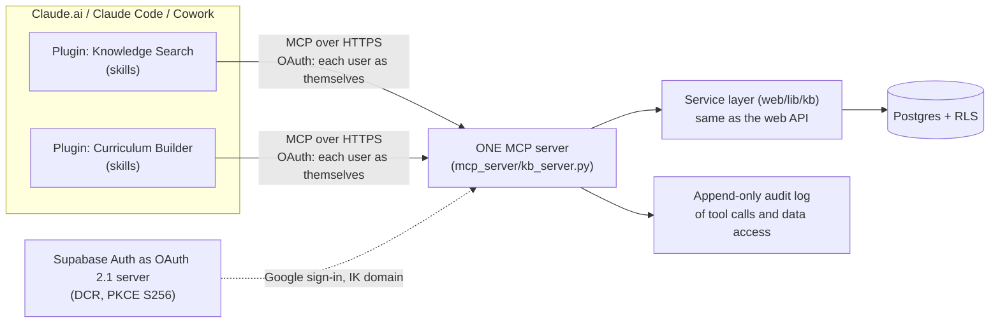

# Phase 5 design note: the Claude plugin platform (proposal, 2026-11-07)

Status: **planning only** (Addition 1 in PLAN-2026-11-07.md). Facts below come from the
current Claude, Supabase and MCP documentation as read on 2026-11-07; links at the end.

## Shape

- **One MCP server**, Streamable HTTP, built on `mcp_server/kb_server.py` and the
  service layer; tools for graph queries, search/retrieval with slide/page/section/
  timestamp citations, record operations and program/schedule queries; provenance in
  every result. `ikkb_` tokens stay for scripts.
- **Hosting:** alongside the app on Vercel (Python function serving the MCP endpoint)
  is the simplest; tool calls time out at 240 s in Claude, well above our needs. The
  alternative is a small always-on host if long-lived connections are needed.
- **Auth for Claude.ai custom connectors** (requirements as documented): 401 with
  `WWW-Authenticate: Bearer resource_metadata=...` when unauthenticated; RFC 9728
  protected-resource metadata whose `resource` equals the connector URL; an
  authorization server with RFC 8414/OIDC discovery and PKCE S256; a client identity
  through Dynamic Client Registration, a client metadata document, or an admin-entered
  client id; redirect URI `https://claude.ai/api/mcp/auth_callback` (and loopback for
  Claude Code); no client-credentials grant; responses within 10 s (30 s for refresh).
- **Google has no DCR**, so **Supabase Auth acts as the OAuth 2.1 server** (it supports
  DCR and an MCP flow; we host its consent page). Its tokens are Supabase user JWTs, so
  RLS applies to every person as themselves; drafts and restricted data cannot leak.
  The IK-domain rule is enforced in the existing before-user-created hook and on every
  request, as today. *To verify during build: restricting the OAuth server's sign-in to
  the company domain.*
- **Plans:** custom connectors work on Pro, Max, Team and Enterprise (Free: one). On
  Team, an Owner adds the connector under Organization settings → Connectors; each
  member then signs in.
- **Plugins:** `.claude-plugin/plugin.json`, `skills/<name>/SKILL.md`, `.mcp.json`
  pointing at the remote server (no secrets). Logic lives in the plugin; adding a plugin
  needs no core change.
- **Internal distribution (Team/Enterprise):** a **private** marketplace repo
  (`.claude-plugin/marketplace.json`, plugins under `./plugins/`), synced through
  Organization settings → Plugins & skills → "Sync from GitHub"; availability per
  plugin (available / installed by default / required). The Owner also adds the MCP
  connector. Claude Code: `claude plugin marketplace add <owner>/<repo>`, then
  `claude plugin install <plugin>@<marketplace>`; `claude plugin validate` before publishing.
- **Audit:** every tool call writes who, which tool, which records were read or
  changed, to an append-only table (same rule as `kb.audit_log`).

## The example plugin: recommend **Knowledge Search** first

It exercises the full path (OAuth, RLS, retrieval, citations, audit) with read-only
tools and the quality test set from the Phase 4 plan, so it can be scored. Curriculum
Builder then reuses its search tools plus program/schedule tools.

## Future plugins → tools → missing data

| Plugin | MCP tools it uses | Data it still lacks |
|---|---|---|
| Knowledge Search | `search` (hybrid, cited), `get_record`, `related` | embeddings and extracted units (Phase 4) |
| Curriculum Builder | `search`, `program_structure`, `program_schedule`, `find_reusable_modules`, `gap_analysis`, `draft_program` (proposal only) | current programs from KYPs; concept coverage per module |
| SME Discovery | `find_smes(topic)`, `instructor_profile`, `teaches` | instructor ratings, availability, expertise levels |
| KYP Intelligence | `program_schedule`, `kyp_diff(version)`, `sources` | KYP version history (Phase 4 detector) |
| Curriculum Audit | `coverage(program)`, `duplicates`, `missing_resources`, `broken_links` | concept-level coverage; learner outcomes |
| Resource Reuse | `search`, `where_used(record)`, `overlap(program_a, program_b)` | per-unit embeddings; usage counts |
| NP Workflow | `approvals`, `tasks`, `owners` | workflow data (the static workflow nodes are being archived; a real source is needed) |

## Existing `ik-knowledge-assistant` plugin

It already packages skills plus the MCP server for Claude Code. Fold it in by: moving
it to the private marketplace repo as the "Knowledge Search" plugin; pointing its
`.mcp.json` at the remote server instead of a local process; keeping the `ikkb_`
token path as an option for scripts; and removing anything that duplicates core logic.

Sources: claude.com/docs/connectors/building, claude.com/docs/connectors/building/authentication,
support.claude.com/en/articles/11175166, claude.com/docs/plugins/build,
claude.com/docs/plugins/admin, claude.com/docs/plugins/org-sync,
code.claude.com/docs/en/mcp, code.claude.com/docs/en/plugin-marketplaces,
supabase.com/docs/guides/auth/oauth-server/mcp-authentication.
