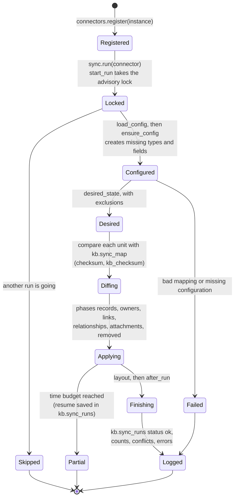

# Connectors: bringing a source into the knowledge base

The sync is **one engine** (`web/lib/kb/sync.py`, `run`) that runs a
**connector**: a small class that knows one source and says what the
knowledge base should hold for it. The engine does everything that is the
same for every source: the lock, the run log, the diff, conflicts, the time
budget. This page explains the interface, the lifecycle of a run, and how to
add the next connectors.

**What exists today, honestly:**

| Exists and runs | Designed, not built |
|---|---|
| The interface `web/lib/kb/connectors/base.py` (`Connector`) | A Google Drive connector that reads Drive directly |
| The registry `web/lib/kb/connectors/__init__.py` (`register`, `get`, `names`, `DEFAULT`) | An Uplevel LMS connector |
| One connector, NP Autopilot (`connectors/np_autopilot.py`), the default for every run | An Atlassian (Confluence, Jira) connector |
| A test that runs a fake second connector through the engine (`tests/test_kb_connectors.py`) | Per-source bookkeeping (`source` column), source cursors, source permissions, retries |

The plan and its order are in [../VISION_AND_ROADMAP.md](../VISION_AND_ROADMAP.md)
§3 and §7. Related: [../architecture/single-source-of-truth.md](../architecture/single-source-of-truth.md)
(what the sync never overwrites), [../workflows/sync.md](../workflows/sync.md)
(running and watching the sync).

## The interface

`web/lib/kb/connectors/base.py`:

| Member | Required | What it must do |
|---|---|---|
| `name: str` | yes | The registry key (`np_autopilot`). Unique: `register` refuses a second connector with the same name. |
| `actor_label: str` | yes (by convention) | How the source should be named in Activity. Today Activity names every sync write "Sync" from `actor_type='sync'`; the engine does not read this attribute yet. |
| `load_config(conn) -> dict` | yes | Load and check the source's mapping; **raise** on a bad one (the run is then logged as failed and admins see a banner). The returned dict must contain the four keys the engine reads to create the KB configuration the source needs (`sync.ensure_config`): `new_record_types`, `new_relationship_types`, `type_fields`, `placement`. Each may be empty, but all four must be present. |
| `desired_state(conn, config, **opts) -> dict` | yes | What the KB should hold for this source, with the source's own rules applied (current or legacy, owners, exclusions). Shape below. `opts` today carries `source` (the schema of the old tables). |
| `exclusions(conn) -> (bool, set)` | no (default: none) | `(rule on?, source keys never to create again)`: the permanent exclusions the connector applies while building its desired state. |
| `after_run(conn, out) -> None` | no (default: nothing) | A finishing step inside the run's last transaction, never cut off by the time budget. It may add keys to `out`. |

The desired-state dict:

| Key | Value |
|---|---|
| `recs` | `{key: {"np", "type", "src_type", "name", "props", "body", "scope_np", "legacy", "review", "tags", "owner_np", "co_np"}}`. `np` is the source key, `type` a KB record type key, `scope_np` / `owner_np` / `co_np` are source keys of other records. |
| `links` | `{url_norm: {"url", "title", "kind", "tags"}}` |
| `rels` | `{key: {"type", "src", "tgt", "props", "note", "edges"}}` (a KB relationship type key and two source keys) |
| `attachments` | `{key: {"rec", "link", "note"}}` (a link on a record) |
| `layout` | `{source key: (x, y)}` |
| `report` | `{"read": {...}, "rejected": [...], "problems": defaultdict(list), ...}`: counts and ids only, never content |

### How `sync.py` uses it

`sync.run(conn, ..., connector=None)` takes a connector; with none it uses
`connectors.get(connectors.DEFAULT)`, which is NP Autopilot. Every existing
call site (`pipeline/kb_import_projection.py`, `web/lib/kb/sync_api.py` for
the cron route and Sync now, `scripts/kb_sync_timing.py`) uses the default.
To run another connector: `sync.run(conn, connector=connectors.get("<name>"))`.

The NP Autopilot connector is thin wrappers around code that already
existed: `load_config` is `sync.load_mapping()` (`config/kb-projection-mapping.yaml`,
checked against `config/taxonomy.yaml`), `desired_state` is
`sync.desired_state()` (the `public` tables, `np_categories` for current vs
legacy), `exclusions` is `legacy_delete.excluded()` (`kb.sync_exclusions`), and
`after_run` re-applies the legacy archive (`legacy.archive`) once it has been
adopted.

## Lifecycle of a run

While **Applying**, each unit is created, updated, left unchanged, skipped
(archived in the KB), flagged as a **conflict** (edited in the KB and changed
at the source: never overwritten), or flagged as **removed at source**.
Conflicts and removals are listed on Data quality
(`GET /api/kb/quality/sync`). The rules are in
[../architecture/single-source-of-truth.md](../architecture/single-source-of-truth.md).

What the engine provides for every connector: one run at a time
(`LOCK_KEY` advisory lock; a "running" run older than `STALE_MINUTES` = 20
counts as dead), the run log (`kb.sync_runs`, trigger `cron`, `manual` or
`cli`), batched writes (`batch=400`), resume after the time budget
(`kb.sync_runs.resume`, phase and last key), preview (`apply=False` rolls
back), the shared layout (only where nobody placed a record), and attribution
(`actor_type='sync'`). `KB_SYNC_ENABLED=false` switches every run off.

## Before a second connector runs for real

The interface works for a second source in a test, but the bookkeeping is
still single-source. These are **required** before any new connector writes
to a shared database (roadmap item 4):

1. **Namespacing.** `kb.sync_map`, `kb.sync_runs` and `kb.sync_exclusions`
   have no `source` column. Two connectors would each see the other's units
   as "removed at source". Add `source` to their primary keys (an additive
   migration with a `.down.sql`).
2. **External ids.** The engine writes and looks up `external_id = 'np:' + key`
   (`sync.py`, records). Make the prefix the connector's name.
3. **One lock per source.** Today there is one lock (`sync.LOCK_KEY`); make it
   per connector (for example from the connector name).
4. **A schedule per source.** The cron route runs the default connector only.

Not in the interface yet (each a design in `connectors/base.py` and the
roadmap): an incremental cursor (`changes(conn, cursor)`, stored per
connector), source permissions (`acl(items)` into a `kb.source_acl` table with
RLS), and retries with back-off through a job table. A connector can still be
built without them; it then rebuilds its full desired state every run, as NP
Autopilot does.

## How to add a connector (the steps every source shares)

1. **Write the class** in `web/lib/kb/connectors/<name>.py`: subclass
   `Connector`, set `name` and `actor_label`, implement `load_config` and
   `desired_state`, and `exclusions` / `after_run` if the source needs them.
   Keep it thin; put source logic in its own module, and never write to `kb`
   from the connector (the engine writes).
2. **Write the mapping** as a YAML file in `config/` (for example
   `config/kb-<name>-mapping.yaml`), in the same spirit as
   `config/kb-projection-mapping.yaml`: source type to KB type, which source
   items become links, relationships, the types and fields to add. Check it in
   `load_config` and raise on anything unknown.
3. **Register it**: `connectors.register(MyConnector())` in
   `web/lib/kb/connectors/__init__.py`.
4. **Secrets**: read them from environment variables, by name; list each new
   name in [../operations/environment-variables.md](../operations/environment-variables.md);
   never commit a value. A credential that only an operator's machine or a
   worker needs must **not** be set in Vercel.
5. **Do the bookkeeping changes above** before it runs against a shared
   database.
6. **Tests**, against the local test database only (`tests/kb_support.py`,
   synthetic data):
   - the registry returns it (`connectors.get("<name>")`);
   - `load_config` refuses a mapping that names an unknown type;
   - a run through `sync.run(conn, connector=...)` creates the expected
     records, and a second run writes nothing (`tests/test_kb_connectors.py`,
     `test_a_second_connector_writes_through_the_same_engine`, is the model);
   - an edit in the KB followed by a source change gives a conflict, not an
     overwrite;
   - an item removed at the source is flagged, not deleted;
   - an exclusion is never re-created;
   - its writes are attributed to `actor_type='sync'`.
7. **Document it** here and in the workflows docs.

## Google Drive

**Today:** Drive reaches the KB only indirectly. Pass 0
(`pipeline/00_fetch_drive.py`) fetches the allow-listed folders read-only into
a local cache; passes 1 to 4 and `pipeline/project_graph.py` turn them into
the `public` tables; the NP Autopilot connector syncs those. Drive URLs reach
the KB as links (the projection's artifact types, and a "Source" link per
cited file).

**A direct `gdrive` connector (design, [../VISION_AND_ROADMAP.md](../VISION_AND_ROADMAP.md) §3.1):**

| Part | What it would be |
|---|---|
| Class | `name = "gdrive"`. `desired_state` lists the files in the shared folders and returns them as `links` (title, URL, kind from the MIME type as `sync._mime_kind` does, tags), and as `attachments` to the records they belong to. It extracts no people and no contact columns. |
| Config | A mapping file (folders to records or types, MIME to kind). The folder scope stays the one in `config/drive.yaml.example` and `pipeline/lib/sources.py`: the allow-list is still the only path for structured entities. |
| Secrets (names) | The existing ones: `NP_DRIVE_SA_KEY` (the path to the service-account key, `drive.readonly`) and `NP_DRIVE_CONFIG` (the Drive config file). These live on an operator's machine or a worker, **not** in Vercel; Drive listing needs minutes, so this connector runs outside the Vercel function. |
| Mapping into kb | Files become `kb.resources` with a `link_kind` (`drive_file`, `drive_folder`, `doc`, `sheet`, `slides` already exist in `kb.link_kinds`). Programmes, modules and instructors keep coming from NP Autopilot until the pipeline is retired. |
| Exclusions | The payroll file and anything outside the allow-list are never listed; use `exclusions` for ids an owner removed. |
| Needs first | Namespacing (above), a cursor (Drive's Changes API `startPageToken`), and source permissions (`kb.source_acl`; a file shared with a group needs group expansion, an owner decision in roadmap §3.2) before it goes beyond the NP folders. |
| Tests | The shared list above, plus: a file outside the allow-list is never produced; no contact data appears in any record or link; a Drive change after a KB edit is a conflict. Use a fake Drive client, never the real API, in tests. |

## Uplevel LMS

**Today:** no connector and no API access. Uplevel appears only as links:
`uplevel_link` props from the projection become links, and the `uplevel`
link kind recognises `uplevel.interviewkickstart.com` URLs.

**Design (roadmap §3.4, item 11):**

| Part | What it would be |
|---|---|
| Class | `name = "uplevel"`. `desired_state` reads programs, courses, modules and sessions from the LMS API and returns them as `recs` (with `scope_np` for placement), `rels` (`contains`, `teaches`) and `links` (the course pages). |
| Config | A mapping file: LMS object type to KB type (`program`, `course`, `module`, `session`), LMS fields to KB fields (`type_fields`), any new types (`new_record_types`). |
| Secrets (names) | None defined yet. It needs read-only API credentials with a stated scope; add the variable names to the environment-variables page when they exist. |
| Mapping into kb | Matching an LMS course to an existing KB record must be explicit (by a stored id), never by name alone. `review: true` marks a record for review when the match is uncertain. |
| Exclusions | Learner data (enrolments, grades, names) is out of scope and must never be produced. |
| Needs first | Namespacing; an ACL story (cohorts); API access and scope from the owner. |
| Tests | The shared list, plus: no learner data in any record; a course matched by id, not name. |

## Atlassian (Confluence and Jira)

**Today:** nothing in the repository reads Confluence or Jira.

**Design (roadmap §3.4, item 12):**

| Part | What it would be |
|---|---|
| Class | `name = "atlassian"` (or one per product). Confluence pages and Jira issues become `links` attached to the records they are about (for example a page labelled with a course), not new records, unless a mapping says otherwise. |
| Config | A mapping file: which spaces or projects, which labels or fields link an item to a KB record. |
| Secrets (names) | None defined yet. A read-only API token scoped to the listed spaces and projects. |
| Mapping into kb | `kb.resources` with a new link kind (add it in Settings → Link kinds, or in the mapping), attached through `attachments`. |
| Exclusions | Spaces or projects not in the mapping; pages restricted at the source until source permissions exist. |
| Needs first | Namespacing; space-permission mapping into `kb.source_acl`. |
| Tests | The shared list, plus: a restricted page is never produced. |
