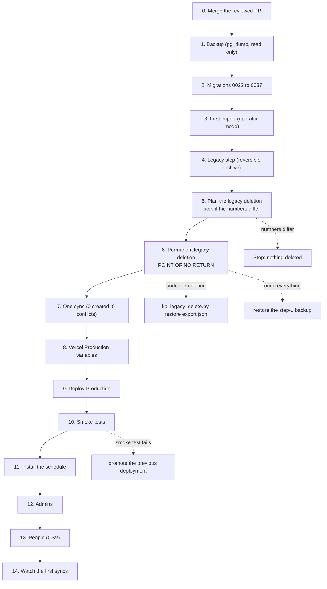

# GO LIVE — the production runbook (knowledge platform, run 6)

The exact order for production, with the time each step took when it was
rehearsed on the DEV database (2026-11-03/04, over a ~175 ms pooler from a
laptop; expect less in region). **Nothing here has been run on production.**
Production is project `yqmzjgzhxhihnpbgqmeh`, at migration 0021.

Who: one owner with the production database owner login (session pooler) and
the Vercel project's Production scope. Do it in a quiet hour. Tell users that
"/" (NP Autopilot) and /kb/ may be briefly unavailable during step 9.

**The point of no return is step 6 (the permanent legacy deletion).** Before
it, every step has its own rollback. After it, rolling back the deletion means
`kb_legacy_delete.py restore <export>` (tested: every row back with the same
ids), and rolling back everything means restoring the step-1 backup.

Steps 3 to 7 run from a laptop with `SUPABASE_DB_URL_SESSION` set to the
production session pooler, as in step 2. `pipeline/kb_legacy_delete.py`
refuses production for **every** subcommand (`plan`, `delete`, `restore`)
unless `NP_ALLOW_LEGACY_DELETE_ON_PRODUCTION=yes` is set for that command.

| # | Step | Command | Time on dev | Rollback |
|---|---|---|---|---|
| 0 | Merge the branch (reviewed PR, docs/project-history/PR_DESCRIPTION.md) | GitHub | — | revert the merge commit |
| 1 | **Backup** (read-only) | `pg_dump --no-owner --no-privileges -n public -n kb "$PROD_SESSION_URL" -f backups/prod_before_golive_<date>.sql` (see `scripts/dev_db.py backup` for the exact flags) | 1 min (59 MB) | nothing changed |
| 2 | **Migrations 0022–0038** (0036 unused; 0038 is an index only) | `SUPABASE_DB_URL_SESSION=$PROD python pipeline/migrate.py status`, then `up` | 7 s for 0032–0037; 0022–0031 measured in run 5 (under 1 min) | `python pipeline/migrate.py down --to 0021` (each has a `.down.sql`; rehearsed on dev: 0037→0031 down and up again; run 5: the whole chain) |
| 3 | **First import** (operator mode: no KB admin exists yet) | `SUPABASE_DB_URL_SESSION=$PROD python pipeline/kb_import_projection.py apply --operator --report backups/prod-import.json` | 245 s (25,226 units) | restore the step-1 backup: once the import has written sync state, `migrate.py down` refuses at 0030 and 0029 ([runbook.md](runbook.md) §2); the old tables are never written |
| 4 | **Legacy step** (reversible archive of legacy instructors etc.) | `python pipeline/kb_legacy.py archive` | < 10 s | `python pipeline/kb_legacy.py restore` |
| 5 | **Plan the legacy deletion** | `NP_ALLOW_LEGACY_DELETE_ON_PRODUCTION=yes python pipeline/kb_legacy_delete.py plan` (the production gate applies to `plan` too; it changes nothing) | < 2 s | — (read only). Expect: 4 current domains kept (Full Stack, Backend, Frontend, Test Engineering), 42 domains and 904 modules to delete, 0 records left without a parent. **Stop if the numbers differ.** |
| 6 | **Permanent deletion of legacy domains and modules** (owner-approved, run 6 R3) | `NP_ALLOW_LEGACY_DELETE_ON_PRODUCTION=yes python pipeline/kb_legacy_delete.py delete` — it writes the export `backups/legacy_deleted_supabase_<time>.json` FIRST and refuses to delete if the file does not read back complete | 15 s | `NP_ALLOW_LEGACY_DELETE_ON_PRODUCTION=yes python pipeline/kb_legacy_delete.py restore backups/legacy_deleted_<...>.json` (rehearsed on a clone: every table's count back exactly) |
| 7 | **One sync** (proves nothing comes back) | `python pipeline/kb_import_projection.py apply --operator --report backups/prod-sync.json` | 24 s | — (read: 0 created, 0 conflicts expected) |
| 8 | **Vercel Production variables** (next to the existing ones) | `vercel env add KB_SYNC_SECRET production` (new, 32+ chars), `KB_SYNC_ENABLED=true`, `KB_SYNC_BUDGET_SECONDS=10`; check `NP_ALLOWED_HD=interviewkickstart.com` and `NP_SHARED_ACCOUNTS` | 5 min | `vercel env rm` each new one |
| 9 | **Deploy Production** | from `main`: `vercel --prod` | 2–3 min | Vercel → Deployments → the previous one → "Promote to Production" (instant) |
| 10 | **Smoke tests** (below) | browser + curl | 10 min | step 9's rollback |
| 11 | **Schedule** | in the SQL editor, as owner: `select vault.create_secret('<KB_SYNC_SECRET>', 'kb_sync_secret');` then `select kb.sync_schedule_install('https://<prod host>/api/cron/kb-sync');` | 2 min | `select kb.sync_schedule_remove();` (or `KB_SYNC_ENABLED=false`) |
| 12 | **Admins** | each admin signs in once at /kb/, then `ADMIN_EMAILS=a@interviewkickstart.com,b@... python pipeline/kb_admins.py`; further members from Settings → Members (invitations apply on first sign-in) | 5 min | Settings → Members, or `kb_admins.py` again |
| 13 | **People** | Settings → People: CSV upload (name,email), confirm the matches | 15 min | unlink per record |
| 14 | Watch the first scheduled sync (Settings → Sync: trigger "Schedule", status ok, its duration under the function cap) and Data quality for conflicts in the first week | — | — | `KB_SYNC_ENABLED=false` |

Total hands-on time: about 45 minutes, plus the first scheduled sync.

## Before go-live: plan changes (checked 2026-11-07, prices USD excl. tax)

| Change | Why | Monthly cost |
|---|---|---|
| **Vercel Hobby → Pro** (1 developer seat) | Hobby is limited to non-commercial personal use; a company's internal tool needs Pro | $20 (includes $20 usage credit), +$20 per extra deployer |
| **Supabase production org → Pro** | Free has no backups and pauses projects after a week of inactivity; Pro gives 7 days of daily backups and no pausing | $25 (the $10 compute credit covers one Micro project) |
| Keep DEV in a separate Free org | plans cannot be mixed within one org; DEV may pause when idle | $0 |
| Optional: Supabase PITR (7 days) | recovery finer than daily | +$100 |
| GitHub repo → private (before Phase 4) | the owner's request; CLI deploys upload local files, so deployment does not depend on the repo being public | $0 |

Minimum about **$45/month** plus usage above the included amounts. Sources:
vercel.com/docs/limits/fair-use-guidelines, vercel.com/pricing, supabase.com/pricing,
supabase.com/docs/guides/platform/backups, docs.github.com (repository visibility).
Making the repo private does not undo anything already exposed: rotate any secret
that was ever committed (none found by the history scan in `verify_all.sh`).

## Notes added 2026-11-07

**Live updates over Realtime at go-live (recommended).** Without it, every open
tab polls `/api/kb/changes` every 2.5 s (map and workspace separately). After
step 8, and before step 9's deploy:

1. `KB_REALTIME_ORIGIN=https://<production ref>.supabase.co python scripts/kb_csp_origin.py`
   adds that origin (https and wss) to `connect-src` in vercel.json; commit it.
   `--check` validates; `--clear` removes it again.
2. `vercel env add KB_REALTIME_ORIGIN production` with the same value (it must
   equal `SUPABASE_URL`).
3. After step 9, check in a browser that the workspace receives changes without
   polling (two tabs: an edit in one shows in the other within a second or two).

Rollback: remove the variable and redeploy; the page falls back to polling on its own.
docs/operations/deployment.md "KB live updates over Supabase Realtime" has the details.

**Fluid compute and the connection fix.** The Vercel project runs Fluid compute:
one instance serves concurrent requests. `web/lib/data.py` gives each request its
own database connection (checked out, never shared). Before that fix one
request's rollback could end another's transaction, and two callers could run
statements under each other's identity. The fix went to production alone as a
hotfix on 2026-11-07: deployment `dpl_HzgySKhJxwLDxXdxtK1JqERR9Xr5`, promoted
20:46 UTC on 2026-11-06, verified by the owner's sign-in; `main` = `7be3b4c`.
Fluid stays on. Keep the per-request checkout in any future change to `data.py`
(`tests/test_warm_connection_isolation.py::test_concurrent_requests_never_share_a_connection`).

## Smoke tests (step 10)

| Check | Expect |
|---|---|
| `GET /api/config` | 200, three non-empty values |
| `GET /kb/` and `/` | 200; sign-in page with the IK logo |
| `GET /api/kb/me` without a session | 401 |
| A session for a NON-IK Google account (e.g. a personal Gmail) | 403 on every API route, /kb/ and the "/" map (checked server-side on every request, run 6 F5) |
| `POST /api/cron/kb-sync` without the secret | 401 |
| `GET /local-login` | 404 (local servers only) |
| An IK admin signs in: /kb/ dashboard fits one screen; Graph shows 4 domains and 20 current modules; "/" map draws from the KB | as on dev |
| Response headers on `/api/*` | CSP, HSTS, X-Content-Type-Options nosniff, X-Frame-Options, Referrer-Policy (run 6 security sweep) |

## What changes for users of "/"

- The NP Autopilot map at "/" now reads the **knowledge base**, not the old
  tables (docs/architecture/overview.md). Edits made in /kb/ (names, relationships,
  owners, archiving) appear on the map within a few seconds, without a reload.
- Legacy domains and legacy modules are **gone** from the map, the KB and its
  counts (run 6 R3). Legacy instructors, topics and programmes stay.
- Files are no longer drawn as nodes; they are a record's links.
- **Access to "/" is unchanged**: anyone allowed today (an IK account with an NP
  role) still is; every request now also re-checks the IK domain on the server.
- Rollback for the map alone: set `NP_MAP_SOURCE=old` in Vercel and redeploy:
  "/" reads the old tables again (B1's switch; kept until production is stable).

## Domain restriction

Sign-in is limited to `interviewkickstart.com` in three places, all of which must
hold: the Supabase "before user created" hook (migration 0007), Google's `hd`
claim check at sign-in, and (run 6) a server-side check of the session's
address on every request (`web/lib/auth.py`). A shared mailbox listed in
`NP_SHARED_ACCOUNTS` keeps working as before; whether it may hold an editor or
admin role in the KB is an owner decision (run 6 security sweep).

## Rehearsal on dev (2026-11-04)

Run on the DEV project with `scripts/dev_db.py` (it refuses production):
check → backup → migrate (0032–0034, 0037: 7 s) → **rollback** (down to 0031,
up again: OK) → legacy-plan → legacy-delete (15 s) → sync (24 s) → verify:
every count and parity number equals the local real-data copy, RLS on 26/26
kb tables. Steps 8–11 need a working Vercel token (the one in .env was
rejected on 2026-11-04): they are documented, not rehearsed.
