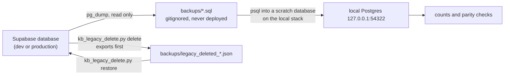

# Backups and restore

What exists today: operator-run logical dumps into the gitignored `backups/`
folder, the legacy deletion's own export, and the window scripts from the
original site's migration. A scheduled production dump with a tested restore
is **not** in place yet (roadmap item below). Whatever Supabase's own backups
provide depends on the project's plan and is not configured from this
repository.



## Taking a dump

All dumps are **read-only** on the source: `pg_dump` takes a consistent
snapshot and writes nothing to the database. Use the **session pooler** URL
(port 5432), never the direct host.

**DEV**, with the guard that refuses production
([`scripts/dev_db.py`](../../scripts/dev_db.py)):

```bash
python scripts/dev_db.py backup
# -> backups/dev_backup_<YYYYmmddTHHMMSSZ>.sql, with the size and the number of tables with data
```

It runs `pg_dump` in a `postgres:17` Docker container (so the client matches
the server's major version) with exactly these flags:

```
pg_dump "$KB_DEV_DUMP_URL" --no-owner --no-privileges -n public -n kb -f /out/<name>
```

The URL is passed through the container's environment, never on the command
line, and is never printed. Docker must be running.

**Production** (GO_LIVE step 1), the same flags, run by the owner with the
production session-pooler URL in a shell variable:

```bash
pg_dump --no-owner --no-privileges -n public -n kb "$PROD_SESSION_URL" -f backups/prod_before_golive_<date>.sql
```

On DEV this took about 1 minute for 59 MB. If the local `pg_dump` is older
than the server (Postgres 17), use the same `docker run ... postgres:17`
pattern as `dev_db.py`.

What the flags mean: `-n public -n kb` dumps the original site's tables and
the knowledge base, including `kb.audit_log` (append-only history). It does
**not** dump `auth` (users, identities), Vault secrets or storage.
`--no-owner --no-privileges` leaves out ownership and GRANT statements, so a
restore into another database does not need the same roles, and the grants
must come from the migrations.

**The window scripts** ([`db/window/`](../../db/window/)) are the original
site's migration-window tooling: `WINDOW_DSN=<dsn> db/window/backup.sh <dir>`
takes custom-format, data-only dumps of the projection plus row counts into a
directory outside the repository (mode 700); `restore_projection.sh` restores
them. See [window-runsheet.md](window-runsheet.md). They are not the KB backup.

## Where backups go

- `backups/` at the repository root. It is gitignored (`/backups/`, and
  `backups/`, `*.dump`, `*.backup`, `*.sql.gz` anywhere in the tree), and
  excluded from every deployment (`.vercelignore`).
- The local real-data copy reads `backups/prod_schema.sql` and
  `backups/prod_data.sql` (a read-only dump of 2026-11-03); see
  [local-demo.md](local-demo.md).
- Import and sync reports (`backups/dev-import.json`, `prod-import.json`, ...)
  hold counts and ids only, but stay in the same folder.

## Restoring a dump locally

Restore into a **separate database** on the local Supabase stack, never over
a database you use.

**The tested path** is the local real-data copy
([local-demo.md](local-demo.md), "The real-data copy"):
[`eval/kb_realdata_db.py`](../../eval/kb_realdata_db.py) creates the database
`kb_realdata` in the local stack, bootstraps what a fresh database lacks
compared with a Supabase project (the `extensions` schema with `pg_trgm`,
`pgcrypto` and `uuid-ossp`, and a minimal `auth` schema with `auth.uid()`),
then loads a schema dump and a data dump with `psql` inside the local
database container, checking counts. It refuses any non-loopback address.

```bash
python eval/kb_realdata_db.py rebuild    # create + restore backups/prod_schema.sql and prod_data.sql + migrate up + local admin
python eval/kb_realdata_db.py counts     # row count of every public table
```

It expects the dump split into `backups/prod_schema.sql` and
`backups/prod_data.sql`. A single file from `dev_db.py backup` can be loaded
the same way by hand (`docker exec -i <local db container> psql -U postgres
-d <scratch db> < backups/<file>.sql`; the container is
`supabase_db_np-autopilot-test` unless `KB_LOCAL_DB_CONTAINER` says
otherwise), but only after the same bootstrap; that manual route has not been
rehearsed. Because the dumps carry no GRANTs, check counts as `postgres`.

Then compare counts with the source (`python scripts/dev_db.py verify` does
this for DEV against `kb_realdata`).

Restoring **over production or DEV** is not a command in this repository. It
would replace every KB edit made since the dump, and the `auth` schema is not
in the dump. Treat it as an incident decision for the owner (see the
[runbook](runbook.md)).

## The legacy deletion's export and restore

`pipeline/kb_legacy_delete.py delete` writes
`backups/legacy_deleted_<db>_<YYYYmmdd_HHMMSS>.json` **before** it deletes,
reads it back, and refuses to delete if it is incomplete.
`pipeline/kb_legacy_delete.py restore <export.json>` puts every row back with
the same ids. Full description:
[legacy-deletion-and-restore.md](../workflows/legacy-deletion-and-restore.md).
Keep that file as long as there is any chance of needing the deleted records.

## Roadmap: a weekly dump and a restore drill

[docs/VISION_AND_ROADMAP.md](../VISION_AND_ROADMAP.md) §6 (G9) and item 2 of
its plan: confirm and write down the production plan's backup and
point-in-time recovery window; add a **weekly logical dump of `kb`** to
storage outside Supabase; and run a **restore drill**: restore into the local
stack and compare counts the way `eval/kb_parity.py` does. Until that exists,
take a manual dump before any risky operation (a migration, the legacy
deletion, a bulk change).

## Never

- **Never commit a backup**, an export or a report. They hold real data
  (names, e-mail addresses in `person_accounts`, the audit log). The
  `.gitignore` rules above exist for this; `git status` should never show a
  file under `backups/`.
- Never copy a backup into `public/`, a doc, a test fixture or an issue.
- Never put a database URL on a command line that is logged; use a shell
  variable or `.env` (gitignored).
- Never run `pg_restore` or `psql -f` with a production or DEV URL unless the
  owner has decided to restore that database.
- Never use the direct host `db.<ref>.supabase.co`.
