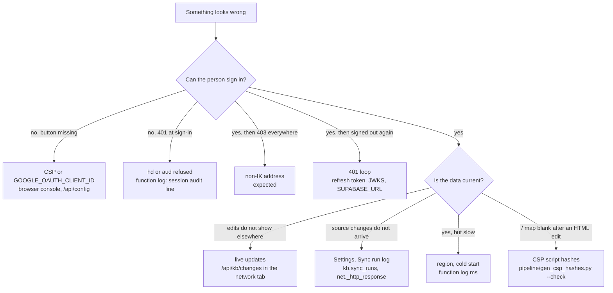

# Monitoring and troubleshooting

What to watch on a running deployment, how to read it, and what to check for
the symptoms that have actually come up. Incident steps with rollback are in
the [runbook](runbook.md). There is no automatic alerting yet (roadmap G8 in
[VISION_AND_ROADMAP.md](../VISION_AND_ROADMAP.md) §6): someone has to look.



## What to watch

### In the app (admins)

- **Settings → Sync**: whether the sync is enabled, the time budget, and the
  last 20 runs with trigger (Schedule, Sync now, Command line), status,
  conflicts and the first error. A run that stays "running" for more than 20
  minutes is abandoned by the next one.
- **The sync banner**: shown to admins on every page while the last
  non-skipped run failed.
- **Data quality**: **Sync conflicts** (edited here, changed at the source),
  **Removed at the source**, records without an owner (for types with "owner
  expected"), broken links, duplicates, records flagged by the legacy
  deletion. A rising conflict count means people edit records the source is
  still changing.
- **Activity**: every write with its actor (a person, "AI assistant (for ...)",
  "Import", "Sync"). Filter by actor or record; export as CSV.
- **Approvals**: pending proposals (also a count on the dashboard).

### Vercel function logs

Every API request prints one JSON line to stdout (`web/lib/guard.py`
`audit()`): `"audit": true`, the time, the subject and e-mail, whether it is a
shared account, the endpoint, its parameters, the row count and `ms`.
Sign-in attempts print a `"endpoint": "session"` line with `ok` and the
refusal reason. Unexpected errors print a Python traceback to stderr while the
client sees only `{"error": "internal"}`. Look for: `ok: false` bursts at
sign-in, 500s, and `ms` well above the usual 40 to 80 ms warm.

### In the database (SQL editor, read-only queries)

```sql
-- the last runs
select id, trigger, status, started_at, finished_at, conflicts, message, counts->>'partial' as partial
  from kb.sync_runs order by id desc limit 10;
-- a run that never finished
select id, trigger, started_at from kb.sync_runs where status = 'running';
-- the schedule and its HTTP results
select jobname, schedule, active from cron.job where jobname = 'kb-sync';
select status_code, created from net._http_response order by created desc limit 5;
-- open conflicts and removed-at-source records
select count(*) filter (where conflict_at is not null and removed_at is null) as conflicts,
       count(*) filter (where removed_at is not null and unit = 'record') as removed
  from kb.sync_map;
-- the change feed is moving
select max(id), max(at) from kb.changes;
```

## Common symptoms

### Sign-in refused with 403

The session is valid but its e-mail is not exactly `@interviewkickstart.com`
(`require_allowed_domain`, every request). Expected for personal accounts. If
an IK colleague gets it, check that `NP_ALLOWED_HD` in Vercel is the domain
(or unset) and that the account's address in Supabase Auth is the IK one.

At sign-in itself, a refusal is 401 from `/api/session` with the reason:
`token has no hd claim` (a consumer account), `hd is ...` (another
Workspace), an `aud` error (the Google client id in Vercel differs from the
one the browser used). The function log has the same reason.

### 401 loops (signed in, then signed out again)

`core.js` retries a 401 once after refreshing the session, then signs out. A
loop means the access token is never accepted. Check, in order:

1. `SUPABASE_URL` in Vercel is the project the browser signs in to: the token
   issuer must be `<SUPABASE_URL>/auth/v1`.
2. The project's signing keys: with JWKS (a `kid` in the token header) the
   app fetches `<SUPABASE_URL>/auth/v1/.well-known/jwks.json`; without, it
   needs `SUPABASE_JWT_SECRET`. A rotated key is picked up within the
   one-hour cache.
3. The refresh token was revoked (sign-out revokes them globally) or expired:
   sign in again.
4. A Google ID token sent to a data route says so in the reason: it belongs at
   `/api/session` only.

### Live updates not arriving

1. In the browser's network tab, `/api/kb/changes?since=...` should run every
   2.5 s (15 s in a hidden tab). If it is missing, the page has stopped its
   timer: reload.
2. If it returns rows but the page does not change: a dialog is open or a
   field has focus. The page applies changes after you leave it.
3. If it returns 401 or 403, see above. If the cursor never moves,
   check `select max(id) from kb.changes` on the database.
4. Realtime is optional. It is on only if `KB_REALTIME_ORIGIN` equals
   `SUPABASE_URL` and the origin is in the CSP's `connect-src`
   (`python scripts/kb_csp_origin.py --check`). If the socket fails, polling
   continues; nothing is lost.
5. The "/" map follows the KB only while `NP_MAP_SOURCE` is not `old`.

### Sync stuck or locked

- Status `skipped` with "run N is still going": another run holds the claim.
  Normal if runs overlap.
- A run `running` for a long time: the function hit `maxDuration` (60 s)
  before the budget stopped it. It is marked `abandoned (stale)` after 20
  minutes by the next run. Lower `KB_SYNC_BUDGET_SECONDS`.
- Every run `partial`: the budget is too small for the remaining work; each
  run continues from `kb.sync_runs.resume`. Let it catch up or raise the budget
  (under 60).
- Cron calls answering 401: `KB_SYNC_SECRET` (Vercel) and `kb_sync_secret`
  (Vault) differ, or the secret is shorter than 24 characters.
- `disabled`: `KB_SYNC_ENABLED` is false.

Details: [sync.md](../workflows/sync.md).

### Slow pages

- Functions run in `icn1` (Seoul), next to the database (`vercel.json`
  `regions`). Measured warm: about 40 to 80 ms server-side per request
  ([deployment.md](deployment.md), "Latency").
- The first request on a new instance pays a cold start. The structure
  payload is compressed and ETag-cached (304 when nothing changed).
- Locally: `python scripts/kb_perf.py` (p50/p95 over 5,000 synthetic
  records), `python scripts/kb_explain.py` (EXPLAIN of every query, flags
  sequential scans), `scripts/kb_graph_perf.py` (Graph page frame rate). All
  refuse a non-local database.

### The "/" map is blank after editing its inline script

`vercel.json`'s CSP has no `unsafe-inline` for scripts: the two inline
`<script>` blocks in `public/index.html` are pinned by SHA-256. Edit one, and
the browser silently refuses to run it (the console shows a CSP violation).
Recompute the hashes:

```bash
python pipeline/gen_csp_hashes.py           # rewrite the hashes in vercel.json
python pipeline/gen_csp_hashes.py --check   # fail if they are stale (CI uses this)
```

`tests/test_login_flow.py::test_csp_pins_the_inline_scripts_by_hash` fails
when they drift. A third inline block is refused on purpose. If the sign-in
button disappears instead, a Google asset is blocked; see deployment.md, "The
CSP blocked Google's own assets".

## Local troubleshooting

- **The local stack.** Docker Desktop must be running.
  `db/local/setup.sh` starts the Supabase stack (first run pulls about 2 GB),
  applies migrations, projects and seeds; `db/local/setup.sh --stop` stops it
  and keeps the data. The CLI version is pinned in the script. If the KB tests
  skip with "kb: needs the local database with the kb migrations (0022+)
  applied", run `pipeline/migrate.py up` against the local stack. See
  [testing.md](testing.md).
- **Ports.** The local Postgres is 127.0.0.1:54322 and its transaction pooler
  6543. The demo server is 8765, the real-data copy 8766, the MCP HTTP mode
  8808.
- **Browser tests on 16 GB.** Run the Playwright files one at a time
  (`tests/test_kb_e2e.py`, `test_kb_propagation_e2e.py`, `test_kb_realtime.py`,
  `test_kb_ui_run6.py`, `test_kb_graph_run6.py`, `test_kb_console_run6.py`)
  with nothing else heavy open: running them together has run the machine out
  of memory.
- **The demo looks empty after tests.** The KB tests wipe KB data; re-run
  `python eval/kb_demo_seed.py`.
- **A production URL in your shell.** The test suite refuses it before
  collection (`pytest.UsageError`) unless `NP_ALLOW_PROD_TESTS=1`. Do not load
  a production env file before running tests.
