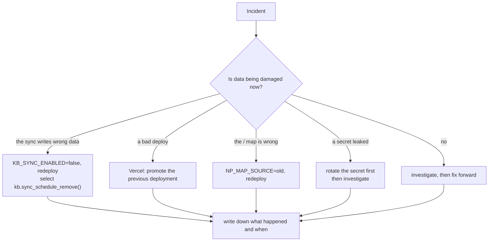

# Runbook: incidents, with exact steps and rollback

For each incident: how to recognise it, what to do, and how to undo what you
did. Commands that touch a database read `SUPABASE_DB_URL_SESSION` (the
session pooler, as the owner); set it in your shell for that command only,
and never paste the URL into a ticket or a chat. Production is the
production Supabase project (its ref is `db.PROD_PROJECT_REF` in
`pipeline/lib/db.py`, which the guarded tools refuse); anything marked **owner** needs the
production database owner login or the Vercel project's Production scope.

Before any step that writes to a shared database, take a backup
([backups-and-restore.md](backups-and-restore.md)).

What to look at first: [monitoring-and-troubleshooting.md](monitoring-and-troubleshooting.md).



## 1. The sync is failing

**Signs:** the admin banner; Settings → Sync shows `error`; cron calls
answer 401 or 500 in `net._http_response`; Data quality conflicts jump.

1. **Stop it** if it may be writing wrong data:
   - Vercel → the project → Settings → Environment Variables → set
     `KB_SYNC_ENABLED` to `false` for the environment, then redeploy
     (Deployments → the current one → Redeploy). Every run then returns
     `disabled`, cron and Sync now alike.
   - And/or, in the SQL editor as the owner: `select kb.sync_schedule_remove();`
     (no more calls at all).
2. **Inspect** the runs:
   ```sql
   select id, trigger, status, started_at, finished_at, conflicts, errors, message, counts
     from kb.sync_runs order by id desc limit 10;
   select status_code, created from net._http_response order by created desc limit 10;
   ```
   The Vercel function log for `/api/cron/kb-sync` has the traceback.
3. **Common causes:** secret mismatch (401: see section 3a); a mapping error
   after a change to `config/kb-projection-mapping.yaml` or
   `config/taxonomy.yaml` (the run fails at `load_config`); a run killed at 60
   s (stays `running`, cleared after 20 minutes: lower
   `KB_SYNC_BUDGET_SECONDS`).
4. **Re-run** once the cause is fixed: Settings → Sync → **Sync now**
   (admin), or from a laptop
   `SUPABASE_DB_URL_SESSION=<db> python pipeline/kb_import_projection.py apply --operator --report backups/sync-<date>.json`.
   A run resumes from the last good place (`kb.sync_runs.resume`).
5. **Conflicts** are not errors: the KB edit was kept. Review Data quality →
   Sync conflicts with the record's owner. There is no "take the source"
   button; a conflict clears itself when the source returns to what the sync
   last wrote.
6. **Undo the switch:** set `KB_SYNC_ENABLED=true` and redeploy; reinstall
   the schedule if you removed it:
   `select kb.sync_schedule_install('https://<host>/api/cron/kb-sync');`
   (the Vault secret must exist).

Wrong writes by the sync are attributed `actor_type = 'sync'` and can be found
in Activity (filter by actor) or `kb.audit_log` by time window; fix them by
hand or restore from a backup (owner decision).

## 2. Rolling back a migration

**Signs:** a migration broke something just after `migrate.py up`.

1. Backup first. Then see where the database is:
   ```bash
   SUPABASE_DB_URL_SESSION=<db> python pipeline/migrate.py status
   ```
2. Roll back the newest one, or down to a version (that version stays applied):
   ```bash
   SUPABASE_DB_URL_SESSION=<db> python pipeline/migrate.py down
   SUPABASE_DB_URL_SESSION=<db> python pipeline/migrate.py down --to 0031
   ```
   Each migration has a hand-written `.down.sql`; each runs in its own
   transaction and is recorded in `np_schema_migrations`.
3. **Refusals.** Several downs refuse while data depends on them, on purpose:

   | Down | Refuses while | Do first |
   |---|---|---|
   | 0037 | `kb.sync_exclusions` has rows | `pipeline/kb_legacy_delete.py restore <export>` |
   | 0030 | `kb.legacy_archive`, `kb.person_accounts`, owners by role or `is_legacy`, `kb.sync_map` or `kb.sync_runs` have rows | `pipeline/kb_legacy.py restore`, unlink people, and clear the sync state |
   | 0029 | unreviewed or merged relationship types, or saved graph positions | review the types; delete positions deliberately |
   | 0027, 0026 | custom fields, types, kinds or proposals that need them exist | remove them first |
   | 0022 | (no refusal) **drops the whole `kb` schema**: every KB record | only on a database you can lose |

   A refusal stops the command at that migration (`FAILED <version>`); the
   newer ones it had already rolled back stay rolled back, each in its own
   committed transaction. So once the first import has run, `down` below 0030
   is refused. Rolling the
   KB back past that point means restoring the backup taken before (owner).
4. **Undo the rollback:** `python pipeline/migrate.py up` (re-applies the
   pending migrations in order). `status` shows `CHANGED` if an applied
   migration file was edited since it ran; write a new migration instead.

## 3. Rotating a secret or a key

Vercel environment changes apply on the **next deployment**: redeploy after
each change (Deployments → Redeploy, or `vercel --prod` from `main`, owner).

### a. KB_SYNC_SECRET (Vercel and Vault together)

The cron job reads the Vault secret each time it fires; the app reads the
Vercel variable. They must be equal.

1. Generate a new value of 32+ characters:
   `python -c "import secrets; print(secrets.token_urlsafe(32))"`.
2. Vercel: `vercel env rm KB_SYNC_SECRET production`, then
   `vercel env add KB_SYNC_SECRET production` (it prompts for the value, so it
   is not in shell history). Do the same for Preview on the dev deployment.
   Redeploy.
3. Vault, in the SQL editor as the owner:
   `select vault.update_secret((select id from vault.secrets where name = 'kb_sync_secret'), '<new value>');`
4. Check: the next scheduled call answers 200
   (`select status_code, created from net._http_response order by created desc limit 3;`).
   Calls between steps 2 and 3 get 401 and do nothing; that is harmless.

### b. A personal MCP token (ikkb_)

- The owner of the token: Settings → API tokens → **Revoke**. It stops working
  at once. Create a new one and update the MCP client.
- Someone else's leaked token: the app lets a person revoke only their own.
  As the database owner:
  `update kb.api_tokens set revoked_at = now() where prefix = '<first 12 characters>' and revoked_at is null;`
  Then check what it did: `select at, table_name, action, row_id from kb.audit_log where actor_type = 'ai' and actor_id = '<user id>' order by id desc limit 50;`.

### c. The Google OAuth client

1. Google Cloud Console → APIs & Services → Credentials → the client: create a
   new client secret (or a new client).
2. Supabase → Authentication → Providers → Google: the client id and secret.
3. If the client **id** changed: `GOOGLE_OAUTH_CLIENT_ID` in Vercel
   (Production and Preview) and the client's authorised JavaScript origins;
   redeploy. Until both agree, sign-in fails with an `aud` error.

### d. Supabase keys and the database password

| Key | Rotate in | Then update | Effect |
|---|---|---|---|
| anon key | Supabase → Settings → API | `SUPABASE_ANON_KEY` in Vercel; redeploy | none for signed-in users once redeployed |
| JWT signing key (JWKS) | Supabase → JWT signing keys | nothing in Vercel; each instance refetches the keys within an hour | sessions signed with a revoked key end |
| legacy HS256 JWT secret | Supabase → JWT settings | `SUPABASE_JWT_SECRET` in Vercel; redeploy | **every session ends**; people sign in again |
| service-role key | Supabase → Settings → API | nothing: no deployed code uses it; make sure it is not in Vercel | none |
| database password | Supabase → Database settings | `SUPABASE_DB_URL_TRANSACTION` in Vercel (redeploy) and your local `SUPABASE_DB_URL_SESSION` | requests fail until redeployed |

The exact dashboard labels may differ from these; the variables are the ones
the code reads ([environment-variables.md](environment-variables.md)).

## 4. Rolling back the "/" map to the old tables

**Signs:** the NP Autopilot map at "/" shows wrong or missing data after
go-live.

1. Vercel → Environment Variables → add `NP_MAP_SOURCE` = `old` for
   Production; redeploy (owner).
2. "/" and its routes read the old tables again (`web/lib/data.py`);
   `/api/stats` answers 404 and the landing page falls back to the static
   `public/stats.json`. The map no longer follows KB edits. The KB at `/kb/` is
   unaffected.
3. **Undo:** remove `NP_MAP_SOURCE` (or set it to `kb`) and redeploy.

## 5. Restoring deleted or archived legacy records

- **The permanent deletion** (GO_LIVE step 6):
  ```bash
  SUPABASE_DB_URL_SESSION=<db> python pipeline/kb_legacy_delete.py restore backups/legacy_deleted_<db>_<YYYYmmdd_HHMMSS>.json
  ```
  On production add `NP_ALLOW_LEGACY_DELETE_ON_PRODUCTION=yes` to that one
  command: the production gate applies to `plan` and `restore` too. Every
  row comes back with the same ids; the sync exclusions and the Data quality
  flags it added are removed. Then run one sync and check it reports 0
  conflicts.
- **The reversible archive:**
  `SUPABASE_DB_URL_SESSION=<db> python pipeline/kb_legacy.py restore`. The
  sync stops re-archiving until `archive` is run again.

Details: [legacy-deletion-and-restore.md](../workflows/legacy-deletion-and-restore.md).

## 6. Rolling back a Vercel deployment (owner only)

1. Vercel → the project → Deployments → the previous Production deployment →
   **Promote to Production**. It is instant: no build.
2. Check `/api/config` (three non-empty values), `/kb/` and `/` load, and
   `GET /api/kb/me` without a session answers 401.
3. A promoted older deployment does not undo database migrations. If the
   rollback is because of a migration, see section 2; an older deployment may
   not understand a newer schema.
4. **Undo:** promote the newer deployment again.

The Vercel project sits under a shared team account; its audit log names the
account, not the person ([deployment.md](deployment.md)). Write down who did
it.

## 7. A leaked secret

1. **Rotate first, investigate second.** Use section 3 for the secret in
   question. For the session-pooler URL or the service-role key, rotate the
   database password or the key in Supabase: both bypass RLS.
2. **If it was committed:** rotating is the fix; rewriting git history is an
   owner decision and does not un-leak a pushed secret.
   `scripts/verify_all.sh` scans history for secret-shaped strings.
3. **Look for use:** the Vercel function logs (the audit line per request);
   `kb.audit_log` by `actor_id` and time; for MCP tokens,
   `kb.api_tokens.last_used_at`.
4. **If it was a person's account:** suspend the Google Workspace account
   (stops new sign-ins), and remove their profile so every request reads
   nothing from the next query on:
   `SUPABASE_DB_URL_SESSION=<db> python pipeline/grant_access.py revoke kbtest-person@interviewkickstart.com`
   (with their real address). Removing only the KB membership is not enough:
   a signed-in IK profile with no membership is still a viewer. Revoke their
   API tokens too (section 3b).
5. Write down what leaked, when it was rotated, and what you found.
