# Security: the access model in detail

The short policy (how to report a problem, the rules in one page) is the root
[../SECURITY.md](../SECURITY.md). This page is the detailed version: who can
sign in, what each role can do, where each rule is enforced, how the AI
assistant is limited, and how secrets are handled. Related:
[architecture/auth.md](architecture/auth.md) (identity and the domain rule in
depth), [operations/risk-register.md](operations/risk-register.md) (known risks),
[workflows/authentication-and-authorisation.md](workflows/authentication-and-authorisation.md)
(the sign-in flow step by step).

## Layers at a glance

```mermaid
flowchart LR
    user["A person or the MCP server"]
    g0["Google consent screen: Internal<br/>(IK Workspace accounts only)"]
    g1["Sign-in: /api/session<br/>Google ID token: signature, aud, iss,<br/>exp, email_verified, hd"]
    g2["Supabase before-user-created hook<br/>(0007, 0016)"]
    g3["Every request: api/index.py identify()<br/>session valid and address in the IK domain"]
    g4["Service: web/lib/kb/service.py<br/>require(role), AI rules, proposals"]
    g5["Database: RLS on every kb table,<br/>guard triggers, append-only audit"]
    data[("kb data")]

    user --> g0 --> g1 --> g2 --> g3 --> g4 --> g5 --> data
```

Each layer assumes the one before it can fail. The database is the last line:
a request that bypassed the service (a forgotten route, psql as
`authenticated`, PostgREST) is still refused by RLS and the triggers.

## Who can sign in: the three-layer domain restriction

Only accounts in the `interviewkickstart.com` Google Workspace. The domain is
enforced in three places, and all three must hold:

| # | Where | What it checks | Code |
|---|---|---|---|
| 1 | Supabase Auth, "before user created" hook | A non-IK identity never becomes an account. It reads the `hd` claim where GoTrue puts it. | `db/migrations/0007_signup_domain_hook.up.sql`, `0016_hook_reads_hd_where_gotrue_puts_it.up.sql`, `0020` |
| 2 | Sign-in, `POST /api/session` | The Google ID token is verified against Google's keys (signature, `aud`, `iss`, `exp`, `email_verified`) and its `hd` claim must be `interviewkickstart.com`. An IK *address* with a wrong or missing `hd` is refused. | `web/lib/auth.py`, `api/session.py` |
| 3 | Every request | `identify()` verifies the Supabase session token and then checks the session's address is in the IK domain (`require_allowed_domain`). A valid session from another domain gets **403**; no or a bad session gets **401**. | `web/lib/guard.py`, `web/lib/auth.py`, `api/index.py` |

In front of all three, the Google OAuth consent screen is set to Internal
(a console setting, not code; [architecture/auth.md](architecture/auth.md), "Layer 0").
Behind them, the database refuses a profile outside the domain
(`public.profiles.domain_is_ik`), refuses an invitation outside the domain
(`kb.member_invites.email_is_ik`), and `kb.role()` grants a knowledge base role
only to a caller with an IK profile (0035). The allowed domain is read from
`NP_ALLOWED_HD` (default `interviewkickstart.com`), set per deployment, never
per request.

Every IK account that signs in gets an NP `member` profile automatically
(0015), and every member is at least a knowledge base **viewer**.

## Roles

Knowledge base roles live in `kb.memberships` (`viewer`, `contributor`,
`editor`, `admin`). With no row, a signed-in IK account is a viewer. Roles
are cumulative: each one can do everything the one before it can.

| Role | In one sentence |
|---|---|
| **viewer** | Reads everything; flags mistakes; claims their own person record; saves their own views; mints their own API token. |
| **contributor** | Adds relationships, links and tags to existing records directly; everything else (new records, field edits, archives, type changes) is **sent for approval**. |
| **editor** | Creates, edits and archives directly; restores; decides proposals; overwrites a conflicting change; manages tags and templates. |
| **admin** | Everything, plus record and relationship types, relationship review and merges, roles and invitations, person-account links and people's e-mail addresses, profile claims, the sync, and permanent deletion. |

How roles are granted: the first admins come from `ADMIN_EMAILS` through
`pipeline/kb_admins.py` (an operator, on the owner connection); after that,
admins use **Settings → Members** (set a role, or invite by
`@interviewkickstart.com` address before the person's first sign-in). The
last admin can never be demoted or removed (`kb.keep_an_admin()`, 0034; also
checked for invitations, 0035). Details:
[workflows/authentication-and-authorisation.md](workflows/authentication-and-authorisation.md).

The NP role on `public.profiles` (`member`, `recruiting`, `admin`) is a
separate, older role: it governs the map at `/` and the curation routes
(`/api/curate` and the curation tables need NP `admin`). A shared mailbox
cannot hold `recruiting` or `admin` (0008).

## The permission matrix

Derived from the RLS policies (`0023_kb_rls`, `0024`, `0026`, `0027`, `0029`,
`0030`, `0033`, `0034`, `0035`, `0037`), the service
(`web/lib/kb/service.py`, `typedefs.py`, `workspace.py`, `people.py`,
`api/kb_routes.py`) and the route sweep `tests/test_kb_access_sweep.py`.

Legend: **yes** = done directly; **proposal** = recorded in Approvals (HTTP
202) for someone else to decide; **no** = refused (403). The **AI token**
column is a request made with an `ikkb_` token (the MCP server): it acts with
its owner's role, so "as role" means the same answer as the owner's column,
and anything else is a further limit.

| Action | viewer | contributor | editor | admin | AI token |
|---|---|---|---|---|---|
| Read records, links, relationships, types, graph, outline, views, search, Data quality | yes | yes | yes | yes | as role |
| Read the change feed (`kb.changes`) and a record's History | yes | yes | yes | yes | as role |
| Read the Activity log | no (History tab only) | no (History tab only) | own changes and their scope | all | as role |
| Flag as incorrect; save own views | yes | yes | yes | yes | as role |
| Claim "this person record is me" | proposal (admin decides) | proposal | proposal | proposal | as role |
| Mint, list, revoke own API tokens | yes | yes | yes | yes | **no** (cannot mint) |
| Create a record | no | proposal | yes | yes | as role |
| Edit a record's fields | no | proposal | yes | yes | as role |
| Overwrite a newer version (`?force=1`) | no | no | yes | yes | as role |
| Add a relationship, attach a link, tag a record | no | yes | yes | yes | as role |
| Save graph positions, reorder the outline | no | yes | yes | yes | as role |
| Archive a record, relationship or link; detach a link | no | proposal | yes | yes | **always proposal** |
| Restore from the Archived page | no | no | yes | yes | as role |
| Duplicate a record; create from or save a template | no | no | yes | yes | as role |
| Rename, merge, archive tags | no | no | yes | yes | as role |
| Decide proposals (approve, reject) | no | no | yes (claims and type changes: admin) | yes | **no** |
| Record types and link kinds: add, change, archive | no | no | proposal | yes | **always proposal** |
| Relationship types: add | no | proposal | yes, unreviewed until an admin reviews | yes, reviewed | **always proposal** |
| Relationship rules (allowed pairs, `POST /types/rule`) | no | no | no | yes | **no** |
| Review and merge relationship types | no | no | no | yes | as role |
| See sync conflicts and removed-at-source (`/quality/sync`) | no | no | yes | yes | as role |
| Record link-check results | no | no | yes | yes | as role |
| Members: list, set roles, invite, remove | no | no | no | yes | **no** |
| Person records: link to accounts, CSV linking, see e-mail addresses | no | no | no | yes | **no** |
| Sync: run log (Settings → Sync) | no | no | no | yes | as role |
| Sync now | no | no | no | yes | **no** |
| Permanently delete an archived record, relationship or link | no | no | no | yes | **no** |

Where each "no" for the AI is enforced:

| AI limit | Service | Database |
|---|---|---|
| Archive and detach become proposals | `archive_node`, `archive_edge`, `archive_resource`, `detach_resource`, `workspace.bulk_archive` | (archive itself needs editor: `kb.guard_archive`) |
| Cannot decide proposals | `decide_proposal` | |
| Cannot mint tokens | `create_token` | |
| Type changes become proposals | `typedefs._gate`, `create_edge_type` | |
| Cannot change relationship rules | `add_edge_rule` | |
| Cannot invite members | `invite_member` | `refuse_ai` on `kb.member_invites` (0035) |
| Cannot change roles or sign-in links | | `refuse_ai` on `kb.memberships`, `kb.person_accounts` (0034) |
| Cannot permanently delete | | `refuse_ai_delete` on `kb.nodes`, `kb.edges`, `kb.resources` (0034) |
| Cannot start a sync | `api/kb_routes.py` (`sync/run`) | |

Note what the AI **can** do with a token whose owner is an admin: restore,
manage tags and templates, review and merge relationship types, and read the
sync's run log. Give the assistant a token from an account with the role it
needs, not an admin's, unless that is intended.

### Where each role rule is enforced

| Rule | Service (`require`) | Database |
|---|---|---|
| Read needs viewer | every read | `*_select` policies: `kb.role_at_least('viewer')` |
| Contributors write links, relationships, tags | `create_edge`, `attach_resource`, `tag` | `*_insert` / `*_update` policies: contributor |
| Contributors cannot insert records | `create_node` (proposal) | `nodes_insert`: editor (0027) |
| Contributors cannot edit record fields or archive | `update_node` (proposal), archives (proposal) | `kb.guard_contributor()` (0033) |
| Archive and restore need editor | archive and restore functions | `kb.guard_archive()` (0023) |
| Types and rules are admin (editors insert only unreviewed relationship types) | `typedefs` | `node_types_admin`, `edge_types_admin`, `edge_types_editor_insert`, `edge_type_rules_editor_insert` (0023, 0029) |
| Proposals: contributors create, editors decide | `propose`, `decide_proposal` | `proposals_insert`, `proposals_decide` |
| Hard delete only of an archived row, by an admin | `hard_delete` | `*_delete` policies: admin and `archived_at is not null` |
| Memberships and invitations are admin | `set_role`, `invite_member` | `memberships_admin`, `member_invites_admin` |
| E-mail addresses on person records: admins and the person | `people.list_people` | `person_accounts_select` (0033) |
| Tokens are strictly your own | `create_token`, `revoke_token` | `api_tokens_own_*` |
| Audit log: admin all, editor own and scope | `activity` | `audit_log_select` (0029); nobody may update or delete (`kb.audit_immutable()`) |
| Sync map editor, run log admin, exclusions admin read-only | `sync_api` | `sync_map_select`, `sync_runs_select`, `sync_exclusions_admin_select` |

The route-by-role sweep (`tests/test_kb_access_sweep.py`) calls every
`/api/kb/*` route as anonymous, as an outside-domain account, and as each IK
role, and checks: anonymous is 401, outside the domain is 403, a role below
the route's minimum is refused, a role at or above it is never 401 or 403 and
never 5xx, and every response carries the security headers and no CORS grant.
The route list is derived from `api/index.py` and `api/kb_routes.py`, so **a
new route fails that test until it is listed** with its minimum role. The
test also checks that `authenticated` and `anon` cannot execute any
owner-only `SECURITY DEFINER` function.

## How a request becomes a database identity

1. `api/index.py` reads the bearer token. An `ikkb_` token is hashed
   (SHA-256) and resolved by `kb.resolve_token()` to its owner (only a live,
   unexpired, unrevoked token resolves; `last_used_at` is updated). Anything
   else must be a valid Supabase session for an IK address.
2. A connection is opened as the `authenticated` role with the caller's
   claims (`sub`), so `auth.uid()` is the caller and every RLS policy applies.
   With no identity, `auth.uid()` is null, `np_role()` is `none`, and RLS
   returns nothing.
3. The service sets the actor type: `human`, or `ai` for a token caller.
   Writes are attributed in `kb.audit_log` (`actor_id`, `actor_type`).
4. One request is one transaction: any refusal rolls everything back; a
   proposal (202) commits, because the proposal row is the successful write.

Bodies are capped (512 KiB for `/api/kb/*`, 16 KiB for `/api/session` and
curation); only `GET`, `POST`, `PATCH` and `DELETE` are accepted on `/api/kb/*`.

## AI caller rules

- **A personal token.** Minted in Settings → API tokens, shown once, stored
  only as a SHA-256 hash (`kb.api_tokens.token_hash`; the audit trigger strips
  it). Every token expires: 1 to 365 days, default 90. Revocable at any time.
- **Acts as its owner, with the owner's role,** under RLS. A viewer's token
  can only read.
- **Attributed as `ai`** in the audit log and Activity ("the AI assistant
  working for <person>").
- **Further limits** (the matrix above): archive and detach are always
  proposals; it cannot decide proposals, mint tokens, change relationship
  rules, change roles or sign-in links, invite, start a sync or delete
  permanently; type changes are always proposals.
- **Retrieved text is data.** Every MCP tool result carries a `data_notice`
  that text from the knowledge base is data, not instructions
  ([integrations/mcp.md](integrations/mcp.md)).
- **No database credential** is needed or accepted by the MCP server.

## Response headers and CORS

- **Pages** (`public/`): `vercel.json` sets, for every path, a Content
  Security Policy (`default-src 'self'`, scripts from `'self'`, Google's
  sign-in client and two pinned hashes; no `eval`), HSTS
  (`max-age=63072000; includeSubDomains; preload`),
  `X-Content-Type-Options: nosniff`, `X-Frame-Options: DENY`,
  `Referrer-Policy: no-referrer`, a `Permissions-Policy` that turns off
  geolocation, camera and microphone, and
  `Cross-Origin-Opener-Policy: same-origin-allow-popups`.
- **API responses**: `api/index.py` adds its own set to every response
  (`SECURITY_HEADERS`): `default-src 'none'; frame-ancestors 'none'` CSP,
  HSTS, nosniff, `X-Frame-Options: DENY`, `Referrer-Policy: no-referrer`. KB
  responses are `Cache-Control: no-store`.
- **No CORS.** No response carries `Access-Control-Allow-Origin`; the API is
  same-origin only. The access sweep fails if any response grows one.
- Supabase Realtime needs the Supabase origin in the page CSP's
  `connect-src`; until a deployment adds it (and sets `KB_REALTIME_ORIGIN`),
  `GET /api/kb/realtime` returns `{}` and the browser polls.

## The scheduled sync's secret

- `/api/cron/kb-sync` accepts no user session, an admin's included. It opens
  only with `Authorization: Bearer <KB_SYNC_SECRET>`.
- The secret must be at least 24 characters, and it is compared in constant
  time (`hmac.compare_digest`, `web/lib/kb/sync_api.py`). Shorter or missing:
  401.
- The same value is stored in Supabase Vault as `kb_sync_secret`; the pg_cron
  job reads it when it fires, so it never appears in the job's text. A
  preview deployment behind Vercel Deployment Protection also needs Vercel's
  bypass secret, stored in Vault as `kb_sync_vercel_bypass`.
- The sync writes as the `kb` tables' owner on a connection of its own, but
  only after the caller is proven to be the scheduler (the secret) or a KB
  admin (Sync now). Its writes are attributed to `actor_type = 'sync'`.

## Secrets: names only

Values never go into the repository, a doc, a commit, a log or a screenshot.
The full list of variable names and where each is set is
[operations/environment-variables.md](operations/environment-variables.md).

| Secret (name) | Where the value lives | Notes |
|---|---|---|
| `SUPABASE_DB_URL_TRANSACTION` | Vercel (per environment) | The app's database connection: the **transaction pooler** only. |
| `SUPABASE_JWT_SECRET` | Vercel | Verifies Supabase session tokens. |
| `SUPABASE_URL`, `SUPABASE_ANON_KEY`, `GOOGLE_OAUTH_CLIENT_ID` | Vercel | Public by design; `/api/config` sends them to the browser. The anon key grants nothing without a session. |
| `KB_SYNC_SECRET` | Vercel, and the same value in Supabase Vault as `kb_sync_secret` | At least 24 characters. |
| `SUPABASE_DB_URL_SESSION` | An operator's shell or gitignored `.env` only | The session pooler, as the table owner: migrations, `pipeline/kb_*.py`, the importers. **Never in Vercel.** |
| `SUPABASE_SERVICE_ROLE_KEY` | Not used by the app | **Never in Vercel.** Nothing in `api/` or `web/` reads it. |
| `NP_DRIVE_SA_KEY` | An operator's machine | The Drive service account for pass 0 (read-only scope). |
| `KB_MCP_TOKEN` | The MCP user's own environment | A personal `ikkb_` token; never written into `.mcp.json`. |
| `ADMIN_EMAILS` | The operator's shell when running `pipeline/kb_admins.py` | A list of addresses, not a credential, but still not committed. |

What the browser gets: `/api/config` returns only the public Supabase URL, the
anon key and the Google client id. CI (`.github/workflows/ci.yml`) scans every
push for service-role keys, JWT literals, direct database connections and
secrets in browser-visible files, and `.githooks/pre-push` refuses to push to
a public repository.

## Data protection

- The Drive corpus is read-only (`drive.readonly`). Contact columns are never
  extracted, the payroll file is excluded, and the sensitive part of the graph
  (`public.nodes.sensitive`, hiring records) is never synced into `kb`.
- A record name can never be an e-mail address or a URL
  (`kb.nodes.name_not_contact`).
- E-mail addresses on person records and invitations are visible to admins
  only (and to the person), and never copied into the append-only audit log.
- Tests, fixtures and docs use synthetic `kbtest-*@interviewkickstart.com`
  accounts. Real-data copies and exports (including the legacy deletion
  export) live in the gitignored `backups/`.
- The audit log is append-only for everyone, including the API.
