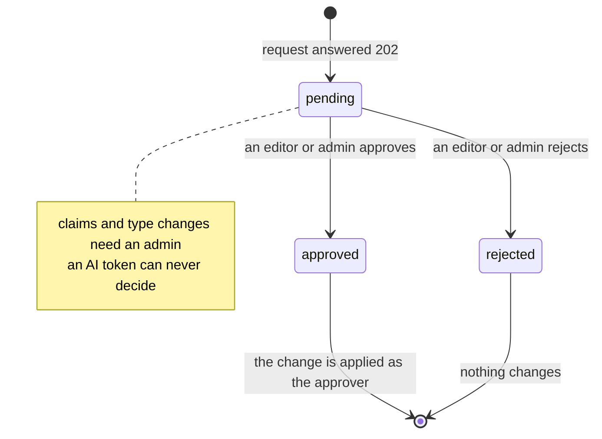

# Approvals: proposals, type reviews and profile claims

Some changes are not applied when they are asked for. They are recorded as a
row in `kb.proposals` and a person decides in **Approvals**
([`public/kb/js/views/approvals.js`](../../public/kb/js/views/approvals.js)).
The API answers such a request with **202 `approval_required`** and a
`proposal_id`; the request's transaction commits, because the proposal row is
the successful write.

## What becomes a proposal

| Who asks | Change | Result | Who decides |
|---|---|---|---|
| contributor | edit a record's fields (name, summary, body, status, owners, props, scope) | `update` proposal | editor or admin |
| contributor | create a record | `create` proposal (validated first, duplicate names refused) | editor or admin |
| contributor | archive a record, a relationship or a link, or detach a link | `archive` proposal | editor or admin |
| contributor | add a link or a relationship | **applied directly** | |
| AI token (any role) | archive or detach anything | `archive` proposal | editor or admin |
| AI token with a contributor role | create or edit a record | `create` / `update` proposal | editor or admin |
| editor (human) | change a record type, relationship type or link kind | `type_change` proposal | admin |
| editor (human) | create a new relationship type | **created at once, `unreviewed`**, plus an `edge_review` proposal | admin |
| contributor, or the AI at any role | create a relationship type | `type_change` proposal only | admin |
| any signed-in member, viewers included | "This is me" on a person record | `claim` proposal | admin |

Viewers cannot propose edits: `create_node`, `update_node` and archive start
with `require(conn, "contributor", ...)`, so a viewer gets 403. The only
proposal a viewer can make is a claim.



## Enforced in the database, not only in the service

Migration [0033](../../db/migrations/0033_kb_dataflow_people.up.sql) adds
`kb.guard_contributor()`, a `before update` trigger on `kb.nodes`,
`kb.edges`, `kb.resources` and `kb.node_resources`. For a request connection
(`current_user = 'authenticated'`) whose `kb.role()` is `contributor`, it
refuses any update of a record, and any archive or restore of a relationship
or link, with hint `kb_needs_approval`. So a contributor who calls the API in
some other way, or SQL with their own JWT, still cannot edit fields directly.
The service routes the same requests to proposals first, so the person sees
"sent for approval" instead of an error. Owner connections (the sync, the
import, operator scripts) are not affected.

Migration 0034 adds `kb.refuse_ai_admin()`: an AI caller can never write
memberships, person accounts or invitations, and can never delete a record,
relationship or link.

## Deciding

`POST /api/kb/proposals/<id>/approve` or `/reject`
(`service.decide_proposal`):

1. Requires the editor role; a `claim` requires admin. An AI token is refused
   ("a person decides in the app").
2. Locks the proposal row (`for update`). A proposal that is no longer
   `pending` returns 409 with the current row, so two editors cannot apply it
   twice.
3. On approve, applies the change **as the approver, as a human**:
   - `create`: runs `create_node` again in full with the stored payload;
   - `update`: applies the stored fields onto the record **as it is now**
     (with its current version, so a change made in between is not reverted
     field by field; only the proposed fields are written);
   - `archive`: archives the record, relationship, link or attachment;
   - `type_change`: `typedefs.apply_type_change` (an `edge_review` may carry
     a new `label`, `inverse_label` or `merge_into` chosen by the admin);
   - `claim`: `kb.apply_claim()` (below).
4. On reject of an `edge_review`: the new relationship type is archived, but
   only while no relationship uses it; otherwise the admin is asked to merge
   it into another type instead (409).
5. Marks the proposal `approved` or `rejected` with `decided_by` and
   `decided_at`. Every step is audited and appears in Activity.

`GET /api/kb/proposals?status=pending` (or `approved`, `rejected`, `all`)
lists them with a readable target label. The pending count is on the
dashboard (`pending_proposals`).

## Relationship-type review

An editor who needs a new relationship type (for example "mentors") gets it
at once: `typedefs.create_edge_type` inserts it with `review_status =
'unreviewed'` and its allowed source and target pairs, so the editor can use
it immediately. It also writes an `edge_review` proposal. An admin then
confirms it, renames it while confirming, or merges it into an existing type
(`POST /api/kb/types/edge/<key>/merge {into}` moves its relationships). A
near-duplicate name is refused up front with the existing type
(`similar_edge_type`). An admin's own new type is reviewed from the start.

## Profile claims

A person record (an instructor or a team member) can be linked to a sign-in
account (see [owner-linking.md](owner-linking.md)). When automatic linking is
ambiguous, or did not happen:

1. The person opens their record and chooses **This is me**
   (`detail.js`, `POST /api/kb/claims {node_id}`).
2. `kb.claim_person()` (0033, security definer) checks that the caller is a
   signed-in member, that the record is a live instructor or team member, that
   neither the record nor the caller's account is already linked, and records
   a `claim` proposal. The proposal stores the account id, **never an e-mail
   address** (proposals are audited). A second claim by the same person for
   the same record returns the existing one.
3. An admin approves it in Approvals. `kb.apply_claim()` reads the claimant's
   address from their profile and writes `kb.person_accounts` with
   `linked_by = 'claim'`. The person then owns what that record owns by role.

## AI calls

A tool call from the MCP server is an HTTP call with an `ikkb_` token; the
API marks it `actor_type = 'ai'` (see [mcp-and-claude.md](mcp-and-claude.md)).
The MCP tools `archive_node` and `archive_edge` therefore never execute: they
return `status: approval_required` and the proposal id. Proposals made by the
AI keep `actor_type = 'ai'`, so Approvals and Activity show that the
assistant asked.

## Files involved

`web/lib/kb/service.py` (`propose`, `propose_update`, `claim_person`,
`list_proposals`, `decide_proposal`, `create_node`, `update_node`,
`archive_*`, `detach_resource`), `web/lib/kb/typedefs.py` (`_gate`,
`create_edge_type`, `review_edge_type`, `reject_edge_review`,
`apply_type_change`), `web/lib/kb/workspace.py` (`bulk_update`,
`bulk_archive`), `api/kb_routes.py` (`/proposals`, `/claims`), migrations
0027, 0029, 0033, 0034, and `public/kb/js/views/approvals.js`.

## Failure modes

| Symptom | Cause |
|---|---|
| 202 "this change is already awaiting approval" | a pending proposal of the same action exists for that record |
| 409 "this proposal was already approved" | someone decided it first |
| 403 "deciding a profile claim needs the admin role" | an editor tried to approve a claim |
| 409 on rejecting a new relationship type | relationships already use it: merge instead |
| 404 "the record of this edit no longer exists" | the target was deleted after the proposal |
| claim refused: "already linked" | the record or your account has a link; an admin can change it in Settings → People |

## How to test it

```bash
.venv/Scripts/python -m pytest tests/test_kb_api.py tests/test_kb_people.py tests/test_kb_rls.py -q
.venv/Scripts/python -m pytest tests/test_kb_audit_run6.py tests/test_kb_mcp.py -q
```

`test_kb_rls.py` runs as `authenticated` with each synthetic user's claims and
no service at all, which is the "contributor calls the database directly" case.
