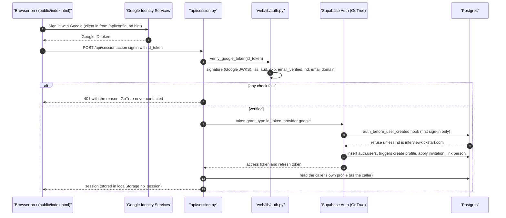
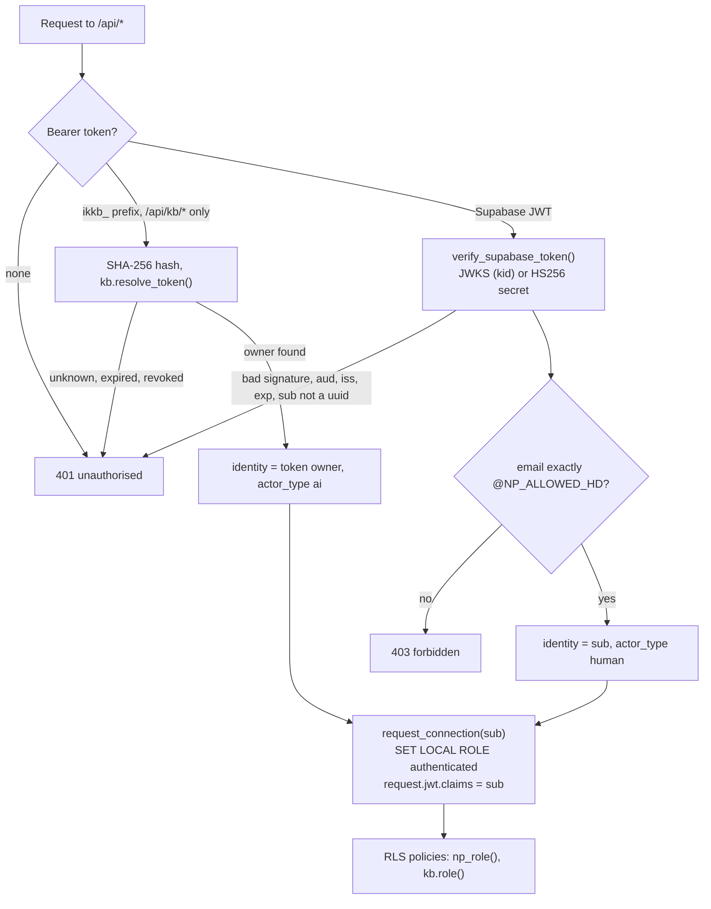

# Authentication and authorisation

Who can sign in, how a sign-in becomes a session, how every request is
checked, and how a person's role is decided. The design and its reasons are in
[docs/architecture/auth.md](../architecture/auth.md) and
[docs/security.md](../security.md); this page is the step-by-step flow.

Four layers, each of which would refuse a non-IK account on its own:

1. **Google `hd` check** in [`web/lib/auth.py`](../../web/lib/auth.py) at
   sign-in (`verify_google_token`).
2. **The "before user created" hook** in the database (migration 0007, fixed
   in 0016 and 0020): GoTrue refuses to create a user without the IK `hd`.
3. **A server-side domain check on every request** (`require_allowed_domain`,
   run 6): a valid session for any other address gets 403.
4. **Row-level security (RLS)** on every table: no identity, no rows.

## Sign-in



1. **`GET /api/config`** ([`api/config.py`](../../api/config.py)) returns the
   public values a browser needs: `SUPABASE_URL`, `SUPABASE_ANON_KEY`,
   `GOOGLE_OAUTH_CLIENT_ID` and `allowed_hd` (`NP_ALLOWED_HD`, default
   `interviewkickstart.com`). If one is missing, the response names it in
   `error`.
2. **The button.** The sign-in page at "/" renders Google Identity Services
   with `hd` set to the allowed domain. That parameter is only a hint the
   browser can change; it is not the check.
3. **`POST /api/session`** with `{"action": "signin", "id_token": ...}`
   ([`api/session.py`](../../api/session.py)). `verify_google_token()` checks,
   in this order: the signature against Google's published keys (cached for
   one hour), the issuer, the audience (`GOOGLE_OAUTH_CLIENT_ID`), expiry,
   `email_verified`, that `hd` is present and equals the allowed domain, and
   that the e-mail is in that domain. A consumer Google account that carries
   an IK-looking address fails on `hd`. A refusal returns 401 **before**
   GoTrue is contacted (`tests/test_login_flow.py::test_a_refused_signin_never_reaches_gotrue`).
4. **GoTrue.** [`web/lib/gotrue.py`](../../web/lib/gotrue.py) exchanges the
   Google token for a Supabase session (`grant_type=id_token`). GoTrue verifies
   the token again. On a first sign-in, creating the user calls
   `public.auth_before_user_created` (the hook must be wired in the Supabase
   dashboard: Authentication → Hooks; see
   [deployment.md](../operations/deployment.md)).
5. **What the first sign-in creates**, all by database triggers:
   - a `public.profiles` row with role `member` (migration 0015,
     `grant_member_on_signup`), only for an IK address;
   - a pending **invitation** applied as a KB membership (0035,
     `kb.apply_member_invite`), see "Roles" below;
   - a **person record link** by e-mail, else by an unambiguous name (0030 and
     0033), see [owner-linking.md](owner-linking.md).
6. **The session.** The browser stores the access and refresh tokens under
   `np_session` in local storage. The KB at `/kb/` uses the same entry. The
   access token is short-lived; `core.js` refreshes it with
   `{"action": "refresh"}` when a request gets 401. `{"action": "signout"}`
   revokes the refresh tokens; the current access token stays valid until it
   expires.

Shared mailboxes listed in `NP_SHARED_ACCOUNTS` are flagged in the audit log
(`shared_account: true`), because one account can be several people.

## Every request



- **`identify()`** ([`web/lib/guard.py`](../../web/lib/guard.py)) is called
  first, unconditionally, by every route in
  [`api/index.py`](../../api/index.py) before any module is loaded or any
  query runs.
- **`verify_supabase_token()`** checks a Supabase access token. If the token
  header has a `kid`, the key comes from the project's JWKS at
  `SUPABASE_URL/auth/v1/.well-known/jwks.json` (cached one hour) and the
  algorithm from that key, never from the token. Without a `kid` it uses the
  HS256 secret `SUPABASE_JWT_SECRET`, which is therefore **not needed when the
  project publishes JWKS** (ES256 or RS256 signing keys). It requires
  `aud = authenticated`, checks the issuer when `SUPABASE_URL` is set, and
  refuses a `sub` that is not a uuid (a Google token sent to a data route).
- **`require_allowed_domain()`** reads the e-mail from the verified token (not
  from `user_metadata`, which a user can edit) and refuses anything that is not
  exactly `<local>@<NP_ALLOWED_HD>`: `x@interviewkickstart.com.evil` and
  `x@notinterviewkickstart.com` both fail. 403, not 401: the token is genuine,
  the account is not one this application serves.
- **No token: 401. Non-IK session: 403.** The same holds for the "/" map
  routes and `/kb/` data (`tests/test_kb_access_sweep.py` calls every route as
  anonymous, non-IK, viewer, contributor, editor and admin).
- **The connection.** `web/lib/data.py` `request_connection()` sets
  `request.jwt.claims` to `{"role": "authenticated", "sub": <uuid>}` and the
  role `authenticated`, both transaction-local, on the transaction pooler.
  Nothing in `api/` or `web/lib/` connects as the owner or with the
  service-role key (`tests/test_login_flow.py::test_no_api_route_connects_as_owner_or_service_role`).
- One line per request is printed to the function log by `guard.audit()`:
  subject, e-mail, shared-account flag, endpoint, parameters, rows, ms. Tokens
  are never logged.

## Roles

Two role systems sit on top of the profile:

| Function | Source | Values | Used by |
|---|---|---|---|
| `np_role()` (0005) | `public.profiles.role` | `none` (no profile), `member`, `recruiting`, `admin` | the "/" map's old-table policies; `recruiting` and site `admin` are granted only by `pipeline/grant_access.py` |
| `kb.role()` (0023, tightened in 0035) | `kb.memberships.role` | `none`, `viewer`, `contributor`, `editor`, `admin` | every KB policy and `service.require()` |

`kb.role()` is `none` when `np_role()` is `none` (no IK profile). Otherwise it
is the caller's live membership role, and **no membership means `viewer`**:
every signed-in IK colleague can read the KB without being added. What each
role can do is listed in Settings → Members (`service.ROLE_HELP`).

**Granting KB roles:**

- **The first admin** on a new database: the person signs in once, then an
  operator runs `ADMIN_EMAILS=kbtest-admin@interviewkickstart.com python pipeline/kb_admins.py`
  with `SUPABASE_DB_URL_SESSION` set (add `--dry-run` to check first). It
  matches the profile e-mail and never invents a profile; it refuses a shared
  account.
- **Everyone else**, by an admin in Settings → Members (`POST
  /api/kb/members/<user_id>`, or `.../remove`).
- **Before their first sign-in** (migration 0035): Settings → Members → add by
  e-mail (`POST /api/kb/members/invite {email, role}`). The address must be
  `@interviewkickstart.com` (checked by the service and by a CHECK
  constraint). If the person has already signed in, the role is applied at
  once; otherwise the `profiles` trigger applies it on their first sign-in. A
  role already set another way is kept. The address never enters the
  append-only audit log. Invitations can be changed or withdrawn until used.
- **The last admin** can never be removed or demoted (0034
  `kb.keep_an_admin`, also enforced for invitations).
- An AI token can never change roles or sign-in links (0034
  `kb.refuse_ai_admin`).

## Local-only sign-in (eval servers)

`/local-login` is a password sign-in page served only by the local servers in
[`eval/`](../../eval/): [`eval/kb_demo_server.py`](../../eval/kb_demo_server.py)
(port 8765, demo users made by `eval/kb_demo_seed.py`, local GoTrue password
grant) and [`eval/kb_realdata_server.py`](../../eval/kb_realdata_server.py)
(port 8766, one local admin). They bind 127.0.0.1, refuse a non-loopback
database or auth URL, and rewrite the "Sign in" link in memory. `eval/` is in
`.vercelignore` and in `vercel.json`'s `excludeFiles`, so it is never deployed:
a deployment answers `GET /local-login` with 404 (a smoke test in
[dev-deploy.md](../operations/dev-deploy.md) and
[GO_LIVE.md](../operations/GO_LIVE.md)). The tokens those servers issue are
still verified by `web/lib/auth.py`, and RLS applies as usual. Details:
[local-demo.md](../operations/local-demo.md).

## Failure modes

| Symptom | Cause | Check |
|---|---|---|
| Sign-in button missing | `GOOGLE_OAUTH_CLIENT_ID` unset, or the CSP blocks Google's script | `/api/config` `error`; browser console |
| 401 "token has no hd claim" at sign-in | a personal Google account | expected |
| 401 "aud" at sign-in | the Google client id in Vercel differs from the one that issued the token | Vercel `GOOGLE_OAUTH_CLIENT_ID` and the Supabase Google provider use the same client |
| 4xx `auth_refused` from `/api/session` | GoTrue or the hook refused | message text; the hook's refusals |
| 403 on every route | the session's e-mail is not in the IK domain | expected for non-IK |
| Repeated 401, then signed out | refresh token revoked or expired, or JWKS / `SUPABASE_URL` misconfigured | [monitoring-and-troubleshooting.md](../operations/monitoring-and-troubleshooting.md) |
| Signed in, KB shows viewer | no membership yet | an admin grants a role, or an invitation exists for the exact address |

## How to test it

```bash
.venv/Scripts/python -m pytest tests/test_auth_google.py tests/test_login_flow.py -q   # no database needed
.venv/Scripts/python -m pytest tests/test_auth_hook_reads_hd.py tests/test_kb_rls.py tests/test_kb_access_sweep.py tests/test_kb_members_run6.py -q   # local stack
```

`test_auth_google.py` signs tokens with a local RSA key and serves a local
JWKS, so every rejection (signature, issuer, audience, expiry, unverified
e-mail, missing or wrong `hd`, IK e-mail with a wrong `hd`) is tested without
network access.
