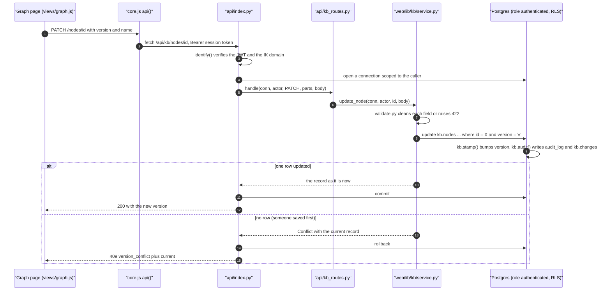
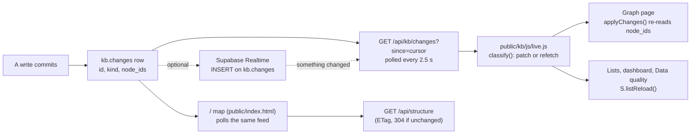

# CRUD and change propagation

How one edit in the knowledge base (KB) gets from a click to the database, and
from there onto every open page without a reload. The example is renaming a
module on the Graph page, but every write follows the same path: a record, a
relationship, a link, a tag, a type, an owner, an import or a sync run.

Related: [the HTTP API](../integrations/http-api.md),
[contracts](../architecture/contracts.md) (§1 the graph read, §2 the
live-update policy), [the schema](../architecture/schema.md),
[approvals](approvals.md) (what happens when the editor is a contributor).

## The path of one write



### Step by step

1. **The UI.** On the Graph page, renaming a node calls `saveName()` in
   [`public/kb/js/views/graph.js`](../../public/kb/js/views/graph.js). It
   changes the label on screen first (optimistic), then sends
   `PATCH /nodes/<id>` with `{version, name}`. The record panel does the same
   in [`detail.js`](../../public/kb/js/detail.js) (`saveNode`), and forms in
   [`form.js`](../../public/kb/js/form.js).
2. **The client.** Every KB request goes through `api()` in
   [`public/kb/js/core.js`](../../public/kb/js/core.js) (there is no separate
   `api.js`). It adds `Authorization: Bearer <access token>` from the session
   in local storage (`np_session`), prefixes `/api/kb`, and turns any status
   of 400 or more, and 202, into an `ApiError` the caller handles. On a 401 it
   refreshes the session once (`POST /api/session` with `action: refresh`) and
   retries; if that fails, it signs the user out.
3. **The front door.** [`api/index.py`](../../api/index.py) is the only WSGI
   entry point. For `/api/kb/*` it runs `_serve_kb()`: it identifies the
   caller first (a Supabase session through
   [`web/lib/guard.py`](../../web/lib/guard.py) `identify()`, or a personal
   `ikkb_` token, see [mcp-and-claude.md](mcp-and-claude.md)), caps the body at
   512 KB, and opens a connection with `data.request_connection(subject)`. That
   connection runs as the Postgres role `authenticated` with the caller's JWT
   claims set transaction-locally, so row-level security (RLS) applies to
   every statement. See
   [authentication-and-authorisation.md](authentication-and-authorisation.md).
4. **The router.** [`api/kb_routes.py`](../../api/kb_routes.py) `handle()`
   maps method and path to one service function. It has no SQL and no
   permission logic. It calls `svc.begin()` first, which stores the actor type
   (`human` or `ai`) in the `kb.actor_type` setting so the audit trigger can
   read it.
5. **The service.** [`web/lib/kb/service.py`](../../web/lib/kb/service.py) is
   the single place for KB business rules. `update_node()`:
   - checks the role (`require(conn, "contributor", ...)`), which only fails
     fast with a sentence; RLS is the real enforcement;
   - rejects unknown fields (`validate.only`) and a missing `version`;
   - cleans each field with [`web/lib/kb/validate.py`](../../web/lib/kb/validate.py)
     (`name`, `text`, `uid`, `choice`, `props`), and custom fields with
     `validate_props`;
   - for a contributor, records the edit as a proposal instead and returns
     202 (see [approvals.md](approvals.md));
   - refuses a duplicate name in the same scope (409 `duplicate`, with
     `existing`);
   - runs `update kb.nodes set ... where id = %s and version = %s`.
6. **The database.** On `kb.nodes` (and every audited KB table):
   - `kb.stamp()` (migration 0022) sets `updated_by` and `updated_at` and
     bumps `version` by one. A caller can never set the version itself.
   - `kb.audit()` (0022, rewritten in 0032 and 0035) writes one row to
     `kb.audit_log` (before and after, minus token hashes, invitation e-mail
     addresses and the search column) and one row with the same id to
     `kb.changes`. The `kb.changes` row carries no content: table, row id,
     action, version, actor, and since 0032 a **`kind`** (for example
     `record.update`, `record.owner`, `relationship.archive`, `link.attach`,
     `tag.detach`, `reltype.update`) and **`node_ids`**, the records the change
     touches (both ends of a relationship).
   - Tables that are not audited still emit a change event (0032,
     `kb.change_only()`): graph positions (`layout.update`), person accounts
     (`owner.account`, no e-mail address) and finished sync runs (`sync.run`).
7. **Commit.** `_serve_kb()` commits only when the handler returns normally.
   Any `KbError` rolls the whole request back, so a create that also makes
   parents, relationships and links is atomic. The one exception is 202: the
   proposal row is the successful write, so it commits.

## Status codes a write can return

| Status | `error` | When | What the body carries |
|---|---|---|---|
| 200 / 201 | none | saved | the record as stored, with its new `version` |
| 202 | `approval_required` | the change became a proposal (contributor, AI archive) | `message`, `proposal_id` |
| 401 | `unauthorised` | no or invalid session or token | `reason` |
| 403 | `forbidden` / `permission_denied` | non-IK account (`forbidden`); role too low or refused by RLS or a trigger (`permission_denied`) | `reason` or `message`, `required_role`, `role` |
| 404 | `not_found` | no such record or route | `message` |
| 409 | `version_conflict` | someone saved first | **`current`** (the record now), `your_version` |
| 409 | `duplicate` | same name in scope, same URL, same relationship | **`existing`** |
| 413 | `too_large` | body over 512 KB | |
| 422 | `validation_error` | a field failed a rule | `message`, **`field`** (for example `name`, `version`, `props.venue`, `edges.2`) |
| 500 | `internal` | an unexpected error; the text is never returned | nothing (the traceback is in the function log) |

Error classes are in [`web/lib/kb/errors.py`](../../web/lib/kb/errors.py).
Database refusals are translated by `service._translate`: a CHECK or NOT NULL
violation becomes 422, and a hint such as `kb_field_value:<key>` becomes
`field: props.<key>`; a unique violation becomes 409 `duplicate`; an
insufficient-privilege error (RLS or a guard trigger) becomes 403.

## Optimistic concurrency

Every record, relationship, link, type and tag has a `version` column. A
write must send the version it loaded. If the row moved on, the conditional
`update ... where version = V` touches nothing and the service raises
`Conflict` with the record as it is now. The Graph page then opens "This
record changed since you opened it", showing your value next to the saved one
with **Use their version** and, for editors and admins, **Overwrite with
mine**. Overwrite re-sends with `?force=1`, which the service allows only from
the editor role up (`update_node(..., force=True)` drops the version
condition).

Nothing is ever merged silently. `tests/test_kb_concurrency.py` runs two
sessions on the same version and checks that exactly one wins and the other
gets 409 with the winner's record.

## How the change reaches every open page



- **The feed.** `GET /api/kb/changes` without `since` returns the current
  cursor (the newest id). With `since=<id>` it returns up to 500 later rows in
  id order and the new cursor (`activity.changes`). RLS on `kb.changes` lets
  every viewer read it; token and membership changes are visible only to
  admins and to the person who made them.
- **Polling.** [`public/kb/js/live.js`](../../public/kb/js/live.js) polls every
  **2.5 s** while the tab is visible, 15 s while it is hidden, backs off up to
  60 s after failures, and slows to 20 s while a Realtime socket is up.
- **Realtime (optional).** When `GET /api/kb/realtime` returns a configuration
  (only if `KB_REALTIME_ORIGIN` is set and equals `SUPABASE_URL`, see
  [environment-variables.md](../operations/environment-variables.md)),
  [`realtime.js`](../../public/kb/js/realtime.js) joins a Supabase Realtime
  channel on inserts into `kb.changes`. The socket only says that something
  changed; the page still fetches the rows through the API, under RLS. If the
  socket drops, polling resumes on its own.
- **The policy** (contracts §2). `classify()` looks at each change's `kind`:
  `record.`, `relationship.`, `link.`, `layout.` and `owner.` changes are
  patched by their `node_ids`; `type.`, `reltype.`, `tag.` and `sync.` changes,
  or 200 or more changes at once, mean refetch. A page waits while the person
  is typing or a dialog is open, then applies the pending changes.
- **The Graph page** subscribes with `onLiveChange()` and also polls the feed
  from its own `head`, then re-reads only the records named in `node_ids`.
- **The "/" map** ([`public/index.html`](../../public/index.html), the
  `LIVE` block) has no supabase-js. It polls `/api/kb/changes` every 2.5 s the
  same way and, on a relevant change, refetches `/api/structure` (one
  compressed response, 304 when nothing it shows changed). Positions, the open
  panel and the camera stay where they are. With `NP_MAP_SOURCE=old` the map
  reads the old tables and does not follow the KB (see [runbook](../operations/runbook.md)).

A change made anywhere shows on other pages within about 5 s without Realtime.

## Files involved

| Layer | Files |
|---|---|
| Browser | `public/kb/js/core.js` (`api()`), `live.js`, `realtime.js`, `detail.js`, `form.js`, `views/graph.js`; `public/index.html` (the "/" map) |
| HTTP | `api/index.py` (`_serve_kb`), `api/kb_routes.py` |
| Rules | `web/lib/kb/service.py`, `validate.py`, `errors.py`, `typedefs.py`, `workspace.py`, `activity.py` (`changes`) |
| Database | `db/migrations/0022_kb_schema.up.sql` (stamp, audit), `0023_kb_rls.up.sql` (RLS), `0029_kb_activity_relationships.up.sql` (`kb.changes`), `0032_kb_contracts.up.sql` (`kind`, `node_ids`, change-only events), `0033` (contributor guard), `0035` (audit without addresses) |

## Failure modes

| Symptom | Cause | What to do |
|---|---|---|
| "This record changed since you opened it" | 409: a newer version exists | Choose a version; editors may overwrite. Expected behaviour. |
| A red field message after Save | 422 with `field` | Fix that field. Names may not contain `@` or a URL (`validate.name_problem`). |
| "Sent for approval" instead of saved | 202: you are a contributor (field edits, new records, archives) | An editor decides in Approvals. |
| Saved, but another page does not update | that page is not polling: hidden tab (15 s), backoff after errors, or a dialog open | See [monitoring-and-troubleshooting.md](../operations/monitoring-and-troubleshooting.md), "Live updates not arriving". |
| 403 on a write you expected to work | your role, RLS, or a guard trigger (`kb_needs_approval`, `kb_ai_refused`, `kb_last_admin`) | Check your role in Settings → Members. |
| 500 `internal` | an unexpected exception | Read the Vercel function log; the traceback is printed to stderr. |

## How to test it

All of these need the local Supabase stack (`db/local/setup.sh`, see
[testing.md](../operations/testing.md)). Running the KB tests wipes KB data.

```bash
.venv/Scripts/python -m pytest tests/test_kb_concurrency.py -q        # 409 with the current record
.venv/Scripts/python -m pytest tests/test_kb_one_validation.py -q     # the same 422 from the API and the sync
.venv/Scripts/python -m pytest tests/test_kb_propagation.py -q        # every write path lands in the feed with kind and node_ids
.venv/Scripts/python -m pytest tests/test_kb_propagation_e2e.py -q -s # the browser matrix (one browser file at a time on 16 GB)
```

`tests/test_kb_propagation_e2e.py` is the acceptance test. One headless
browser opens two pages as a viewer: the KB Graph page on a course and the
"/" map. An admin then performs **26 operations** through the API: record
create, rename, archive, restore and permanent delete; relationship create,
update, archive and delete; custom relationship type create, rename, merge
and archive; a record type change; tag attach, rename and detach; owner by
account and by role; bulk edit; a moved graph position; link attach and
detach; a template instantiated into the course; a Sheets import; a sync run;
and a person account link. For each it measures how long each page takes to
show the change without a reload, over polling (no Realtime), and fails above
5 seconds. The table is written to `kb_change_matrix.md` in the system temp
folder (the path is printed with `-s`), never into the repository.
