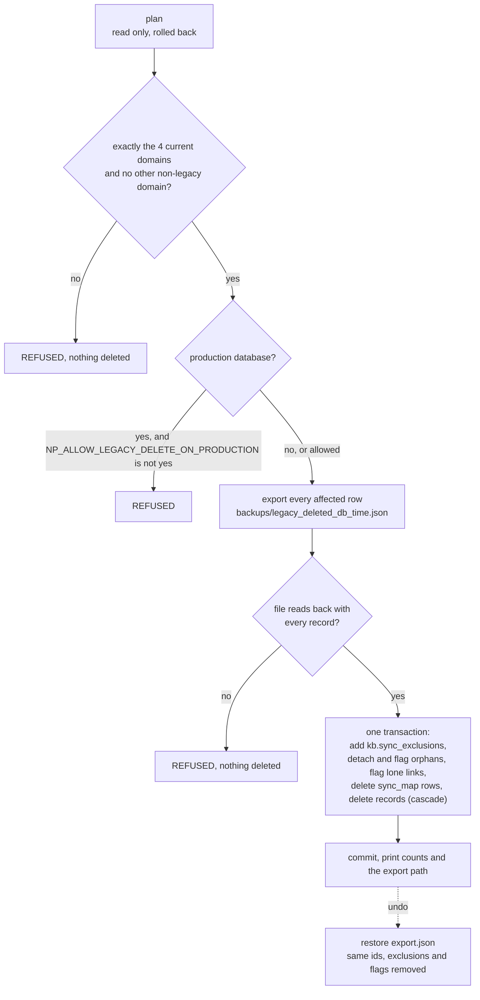

# Legacy records: the reversible archive, the permanent deletion, and restore

NP Autopilot's older sheets left records that are no longer current: legacy
domains, modules, instructors and programmes (`kb.nodes.is_legacy`, set by the
sync from NP Autopilot's own rules). There are two separate tools for them.

| | The legacy step (archive) | The legacy deletion |
|---|---|---|
| Command | [`pipeline/kb_legacy.py`](../../pipeline/kb_legacy.py) | [`pipeline/kb_legacy_delete.py`](../../pipeline/kb_legacy_delete.py) |
| Rules | [`web/lib/kb/legacy.py`](../../web/lib/kb/legacy.py) | [`web/lib/kb/legacy_delete.py`](../../web/lib/kb/legacy_delete.py) |
| Effect | archives (sets `archived_at`); nothing is deleted | **deletes** legacy domains and legacy modules permanently |
| Undo | `kb_legacy.py restore` | `kb_legacy_delete.py restore <export.json>` |
| Re-applied by the sync | yes, on every run once adopted | the sync never re-creates what was deleted (`kb.sync_exclusions`) |
| Production | allowed | refused unless `NP_ALLOW_LEGACY_DELETE_ON_PRODUCTION=yes` |

All commands connect with `SUPABASE_DB_URL_SESSION` (the session pooler, as
the kb tables' owner) and print counts and ids only.

## The reversible archive (pipeline/kb_legacy.py)

```bash
SUPABASE_DB_URL_SESSION=<db> python pipeline/kb_legacy.py plan      # what would be archived, no change
SUPABASE_DB_URL_SESSION=<db> python pipeline/kb_legacy.py archive   # archive (re-runnable)
SUPABASE_DB_URL_SESSION=<db> python pipeline/kb_legacy.py restore   # put back everything it archived
```

Rules (`legacy.py`): every legacy domain is archived, except one a current item
is connected to (today: current instructors' declared expertise); a legacy
module or instructor is archived when all its domains are legacy and it is
connected to no current item. Archiving goes through `kb.nodes`, so the
cascade trigger archives the record's relationships and links and the restore
brings back exactly those. What was archived is recorded in
`kb.legacy_archive`. While that table has rows, the sync re-applies the rules
at the end of every run; after `restore` (which empties it) the sync stops
doing so until `archive` is run again. Writes are attributed to Sync.

## The permanent deletion (pipeline/kb_legacy_delete.py)

Owner-approved in run 6 (R3). It removes **every domain that is not one of the
four current ones** (Full Stack, Backend, Frontend, Test Engineering) and
**every legacy module**. Legacy instructors, topics, sessions and programmes
stay.



### Commands

```bash
SUPABASE_DB_URL_SESSION=<db> python pipeline/kb_legacy_delete.py plan
SUPABASE_DB_URL_SESSION=<db> python pipeline/kb_legacy_delete.py delete
SUPABASE_DB_URL_SESSION=<db> python pipeline/kb_legacy_delete.py restore backups/legacy_deleted_<db>_<YYYYmmdd_HHMMSS>.json
```

On the DEV project, [`scripts/dev_db.py`](../../scripts/dev_db.py) wraps the
first two (it refuses production and never prints a URL or host):

```bash
python scripts/dev_db.py legacy-plan
python scripts/dev_db.py legacy-delete
```

### What each step does

1. **`plan`** (`legacy_delete.plan`). Finds the domains. Refuses unless exactly
   four non-legacy domains match the owner's list by name and no other domain
   is non-legacy. Lists the domains to delete, the legacy modules, the
   records that sit inside one of them (`orphans`: they will be detached, not
   deleted), the links attached only to deleted records (`lone_links`), and
   the number of expertise links (`sme`) to deleted domains. Prints
   `current_domains_kept`, `domains`, `modules`, `detached_and_flagged`,
   `links_flagged`, `expertise_links`. Changes nothing (rolled back).
2. **The production gate.** If the URL's host or user names the production
   project ref, the command stops unless
   `NP_ALLOW_LEGACY_DELETE_ON_PRODUCTION=yes` is set for that one command.
   Never put it in a shell profile or an env file.
3. **`delete`, export first.** `legacy_delete.export` copies every affected
   row to JSON: the records, and every row that the database's cascades would
   remove with them (relationships from either end, attachments, tags, saved
   positions, legacy-archive rows, person accounts), the orphans' scopes and
   the sync-map rows. It is written to
   `backups/legacy_deleted_<db>_<YYYYmmdd_HHMMSS>.json`, where `<db>` is the
   local database name, or `supabase` for any Supabase host (never the host
   itself). `backups/` is gitignored: the file holds real data.
4. **Read back.** The file is read back from disk; if it does not hold every
   record to be deleted, the command stops and deletes nothing.
5. **Delete, in one transaction** (`legacy_delete.delete`, attributed to
   `system`):
   - adds `kb.sync_exclusions`: the rule `np_legacy_domains_modules` and one
     `record` row per deleted source id, so the sync never re-creates them;
   - detaches the orphans (`scope_id = null`), refreshes their sync checksum
     so the next sync sees no false conflict, and flags them and the lone
     links on Data quality ("Its parent was permanently deleted ...");
   - deletes the sync-map rows, then the records; the cascades remove their
     relationships, attachments and the rest.
   It commits only if every step succeeds, then prints the counts and the
   export path.
6. **`restore <export.json>`** (`legacy_delete.restore`). Refuses a file that
   is not a legacy-delete export. Inserts every exported row back with the
   same ids, containers before what sits in them, then restores the orphans'
   scopes, removes the flags it added, and **empties `kb.sync_exclusions`**.
   Rows that already exist are skipped (`on conflict do nothing`).

### The numbers

On the local real-data copy and on DEV (run 6, 2026-11-04):

| | Count |
|---|---|
| Records deleted | **946** = 42 domains + 904 modules |
| Relationships removed with them | 3,844 |
| Of those, expertise links to deleted domains | 1,133 (the instructors are kept) |
| Attachments (links on records) removed with them | 1,040 |
| Records left without a parent | 0 |
| Domains / modules live after | 4 / 20 |
| A sync afterwards | 0 created, 0 conflicts |

Delete took 15 s on DEV over a ~175 ms link. Delete then restore on a clone
brought every table's count back exactly. On production this is step 6 of
[GO_LIVE.md](../operations/GO_LIVE.md), the point of no return.

## Failure modes

| Message | Meaning |
|---|---|
| `REFUSED: expected exactly the 4 current domains ...` | the data does not look like the owner's list; stop and investigate |
| `REFUSED: N non-legacy domain(s) outside the owner's list` | a domain is current but not on the list |
| `REFUSED: this is production; see docs/operations/GO_LIVE.md` | the production gate |
| `REFUSED: the export does not hold every record; nothing deleted` | the file did not read back complete (disk, permissions) |
| `REFUSED: not a legacy-delete export` | wrong file given to `restore` |
| `0037 down: kb.sync_exclusions is in use` | rolling back migration 0037 needs `restore` first |
| `0030 down: records are archived by the legacy step` | rolling back 0030 needs `kb_legacy.py restore` first |

## How to test it

```bash
.venv/Scripts/python -m pytest tests/test_kb_legacy_delete.py -q
.venv/Scripts/python -m pytest tests/test_kb_sync.py -q -k legacy
```

The tests use a synthetic source (`kbsync_src`), never real data: the delete
removes legacy domains and modules and nothing else, the sync never re-creates
them and sees no conflict, restore puts every row back with the same ids, the
plan refuses when the current domains are not the owner's list, and the CLI
refuses production.
