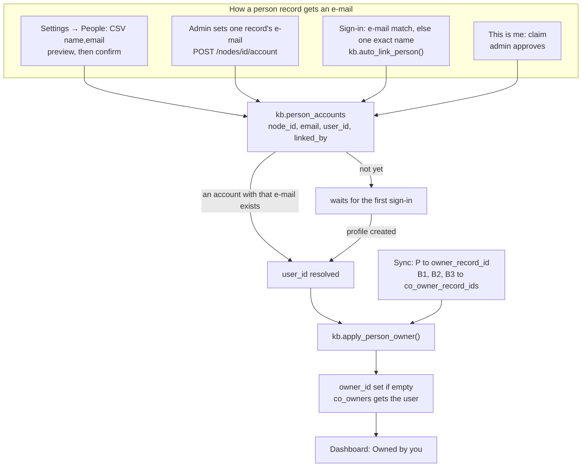

# Owner linking: people records and sign-in accounts

A record in the knowledge base (KB) can have two kinds of owner:

- **Account owners**: `kb.nodes.owner_id` and `co_owners`, the uuids of
  people who sign in. These are what "Owned by you" and the permissions of
  owners use.
- **Owners by role**: `owner_record_id` and `co_owner_record_ids` (migration
  0030), which point at **person records** (records of type `instructor` or
  `team_member`). The sync fills them from NP Autopilot's roles.

A person record becomes an account through **`kb.person_accounts`**: one row
per person record with an e-mail address, resolved to a user id when an
account with that address exists. Once linked, the person gets the account
ownership of everything their record owns by role.



## Owners from roles

The sync ([sync.md](sync.md)) reads NP Autopilot's teaching relationships
from the **current mastersheet only** (`tier = 'mastersheet'`,
`instructor_role`):

| Mastersheet role | KB field |
|---|---|
| P (`primary`) | `owner_record_id` (the first primary) |
| B1, B2, B3 (`backup_1` .. `backup_3`) | `co_owner_record_ids`, in that order |

A domain's owner and co-owners come from the source's owner and co-owner
links. The older sheets' `role` is kept separately on the relationship
(`older_role`) and never mixed in. If someone changed a record's owners by
role in the app, the sync leaves them and reports a conflict
(`conflicts.owners`).

A record's owners by role must be live person records
(`service._require_person_records`, 422 otherwise).

## Linking a person record to an account

All writes to `kb.person_accounts` are admin-only (RLS and
`service.require(conn, "admin", ...)`), except sign-in and approved claims,
which run through security-definer functions. An AI token can never write
them (0034).

1. **CSV upload** (Settings → People,
   [`views/people.js`](../../public/kb/js/views/people.js),
   [`web/lib/kb/people.py`](../../web/lib/kb/people.py)). Paste or upload
   `name,email` (header optional, at most 2,000 rows).
   - `POST /api/kb/person-records/preview {csv}` **writes nothing**. Each row
     gets a status: `exact` (same name), `normalised` (same name ignoring case
     and spacing, and ignoring the " (2)" the import adds to keep same-name
     records apart), `suggested` (near matches, ratio 0.82, the admin picks),
     `ambiguous` (two or more records carry that name: never picked for the
     admin), `none`, or `invalid`. It also warns when confirming would replace
     an address (`current_email`) or when the address is already on another
     record (`email_taken_by`).
   - `POST /api/kb/person-records/link {links: [{node_id, email}]}` writes
     only the rows the admin confirmed (`linked_by = 'csv'`) and returns how
     many are linked now and how many wait for a first sign-in.
2. **One record**: an admin sets or clears a record's e-mail
   (`POST /api/kb/nodes/<id>/account {email}`, or DELETE to unlink;
   `service.set_person_account`).
3. **At sign-in** (0030, 0033). When a profile row is created or its e-mail
   changes, `kb.profile_links_person()` resolves any `person_accounts` row
   with that address (`linked_by = 'sign_in_email'`), then runs
   `kb.auto_link_person()`: if no row has the address, and **exactly one**
   unlinked live person record carries the account's name (from the Google
   profile name, else the e-mail's local part), it links that record
   (`sign_in_name`). Two records with the same name are never linked
   automatically.
4. **On each visit**: the dashboard calls `POST /api/kb/my/link` once per
   session (`people.link_me` → `kb.link_me()`), which runs the same automatic
   step for the caller only. The answer is `email`, `name`, `already`,
   `none`, or `ambiguous` with the candidate records ("Is this you?").
5. **Claims**: "This is me" on a person record becomes a proposal an admin
   approves (`linked_by = 'claim'`); see [approvals.md](approvals.md).

`kb.person_accounts_resolve()` lowercases the address and fills `user_id`
when a profile with that address exists; `kb.person_accounts_apply()` then
calls `kb.apply_person_owner(node_id)`, which:

- sets `owner_id` to the person on every live record whose `owner_record_id`
  is this person **and whose `owner_id` is empty**;
- adds the person to `co_owners` on every live record that lists this person
  in `co_owner_record_ids`.

It is additive: an owner set by hand in the KB is never replaced.

## Privacy

E-mail addresses are personal data. They are visible to admins only, and to
the person themself (0033 policy `person_accounts_select`). They are never
copied into the append-only audit log: `person_accounts` is not audited, and
its writes emit a content-free `owner.account` change event instead (0032).
Proposals never hold an address. The CSV is not stored.

## "Owned by you"

`GET /api/kb/my/owned` (`people.owned_by_me`), shown on the dashboard
(`views/dashboard.js`, `data-testid=owned-by-you`), lists live records where
you are the owner or a co-owner by account, or where your linked person
record is the owner or a backup by role. Each item says how (`owner`,
`co-owner`, `owner by role`, `backup by role`).

## Owner expected, per type

Each record type has `owner_expected` (0032). It is on by default for
program, course, domain, module, session, week and link, and editable in
Settings → Record types. **Data quality → Records without an owner**
(`GET /api/kb/quality/no-owner`) lists current, non-legacy records of those
types that have neither an account owner nor an owner by role.

## Files involved

`web/lib/kb/people.py`, `web/lib/kb/service.py` (`set_person_account`,
`claim_person`, `update_node` owner fields), `web/lib/kb/sync.py` (owners
phase), `api/kb_routes.py` (`/person-records`, `/my/link`, `/my/owned`,
`/claims`, `/nodes/<id>/account`, `/quality/no-owner`), migrations 0030, 0032,
0033, 0034, `public/kb/js/views/people.js`, `views/dashboard.js`, `detail.js`.

## Failure modes

| Symptom | Cause | What to do |
|---|---|---|
| A person signed in but owns nothing | no `person_accounts` row with their exact address, or the name matched two records | link in Settings → People, or ask them to claim the record |
| "waiting for sign-in" never resolves | the address differs from the profile e-mail (case is ignored, other differences are not) | correct the address |
| Owner by role set, but not the account owner | the record already had an `owner_id` set by hand | expected (additive); change it in the record if needed |
| Preview row `ambiguous` | two records carry that name | pick the right record; never automatic |
| 422 "owners by role must be live instructor or team member records" | wrong record type | choose a person record |

## How to test it

```bash
.venv/Scripts/python -m pytest tests/test_kb_people.py -q
.venv/Scripts/python -m pytest tests/test_kb_sync.py -q -k "owner or person_account"
```

`test_kb_people.py` covers the CSV preview and confirm, automatic linking on
sign-in, claims, "Owned by you" and the Data quality lists, with synthetic
people only, and checks that addresses never reach the audit log, the change
feed or a non-admin.
