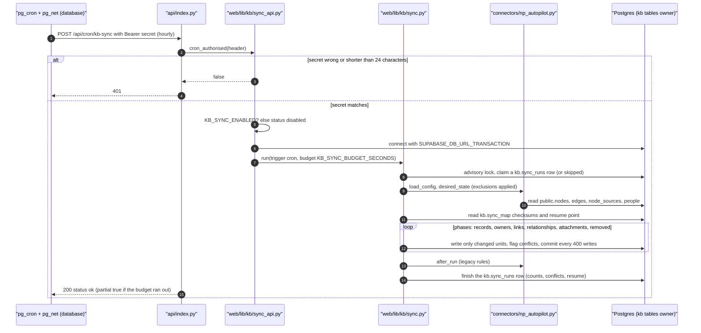

# The sync: the original site's tables into the knowledge base

Until the knowledge base (KB) is the only place to edit, the tables the
original NP Autopilot site reads (`public.nodes`, `edges`, `node_sources`,
`node_layout`, `people`, `people_aliases`, `domain_aliases`,
`workflow_owners`, ...) keep feeding it. One engine,
[`web/lib/kb/sync.py`](../../web/lib/kb/sync.py), does both the first import
(command line) and every scheduled run.

Related: [deployment.md, "Scheduled sync"](../operations/deployment.md#scheduled-sync-run-5)
(why the schedule lives in the database),
[dev-deploy.md step 6](../operations/dev-deploy.md#6-the-schedule-cron) (setting
it up), [connectors](../integrations/connectors.md) (the interface a new
source implements), [import mapping](../architecture/import-mapping.md).

## One run



### 1. The schedule and the triggers

A run starts in one of three ways (`kb.sync_runs.trigger`):

| Trigger | How | Shown in Settings → Sync as |
|---|---|---|
| `cron` | pg_cron fires in the database and pg_net POSTs to `/api/cron/kb-sync` with `Authorization: Bearer <secret>` | Schedule |
| `manual` | an admin presses **Sync now** (Settings → Sync), which calls `POST /api/kb/sync/run` | the admin's name |
| `cli` | `pipeline/kb_import_projection.py apply ...` from a laptop or CI | Command line |

The schedule is installed by migration
[`0031_kb_sync_schedule.up.sql`](../../db/migrations/0031_kb_sync_schedule.up.sql):
`kb.sync_schedule_install('<https://host>/api/cron/kb-sync', '0 * * * *')`
creates a pg_cron job named `kb-sync` (hourly by default; any cron
expression). The job reads the secret from Supabase Vault (`kb_sync_secret`)
**each time it fires**, so the secret never appears in the job text. For a
protected Vercel preview it also sends `x-vercel-protection-bypass` from the
Vault secret `kb_sync_vercel_bypass`, when one exists. Only the database owner
can install or remove the schedule. `kb.sync_schedule_remove()` unschedules it.

Why the database and not Vercel Cron: Vercel Cron fires on Production
deployments only (a preview would never sync), and the Hobby plan allows one
run a day.

The cron route (`api/index.py`, path `/api/cron/kb-sync`) accepts GET or POST
and is opened by nothing but the secret: `sync_api.cron_authorised()` compares
the whole header in constant time and refuses any secret shorter than 24
characters. **Sync now** goes through the normal KB route, requires the admin
role, and is refused for an AI token.

### 2. One run at a time

`sync.start_run()` takes a transaction-scoped advisory lock (key `7302026`),
looks for a `running` row younger than 20 minutes, and either:

- records a `skipped` run ("run N is still going") and returns, or
- marks any older `running` row as `error`, message `abandoned (stale)`, and
  inserts a new `running` row.

The lock is held only for that claim, in its own short transaction, so it
works through the transaction pooler.

### 3. Batches, the time budget and resume

`sync_api.run_now()` passes `budget_seconds = KB_SYNC_BUDGET_SECONDS` (default
10, minimum 3). The function's cap is `maxDuration: 60` in
[`vercel.json`](../../vercel.json). The engine:

- commits every 400 writes (`batch`);
- after each unit, checks the clock. Past the budget it flushes what is
  queued, commits, stores where it stopped (`{phase, after}`) in
  `kb.sync_runs.resume` (migration 0033) and ends with `status = ok`,
  `partial = true`;
- on the next run, `resume_point()` reads the last finished run's resume
  point and skips units already done. An error keeps the previous resume
  point, so a failed run is retried from the last good place; its committed
  batches stay.

The phases, in order: `records`, `owners`, `links`, `relationships`,
`attachments`, `removed`. The layout and the connector's finishing step run at
the end and are never cut off.

An unchanged run reads and compares only. Measured in run 6: about 1 s locally,
24 to 28 s from a laptop to the dev database over a ~175 ms link; in region it
should be a few seconds.

### 4. The desired state

The connector builds what the KB should hold. Today the only one is NP
Autopilot ([`connectors/np_autopilot.py`](../../web/lib/kb/connectors/np_autopilot.py),
interface in [`connectors/base.py`](../../web/lib/kb/connectors/base.py)). It
calls `sync.load_mapping()` (reads
[`config/kb-projection-mapping.yaml`](../../config/kb-projection-mapping.yaml)
and checks every type it names against `config/taxonomy.yaml`) and
`sync.desired_state()`, which:

- reads the old tables (sensitive nodes excluded);
- applies NP Autopilot's own rules for what is current and what is legacy,
  and the roles P, B1, B2, B3 from the current mastersheet only (see
  [owner-linking.md](owner-linking.md));
- rejects a name with the same rule the API uses (`validate.name_problem`);
- leaves out everything in `kb.sync_exclusions` (see below);
- returns records, links, relationships, attachments ("Source" links for
  every cited file) and layout positions.

### 5. The diff against kb.sync_map

`kb.sync_map` (migration 0030) has one row per unit (`record`, `link`,
`relationship`, `attachment`, plus `<id>#owners` for owners by role) with:

- `checksum`: a hash of the source content the sync last wrote;
- `kb_checksum`: a hash of the KB content right after the sync wrote it;
- `conflict_at`, `removed_at`.

For each unit in the desired state:

| Situation | What the sync does |
|---|---|
| no `sync_map` row, but a KB record with the same external id (written by the first import) | adopts it (`adopted`) |
| no `sync_map` row | creates it |
| source checksum unchanged | nothing (`unchanged`); if a conflict was open, it is cleared (`conflicts_cleared`) |
| source changed, KB copy unchanged since the sync wrote it | updates it (`updated`) |
| source changed, **KB copy edited in the app** (`kb_checksum` differs) | **does not write**; sets `conflict_at` (`conflicts`) |
| the KB record is archived | skips it (`skipped_archived`) |
| the unit is in `sync_map` but no longer in the source | `removed at source` (below) |

Records created in the KB have no `sync_map` row and are never touched.

### 6. Conflict rules

- **A KB edit is never overwritten.** The record keeps the app's value and is
  listed on **Data quality → Sync conflicts** ("edited here, changed at the
  source", "kept your edit"), from `GET /api/kb/quality/sync`
  (`workspace.sync_issues`). The same applies to owners by role: if someone
  changed a record's owner-by-role in the app, the sync leaves it.
- A conflict clears itself when the source goes back to what the sync last
  wrote. There is no "take the source" button.
- **Removed at the source.** A record is never deleted: it is marked
  `review_status = needs_review` and listed on **Data quality → Removed at
  the source (kept here)**. A relationship or a link on a record is archived
  (reversible). If the source row comes back, the next run restores it
  (`restored_at_source`).

### 7. The legacy exclusion and the legacy rules

- `kb.sync_exclusions` (migration
  [0037](../../db/migrations/0037_kb_sync_exclusions.up.sql)) holds the
  owner-approved permanent deletion: a `rule` row
  `np_legacy_domains_modules` (leave out every domain NP Autopilot does not
  count as current, and every legacy module) and one `record` row per deleted
  source id. The connector reads it (`legacy_delete.excluded`) and the
  desired state leaves those out, with their relationships and attachments.
  Admins can read it; only the owner (the command line) writes it. See
  [legacy-deletion-and-restore.md](legacy-deletion-and-restore.md).
- After the phases, `after_run()` re-applies the reversible legacy archive
  (`web/lib/kb/legacy.py`) on every run, once `kb.legacy_archive` has rows.

### 8. The run log and what admins see

`kb.sync_runs` holds one row per run: `trigger`, `actor_id`, `status`
(`running`, `ok`, `error`, `skipped`), `counts` (created, updated, conflicts,
removed at source, restored, adopted, conflicts cleared, `partial`),
`conflicts` (a total), `errors`, `message`, `resume`. A finished run also
emits a `sync.run` change event (0032), so open pages refetch.

- **Settings → Sync** (admins, `GET /api/kb/sync`): whether the sync is
  enabled, the budget, the last 20 runs, and **Sync now**.
- **A banner** for admins on every page while the last non-skipped run failed
  (`failing` in the same response).
- **Activity** shows every write as actor "Sync" (`actor_type = 'sync'`).

## The switches

| Switch | Effect | Where |
|---|---|---|
| `KB_SYNC_ENABLED=false` | every run (cron and Sync now) returns `disabled` at once; the cron route still answers 200 | Vercel environment; takes effect on the next deployment |
| `select kb.sync_schedule_remove();` | no more calls from the database | SQL editor, as the database owner |
| `KB_SYNC_BUDGET_SECONDS` | seconds per run before it stops and saves its place | Vercel environment |

## Files involved

`api/index.py` (the cron route), `api/kb_routes.py` (`/sync`, `/quality/sync`),
`web/lib/kb/sync_api.py`, `web/lib/kb/sync.py`, `web/lib/kb/connectors/`,
`web/lib/kb/legacy.py`, `web/lib/kb/legacy_delete.py` (`excluded`),
`web/lib/kb/workspace.py` (`sync_issues`), `pipeline/kb_import_projection.py`,
`config/kb-projection-mapping.yaml`, migrations 0030, 0031, 0033 and 0037,
`public/kb/js/views/settings.js` (Sync tab), `public/kb/js/views/quality.js`.

## Failure modes

| Symptom | Likely cause | Check |
|---|---|---|
| cron gets 401 | Vercel `KB_SYNC_SECRET` and the Vault `kb_sync_secret` differ, or the secret is under 24 characters | `select status_code, created from net._http_response order by created desc limit 5;` |
| runs say `skipped` | another run is `running` (normal if runs overlap) | the run log; a stuck one becomes `abandoned (stale)` after 20 minutes |
| a run stays `running` | the function hit `maxDuration` (60 s) before the budget stopped it | lower `KB_SYNC_BUDGET_SECONDS`; the row is cleared after 20 minutes |
| every run `partial` | the budget is too small for the work | raise the budget (under 60 s) or let it resume across runs |
| `error`, banner shown | a bad mapping, a database error | `errors` on the run row; the Vercel function log |
| `disabled` | `KB_SYNC_ENABLED=false` | the Vercel variable |
| no runs at all | no schedule installed, or pg_net calls fail | `select jobname, schedule, active from cron.job;` |

The [runbook](../operations/runbook.md) has the incident steps.

## How to test it

Needs the local stack. Every rule has a test in
[`tests/test_kb_sync.py`](../../tests/test_kb_sync.py), on a synthetic copy of
the old tables (`kbsync_src`): first run, re-run writes nothing, source change
applies, an app edit is never overwritten and becomes a conflict, a removed
source row is flagged and never deleted, KB-created records are untouched,
one run at a time, the kill switch, the cron secret, admin-only routes, the
time budget and resume, attribution to Sync, the run log and the admin banner.

```bash
.venv/Scripts/python -m pytest tests/test_kb_sync.py tests/test_kb_connectors.py tests/test_kb_legacy_delete.py -q
```

To time the batches on a local database (refuses anything not on 127.0.0.1):
`python scripts/kb_sync_timing.py <none|hundred|first> --db <name>_timing [--budget 10]`.
